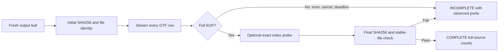

# HG002 reference annotation inventory

2026-10-11. Reference-only diagnostic code. This inventory can expose source-
annotation or endpoint-input feasibility issues before DNA calling and native
reconstruction. It does not change the frozen endpoint, select a gene subset,
or make a biological or publication claim.

## Pinned input and run boundary

The intended input is the complete matched GENCODE 50 primary-assembly GTF:

| Source | Expected bytes | Expected SHA256 |
|---|---:|---|
| `gencode.v50.primary_assembly.annotation.gtf` | 4,688,772,094 | `04af7379ad6c214f49758db270938a38c41bebbf7b9dc8e24065d8f3a9f08d0d` |

These are the retained source-manifest values in the HG002 caller preflight.
This code has not read that reference file and does not attest those bytes on a
cluster. The CLI uses these size and SHA256 values by default. It hashes the
raw source before and after the scan, checks the expected digest, and compares
device, inode, size, modification time and change time across the run.

Use one CPU, at most 16 GiB RAM and a 15-minute wall limit for S0. The script
uses a 900-second deadline by default. For the 15-minute Slurm limit, pass an
840-second deadline. This leaves 60 seconds for final output and scheduler
overhead; do not widen the run budget. The script checks the deadline during
hashing, streaming and optional index measurement. Two full source hashes and
one full parse are required for the final source check. A deadline can
therefore leave an incomplete result. Preserve that leaf and report its
observed prefix; do not present it as a full-source count.

Example:

```sh
python analysis/hg002_reference_inventory.py \
  --source /path/to/gencode.v50.primary_assembly.annotation.gtf \
  --output-dir /path/to/new/hg002_reference_inventory_01 \
  --deadline-seconds 840
```

The output directory must be a new leaf under an existing parent. Creation is
exclusive. An existing file or directory causes an error and is left intact.
The leaf contains `manifest.json` and `inventory.json`. The manifest records
the initial and final source SHA256, source stat checks, elapsed scan time,
deadline, outcome and optional index measurement. The inventory has aggregate
counts and bounded examples; it does not copy source annotation lines.



`COMPLETE` means the parser reached full EOF, the initial and final source
checks passed, and the summary was written. Malformed records remain counted
and listed as issues; they do not silently become valid features. The inventory
stores aggregate issue counts and the first 100 examples. `INCOMPLETE` means a
read/parse error, source check failure, cancellation, deadline or summary
failure stopped the run. Its inventory keeps the observed-prefix counters and
sets `counts_complete` only when the source parser reached EOF. EOF does not
override a failed source hash or stable-file check; inspect both files.

## Reported annotation facts

The streaming pass reports:

- Every observed feature-type value, including a visible type column on a
  malformed-width row. It also reports rows with missing type columns,
  malformed column counts, invalid coordinates, malformed attributes and
  bounded examples.
- Raw `gene_type`, `gene_biotype`, `transcript_type` and
  `transcript_biotype` value counts, plus unique gene/transcript ID counts by
  one consistent declared type, missing type or conflicting declarations.
- Protein-coding gene and transcript IDs with observed CDS rows and, only
  after full EOF, IDs without an observed CDS row. CDS membership follows
  source IDs; malformed IDs or attributes are exposed in issue counts and can
  limit interpretation.
- Transcript ID counts for `cds_start_NF` and `cds_end_NF`, plus source tag
  occurrences by value and feature type.
- Declared `start_codon` and `stop_codon` feature rows, coordinate-block
  lengths summed across each transcript, and strand totals. Split coordinate
  blocks are added as separate blocks, including blocks that span an intron.
  A three-base annotation sum is not a sequence-confirmed or complete codon.
- CDS feature rows, inclusive coordinate-block base sums, phase counts for
  `0`, `1`, `2` and malformed values, bases by phase, transcript CDS-length
  modulo-three counts, and whether transcript phase annotations are all valid,
  mixed or malformed. These are source metadata. The script does not propagate
  phase across blocks, translate DNA, or label a functional CDS complete.
- `transl_except` attribute and feature counts, parsed amino-acid labels,
  Sec/U labels, selenocysteine-named feature rows/bases and related tag values.
  No genomic sequence is read to validate a codon or translation exception.
- Reused gene IDs across contigs, strands, declared types or names; reused
  transcript IDs across contigs, strands, gene IDs, types or names; conflicts
  in GTF `ID`/`Parent` attributes; and duplicate or conflicting identity
  attributes. It also reports identifier presence by feature type, rows with
  missing identifiers, and IDs without a gene/transcript feature row or a
  gene link. The report counts conflicts and keeps up to 100 ID examples per
  conflict group.

The source is comprehensive. The scan does not choose canonical transcripts,
crop loci, filter feature types from the inventory, or use candidate, RNA or
donor-genome inputs.

## Optional existing-index measurement

Add `--measure-existing-index` to run the unchanged
`analysis/hg002_cds_overlap_cohort.py::_read_gtf` in an isolated child process.
It reports that function's wall time, CPU time and process peak RSS. The child
does not write or replace an index. It fingerprints the selected in-memory
rows, then the parent compares those rows with a separate streaming prediction
of the current parser/filter. The report includes row count plus XOR and
modular-sum digests of per-row SHA256 values. A matching fingerprint is strong
concordance evidence, with the usual theoretical hash-collision limit; it is
not a record-by-record export.

The existing index retains CDS rows with valid coordinates unless a truthy
`gene_type` (or fallback `gene_biotype`) is not `protein_coding`. Its separate
`known` flag also uses the current gene/transcript type and ID expression. The
diagnostic measures this exact current selection. It does not change its
selection, rewrite its index, or claim its metadata is a complete functional
CDS set. The option adds another full GTF parse and can use substantial RAM;
the parent releases per-ID inventory state before the child loads the index.
The same passed run deadline applies. For the 15-minute Slurm limit, use
`--deadline-seconds 840`.

## Verification and limits

`tests/test_hg002_reference_inventory.py` uses synthetic GTF only and Python's
standard-library `unittest`; no pytest install is needed. Run it with:

```sh
python3 -m unittest discover -s tests -p 'test_hg002_reference_inventory.py' -v
```

Its fixtures check plus- and minus-strand start/stop codons split across
coordinate blocks, phase 1/2/malformed values, partial tags, protein-coding
CDS/no-CDS counts, source type and ID conflicts, Sec/transl_except,
current-index concordance, exclusive output, truncated gzip and a deterministic
mid-scan deadline and cancellation.

No full GENCODE inventory, real annotation count, cluster job, DNA/RNA access,
LiftOn execution or endpoint classification is reported here. Main owns review,
freeze, cluster execution, actual-reference counts, tracking and Git. An
inventory result can inform feasibility; it cannot decide whether a reference
terminus is biologically present or redefine the fixed P1 same-termini rule.

## Main's finite review and execution preparation

Main FULL-read the implementation and synthetic tests. Eight worker controls
pass again locally0.128s; three additional source-size/digest, post-EOF drift
and failed-index-probe controls give11tests+four subtests passing0.167s,
zero skips. Source SHA55babef7ad53e0908162b7d4f1dfd668450cc86b0ba254ffa05b152d0cb03f0e;
test SHA7ee2c052e9b0c112bf75e6a2fdddbfd63ca49d3665ca5725ed4befed30001b30.
The unchanged current index source is197a54c9dbf6dd3f7f9264a3eb090d0646f08d05fdb7dfe99ae2c337f0064f4e.

Important distinction: a complete, source-verified inventory can have a FAILED
optional index probe. Accept source declarations only within their scope;
require MEASURED and concordant selection separately before using its index
cost or concordance. No endpoint/classifier eligibility follows from either.

[Main's wrapper](../../scripts/run_hg002_reference_inventory_s0.sh) runs11
frozen Linux controls before the actual whole GTF scan and unchanged-index
measurement. Book1CPU/16GiB/15min, no GPU,840s process deadline. Outer logs
stay under an existing scratch logs parent. Complete results and partials
are retained, never cropped/replayed automatically. The per-file Linux
write guard is2MiB; JSON overflow fails and keeps available evidence.

Reserve32MiB total for this small leaf, temporaries and its future HOME copy
inside the existing8GiB other-S0-material reserve, not an extra allowance.
The named prior inventory3.603GB plus newer cache/caller artifacts remains
well below8GiB; it is not an exhaustive project/cache census. Both expanded
reference copies and the separate caller128MiB reserve remain counted, for
total34,338,715,578B below32GiB. No third reference copy or body download.
With running S1 QA, this job's summed allocation is20GiB RAM, no GPU.
Conservative10,000s pre-caller S0 CPU remainder minus1s caller and900s maximum
new diagnostic leaves9099s; charge actual scheduler cost after completion.
S2–S4/RNA remain unreleased; no biological or publication result is claimed.

Actual diagnostic1604302 is RUNNING on hydra-n1/amd_256M. All11 frozen Linux
controls pass0.497s with zero skips; all three source/test/current-index
SHA checks match. Wrapper SHA6d6e802f54d470df4df2204786f22d6598c4a0786b0274ac89fefaa292ae771f.
At223elapsed seconds only a partial inventory checkpoint exists; no full
counts, source-final hash, index cost or concordance result is reported yet.

## Actual01 deadline failure and format defect

1604302 FAILED2:0 after its840s process deadline,842allocatedCPU seconds,
835.112measuredCPU seconds,1346936K MaxRSS. Initial exact GTF SHA passes;
observed8,185,985physical lines do not reach EOF. No final source hash/stable
certification or optional existing-index measurement completes. The unchanged
[native failure manifest and prefix](../../results/hg002_reference_inventory_20261011/README.md)
are retained in Git; whole small packets also stay on scratch and HOME.
HOME/scratch hashes match: manifest93e86efdfc65648e88e80b0bc6e655b6aa67a8688cf11a6e56a490ccf20acfcb,
inventory906b9171f26b9731a0da76460006a32259e42cd508dff82e7db49d0c9fc4d3ee.
No global count, P1 state, unknown-gene exclusion or biological negative follows.

The prefix also exposes a parser defect: it flags8,185,980valid-width rows
for unquoted numeric `level`/`exon_number`. Fresh official
[GENCODE format documentation](https://www.gencodegenes.org/pages/data_format.html)
explicitly permits those numeric fields in its examples. It also lists dot
as a legal CDS-phase value; dot is unknown/unusable for frame propagation,
not evidence of malformed source syntax. These are annotation-declaration
parsing corrections, not a changed endpoint or permission to infer function.
Do not call this reference corruption. The failed01 code/bundle/results are
unchanged; a Luna worker prepares explicit typed numeric/dot-UNKNOWN controls
before any new code freeze. No automatic rebooking or record/isoform crop.

Main considers one explicit corrected02 full-source completion attempt,
1CPU/16GiB/1h and3540s process deadline, inside the original4allocatedCPUh
S0 cap. Prior842s stays charged. Conservative pre-caller10,000s minus caller1s
and01's842s leaves9157s; future toy-interface900s plus02maximum3600s would
leave4657s. That is an upper-cost guard, not measured02 runtime or a release.
Scientific max-effort investment review is underway;02 remains unbooked.

## Finite format correction and schema 2 controls

2026-10-11. This section describes the corrected local software. All preceding
sections remain as the historical01 record. The01 raw JSON, source/runtime
bundle and custody hashes are unchanged. In particular, the old phase labels
and malformed-attribute counts retain their original values and schema1.

The official [GENCODE format page](https://www.gencodegenes.org/pages/data_format.html)
defines `level` as 1, 2 or 3, defines `exon_number` as an integer position from
the transcript's 5' end, and shows both fields without quotes. The corrected
parser permits unquoted integers only for these two explicit keys. It also
accepts their quoted integer forms. `level` must be 1/2/3 and `exon_number`
must be a positive decimal integer. Invalid typed values remain visible as
`invalid_numeric_attribute_value` issues. Other string and ID values still
require quotes. Quote errors, trailing text, missing keys/values, missing
IDs, repeated keys and conflicting values retain their existing checks and
counts. Parsing retains the observed values; it does not silently discard
malformed annotations or resolve conflicting IDs.

New initial/final manifests, full inventories and prefix checkpoints use
`schema_version: 2`. Consumers must inspect that field before combining
reports. Schema2 changes these CDS-phase meanings:

| Declared phase | Row/base counter label | Meaning |
|---|---|---|
| `0`, `1`, `2` | The same numeric value | Numeric phase declaration |
| `.` | `unknown` | Legal UNKNOWN; no usable frame declaration |
| Other or missing value | `malformed` | Invalid phase; raw values remain counted, with `missing` for an empty/unavailable field |

Dot is excluded from `malformed_phase_value_counts` and does not produce a
malformed-phase issue. The full `CDS` report and prefix report include an
explicit phase-interpretation note. Numeric phase declarations still do not
establish a propagated reading frame, functional CDS, biological codon
retention, complete termini or a P1 state.

Transcript statuses now use `NUMERIC`, `UNKNOWN` and `MALFORMED`. A single
observed category gives `ALL_NUMERIC`, `ALL_UNKNOWN` or `ALL_MALFORMED`.
Multiple categories give `MIXED_NUMERIC_AND_UNKNOWN`,
`MIXED_NUMERIC_AND_MALFORMED`, `MIXED_UNKNOWN_AND_MALFORMED`, or
`MIXED_NUMERIC_AND_UNKNOWN_AND_MALFORMED`. These summarize only CDS rows with
valid coordinates and an observed transcript ID, as with the existing
transcript length summaries. All visible CDS rows still contribute their
phase counts; invalid coordinates/identifiers remain reported separately.
The prefix field `observed_CDS_transcript_phase_annotation_status_counts`
retains the status aggregate as rows arrive. It requires no per-ID scan after
a deadline. Prefix statuses and phase totals are scoped to the observed rows;
they are not global transcript classifications without full EOF.

All18 standard-library `unittest` cases pass locally in0.292s with zero skips.
The original11 cases remain, including main's three added source-size/digest,
post-EOF drift and failed-index-probe methods, which are byte-for-byte
unchanged. Seven added cases check a fixed projection of the authoritative
format examples, quoted numeric forms, rejected string/ID and invalid numeric
forms, conflicting keys and missing IDs, all seven transcript phase-category
combinations, a non-EOF gzip prefix, and a deadline prefix with UNKNOWN phase.
The example fixture also checks the existing index's actual selected tuple
and `known=True` against a fixed expected value. The phase fixture confirms
that numeric, UNKNOWN and malformed phases keep the existing index selection.

Run from the repository root, with no test dependency install:

```sh
python3 -m unittest discover -s tests -p 'test_hg002_reference_inventory.py' -v
```

Corrected local hashes, ready for main's review:

- Source: `d9c4ea440513f4a911fea1dee85a872020fb1a1e2e0f9a4d7abe1aca90fdc0d1`.
- Tests: `2acc51a135d7789dc4f07e7bcae1aea5f7a9b5cbde14d088c28bd42d94a7bf3d`.
- Unchanged caller CDS-index source:
  `197a54c9dbf6dd3f7f9264a3eb090d0646f08d05fdb7dfe99ae2c337f0064f4e`.

The inventory's legacy attribute/filter prediction and exact index-probe code
also compare byte-for-byte with their pre-correction versions. Source SHA
checks, exclusive leaves, checkpoint/deadline controls, source coverage,
selection and the `known` expression keep their previous behavior. The code's
default deadline remains900s; any later run needs main's explicit deadline
and a fresh leaf. This correction does not book02, change the wrapper or
alter the historical budget record. Whole-source runtime and memory under the
corrected parser remain unmeasured. No annotation body was fetched locally.
