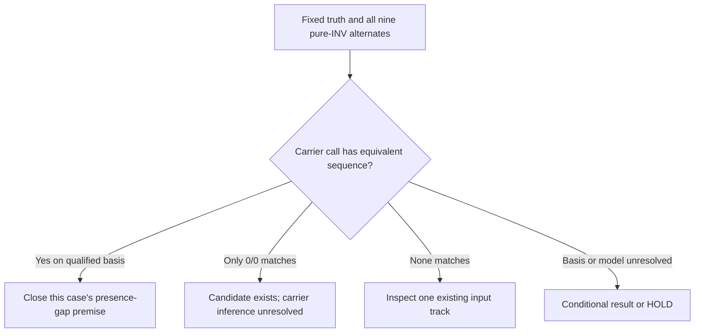

# Fixed inversion residual: next-step investment decision

2026-10-13, Asia/Tomsk. Requested GPT-6.1 Sol/max; backend model and effort are not attested.
Scope: this decision only. Main owns execution/integration; the maintained reviewer owns actual-packet assessment.

## Decision

Recommend one capped, existing-reference alternate-string check across all nine selected INV records.
It can cheaply reject a geometric-miss premise in repeat context. Do not select a new study or caller campaign.
If no carrier call is sequence-equivalent, retain one small input trace below, subject to existing-input availability.
The fixed case is a Tier 1 simple INV, not the original complex-INV mechanism test. No case substitution follows a closure.
HG008 generic calling and HG002 annotation remain stopped. DeepSV supplies no foundation; the publication goal is unmet.

I fully read the attached goal and the [frozen protocol](2026-10-13-inversion-fixed-case-protocol.md),
[scout](2026-10-13-inversion-case-feasibility.md), [source contracts](2026-10-13-inversion-source-contracts.md),
and [initial maintained review](2026-10-13-inversion-fixed-case-review.md).
Main reports freeze commit 8e8c76e before caller-body inspection; I did not check Git.
The saved sources.json exists. The 25-member/6.088-MB packet and records below are main-supplied findings,
not an independent full-packet audit or an inference that the acquisition worker completed. No duplicate hash review ran.
This author-selected miss is development evidence, not an unbiased recall estimate or an untouched final test.

## Fixed evidence and why this check is worth doing

| Record scope | Main's reported declaration |
|---|---|
| First Table S10 HG002 case | chr2:240685775–240688980; INV 3,205 bp; Tier 1 simple; truth GT 0/1, symbolic INV, SRC maternal. Repeat_ge5Kb and Repeat_ge10Kb report rp2sides. |
| Severus ONT/Minimap2 | POS 240685789, END 240702018, length 16,229; GT 0/0, DR 22, DV 3. An INV candidate declaration, never carrier detection. |
| Eight spanning declarations | Severus ONT/VACmap 3 and PacBio/VACmap 2; Sniffles ONT/VACmap 2 and PacBio/VACmap 1. Lengths 12,863–22,369; some GT 0/1. |
| Other frozen endpoint selections | No selected records; this does not mean zero inversions or absence from original all-types outputs. |

All 25 sources report chr2 length 242,193,529, consistent with hg38; this does not certify reference bases.
The release is INV-only. Its Severus v1.1, Sniffles2.7 and generic SVision v1.9 labels do not qualify current executions.
Common sample names do not establish the same read batch, depth, alignment parameters, or evidence budget.
Keep the December 2025 seven-caller release separate from the August 2026 nine-caller publication.

The largest truth/call size ratio here is 3205/12863 ≈ 0.249, below the inspected source script's pctsize=0.3.
Thus different declared spans could fail that rule even if they describe the same alternate sequence.
This is a reason for diagnosis, not proof of the publication's executed matching rule or an erroneous result.
Repeat flags alone do not prove inverted-repeat symmetry; the reference-string check tests that possibility.
A positive result would be a useful closure of this candidate, not a normalization paper or biological discovery.

## One cheap falsifier: pure-INV sequence equivalence

1. Inventory the durable cluster S0 GRCh38 reference, its recorded identity and existing indexes first.
   Reuse it in place. No new genome, whole-reference scan, index rebuild, transfer, or caller setup is proposed.
   Historical source/base identity can remain unresolved while testing equivalence conditional on this declared reference.
2. Qualify truth and caller coordinates from the actual author writer/converter and VCF conventions.
   Freeze the conversion to zero-based half-open intervals before sequence comparison.
   Do not choose a one-base shift because it creates a match; unresolved conventions yield conditional results or HOLD.
3. Freeze one common window enclosing the truth and all nine intervals, plus 1,000 reference bases on each side.
   For each declared pure INV, construct the alternate by reversing and complementing only its qualified interval.
   Use the same unchanged outer sequence for every allele:
   `A_i = R[a:s_i] + reverse_complement(R[s_i:e_i]) + R[e_i:b]`.
   Compare each full string exactly with the fixed truth alternate; no distance threshold or post-result boundary search.
4. Preserve all nine records, IDs, FILTER and GT, including the 0/0 record. Report structural equivalence and carrier status separately.
   A 0/0 equivalence establishes a represented candidate only. Missing GT is unknown; retain FILTER when judging a nonreference GT.
   A 1/1 equivalent call may detect the alternate while disagreeing with truth's 0/1 declaration.
5. Report this as a pure-inversion model on the chosen reference, not observed allele sequence, phase, CN or biological truth.
   If annotations indicate extra changes, do not force a compound allele into a pure flip. That record remains outside this model.

Proposed cap: one case, all nine records, ≤100 kb reference bases, one core, ≤1 CPU-hour total and ≤1 GiB RAM.
Use existing indexed access. If inventory, conventions or the complete window exceed that cap, HOLD; do not enlarge setup.
This note recommends the diagnostic; it performs no sequence check and releases no job or native caller.

Even a carrier match remains conditional if historical reference bases are unqualified; do not claim exact native rescue.
No match rejects equivalence of these pure flips only. It does not prove the truth, an original caller miss, or its cause.
Check an existing all-types output/export record where available during the next trace; do not acquire a new full panel.

## If none is equivalent: one useful small input trace

Freeze one compatible available track before inspecting molecules; prefer a documented strong Severus/VACmap track.
Use existing local alignments, original all-types outputs and candidate/filter records where available.
A different durable HG002 read set is a separately declared input track, not reproduction of the released 20 results.
Within the same fixed locus/window, inspect complete query-ordered alignment segments and molecule identities.
Ask whether observed molecules distinguish the 3,205-bp path from reference/repeat mappings and the larger declared inversions.
Record two-junction linkage, alternative placements and independent molecule support; screenshot density is insufficient.
Trace supported evidence into a candidate, then filtering/genotyping and export. Mark every unavailable stage unknown.
No candidate log means the VCF alone cannot locate candidate or filter loss. DR/DV and GT alone do not prove genotype error.
If only one stage is inspectable, report that bounded finding; all future comparators are not prerequisites for this diagnosis.
If only a 0/0 candidate was equivalent, narrow this trace to actual molecule support and genotype/filter evidence.
Cap this separate proposal at one track, ≤1 CPU-hour, ≤1 GiB RAM, ≤1,000 alignment records and ≤10 MiB of case evidence.
Keep the local census complete within the cap; truncation cannot support an absence claim. Missing inputs mean HOLD.

Retain a mechanism only if permitted evidence distinguishes the allele and identifies a specific recoverable loss.
Ambiguous repeat placements or uncertain truth scope support an information limit, not a rescue claim.
Author-asserted Strand-seq orientation and assembly-derived breakpoints/maternal labels have different truth scopes.
A simple INV trace cannot establish loss of complex component linkage; SVision-pro already orders and joins components,
compares allele fractions, and pantree already treats inversion edges separately when pairing is unresolved.

A possible science path is to correct a demonstrated repeat-conditioned alignment or allele-inference loss at controlled error,
then test that frozen cause on independent loci/samples and hard negative/alternate structures with strong compatible methods.
The endpoint must improve recovered haplotype/allele decisions or genotype accuracy, not merely benchmark matching or call count.
Basic linkage, a threshold change, or one equivalent representation is insufficient. No new useful contribution is selected yet.
No clinical outcome or new architecture is required. Main costs any later step; maintained review precedes costly work or major positives.
Only this file was created. No Git, jobs, downloads, native runs, analysis-code execution, or other edits occurred.
