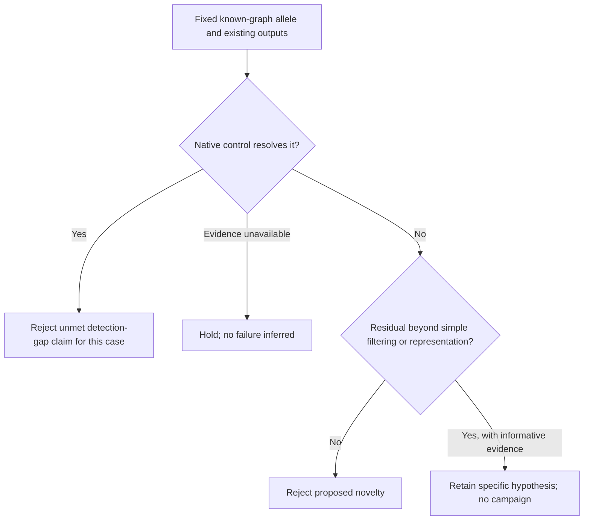

# SVPG modes versus complex inversions: investment decision

Date: 2026-10-13, Asia/Tomsk. Requested GPT-6.1 Sol/max; backend model and effort are not attested.
Scope: replacement for the interrupted comparison only. OldKant's authoritative `not_found` is accepted.
The completed [October 12 decision](2026-10-12-functional-deletion-investment-decision.md) remains intact.
Main owns integration, the Zenodo callset check, and Luna's separate coded-mode/interface check.

## Decision

Prioritize one comparison of existing HG008 outputs that can reject the known-graph somatic detection premise.
Rank it above the earlier conditional complex-INV test; select neither as a new caller programme.
The somatic case has a named allele and a specific mode distinction. The INV case has no clean missed-presence exemplar.
Reject publication investment in repeating SVPG's documented miss, combining callsets, or using an existing native rescue.
Do not release jobs, raw-read work, new graph construction, models, installs, or Git actions from this note.
The HG002 annotation-exclusion STOP remains in force. The publication goal remains unmet.
A useful molecular or calling result can qualify without clinical outcomes, a new architecture, sham edits, or a pre-proved failure.

## Evidence and scientific value

I read the complete attached objective, the complete prior decision, the October 7 inversion decision,
the maintained October 12 opportunity review, and the current PROGRESS restart/STOP record.
I independently read all text in SVPG's mode overview, somatic results/Fig. 4 caption, Discussion,
calling/genotyping methods, somatic benchmarking methods, and data/code availability.
Firecrawl returned the publisher HTML, cached October 12. No supplement, VCF, raw read, or caller code was inspected here.
INV details below use main/user's supplied source record; the August publication body was unavailable to main.
Luna's coded-mode result and main's archive result are pending evidence, not assumed successes.

| Direction | Important result if it works | Present evidence and investment rank |
|---|---|---|
| Known-graph somatic alleles | Keep true tumor-specific changes detectable as population graphs contain more alleles, while controlling germline false positives. A later joint path-dosage result must improve a defined tumor–normal inference task. | First for one cheap diagnostic. SVPG documents graph-encoded misses, but guided-mode and paired-caller rescues remain unresolved for the named case. |
| Complex INV recovery | Recover the correct orientation and linked structure when alignment or decomposition loses informative evidence. | Second, conditional. Low recall does not identify that mechanism; the displayed chr1/18 components are already detected by Severus/Sniffles. |

### What SVPG actually establishes

[SVPG, published September 21, 2026](https://www.nature.com/articles/s41592-026-03219-2#Fig4)
uses HG008 HiFi tumor and matched normal. Its based mode takes minigraph GAF alignments.
Tumor and normal are called independently; a custom script then subtracts tumor calls
when a normal breakpoint lies within 1,000 bp. That rule uses position, not joint allele identity or dosage.
Four of five missed benchmark INDELs were already encoded in the graph.
Fig. 4d names a 419-bp deletion at chr7:19196736, reported by GIAB as cancer-specific.
This establishes the published based-mode limit. It does not establish failure of all SVPG modes.

[Guided-mode methods](https://www.nature.com/articles/s41592-026-03219-2#Sec10)
start with linear BAM CIGAR/split-alignment signatures, then refine graph path signals and call SVs.
Known path transitions can supply SV signals. Native maximum-likelihood genotypes are diploid 0/0, 0/1, or 1/1.
Guided mode may therefore retain this allele. That rescue has not been tested in the supplied record.
Diploid genotyping alone neither implements nor disproves useful joint somatic path-dosage inference.
The same paper already compares paired Severus/nanomonsv and miniSV's tumor–normal-pairs mode.
A stronger linear paired workflow is an essential control; graph use alone does not establish novelty.

Graph membership describes variation in other genomes. It does not prove that the matched normal carries an allele.
Conversely, a normal VCF no-call does not prove absence without adequate local evidence.
Neither population frequency nor graph membership establishes somatic status, causality, or cancer-driver status.
The paper already discusses overlap between somatic and common germline variation; repeating that observation is occupied ground.

### What the inversion record permits

Keep [preprint 2025.11.28.691176](https://doi.org/10.1101/2025.11.28.691176)
separate from [August 2026 publication](https://doi.org/10.1186/s13059-026-04223-7).
The preprint evaluates seven callers. Luna reports nine, including PAV, in the publication.
Do not present seven-caller results or percentages as verified results of the current nine-caller panel.
Main reports preprint Fig. 5 chr1/18 components already detected by Severus/Sniffles.
Those examples can test complete representation/linkage, but are not clean absent-allele demonstrations.
Evaluation uses `pctseq=0`, `pctsize=0.3`, and reference-distance allowances up to 100 kb.
Such matches do not verify exact compound architecture or explain which stage lost evidence.
Strand-seq supports orientation; the same phased assemblies supply structural detail and assembly-caller inputs.
That dependence permits an assembly-conditioned recovery test, not independent truth for all genotypes, copy states, or junctions.
The [October 7 STOP](2026-10-07-inversion-centromere-decision.md) concerns recurrence against ferromic, not inversion calling.
Do not launch this second diagnostic automatically if the somatic premise closes.

## Single priority falsifier: does a current native control already resolve the named allele?

Use main's existing [Zenodo 18456502](https://zenodo.org/records/18456502) check and Luna's interface result once.
This note does not repeat either audit or start a native run.
Freeze the Fig. 4d deletion before examining outputs. Include the other three reported graph-encoded misses
only if main supplies their exact IDs from the current audit; retain every supplied member, with missing entries visible.
This is one selected diagnostic panel, not an unbiased recall or prevalence estimate.

Make one allele-level table from already available outputs: based-mode tumor/normal calls and final subtraction,
guided-mode tumor/normal calls with the paper's separately scripted subtraction as a simple comparator,
and paired Severus, nanomonsv, and miniSV calls. Do not assert a built-in guided tumor–normal interface.
Record mode/version, build, filters, and provenance; unknown fields remain unknown.
Accept equivalent deletion representations; compare allele sequence/path or structure when available.
Inspect all existing calls in each fixed 1,000-bp subtraction neighborhood, including different nearby normal alleles.
Keep allele absent from candidates, filtered, proximity-subtracted, representation mismatch, and unavailable output distinct.
Report raw versus final calls where both exist. A final VCF alone cannot identify the missing stage.
A tumor no-call records non-recovery, but a final VCF alone cannot explain its cause.
A normal no-call alone is not a qualified negative. Absent guided output or unsupported input leaves that control untested.
Missing path counts leave dosage inference untested; do not convert an interface or access limit into native failure.
Truth stays evaluation-only. Do not construct graph paths from the evaluated allele or invent normal path coverage.
Published GIAB membership scopes this test; it does not independently validate dosage or every neighboring negative.

| Result of this one comparison | Decision |
|---|---|
| A guided-mode paired workflow or strong paired caller reports the correct somatic allele | Close the new known-graph presence-recovery claim for this case. Raw tumor detection alone does not establish correct somatic classification. Native rescue is not our method contribution. |
| A union, equivalent representation, or simple allele-aware subtraction resolves it | Reject the proposed novelty. Removing the filter alone gives no precision guarantee. |
| Informative permitted evidence remains unresolved by the applicable controls | Retain a specific inference hypothesis; neither prevalence nor publication value is established by four selected misses. |
| Required outputs or evidence are missing | HOLD this test. Main can report the limitation; no raw-read acquisition, genome-scale setup, or caller failure follows here. |

## Contribution worth considering after the diagnostic

A possible contribution is calibrated joint tumor–normal inference of known graph-path abundance and identity,
with a measured benefit beyond guided-mode calls, simple allele-aware subtraction, and strong paired callers.
Graph genotyping already exists; a path counter or likelihood module alone is not the contribution.
Separate tumor-only allele acquisition from a change in dosage of an allele already present in normal.
Purity, copy number, loss of heterozygosity, and mapping ambiguity can change path fractions;
a fraction difference alone cannot identify a new structural event or its evolutionary origin.
A benchmark contribution could quantify how graph membership changes a consequential accuracy conclusion
while sample evidence stays fixed, and establish the conditions under which a task-appropriate remedy works.
It needs a new conclusion across independent loci/samples beyond the documented four misses and native-mode choice.
If every relevant decision is already correct under the existing controls, this new calling premise closes.

A later pilot needs frozen eligible loci, matched inputs/graph information, scoped truth, callable negatives,
and a precision–recall or calibrated dosage endpoint relevant to the stated claim.
Judge significance by the decisions or structures corrected at controlled error, not by emitting more calls.
Clinical outcomes are needed only for a clinical claim. A residual current-method failure need not be proved before any useful pilot.
This recommendation authorizes only the decision note; main must cost any separate execution.
Maintained independent review precedes a costly campaign and acceptance of a major positive result.
No independent approval of this note is claimed. Only this file was created; the earlier 150-line decision was preserved.

## Addendum — 2026-10-13: accept STOP for the named presence-calling candidate

Accept main's STOP for a generic unmet presence-caller programme based on this named benchmark candidate.
Stop further cost for its mode-control check. Severus already reports the declared deletion geometry and genotype.
This refines the earlier priority: no guided-mode run is needed to justify this narrow investment stop.

I fully read the [11-member saved report](../../results/svpg_named_case_20261013/sources.json),
the completed [64-line native-mode note](2026-10-13-svpg-native-mode-check.md), and the 117-line maintained review.
I did not reread source VCFs or caller code. Actual-panel reviewer acceptance is not inferred.
The report records 236,857 fresh range bytes and member CRC checks; whole-archive verification is still false there.
Main reports an October 4 cached archive and is rechecking both sources without a new download.
The report leaves `comparative_allele_recovery_claim=NOT_ASSESSED`; this decision uses its listed fields, not a new accuracy score.

| Saved record | Declared result for the fixed case |
|---|---|
| Truth `SV_62` | PASS; chr7 POS 19196736, END 19197155; DEL length 419; GT 0/1; explicit REF length 420, ALT A. |
| Severus header `Severus_v1.5` | Same POS, END and DEL length; GT 0/1, PASS in both archived VCFs; HP 1, VAF 0.44, DR 27, DV 21. REF N / ALT <DEL> supplies no allele sequence. |
| SVPG | Nearby INS 130 and DEL 191, both GT 1/1; these declarations do not reconstruct the full truth deletion. |
| miniSV / nanomonsv | miniSV reports a partial DEL 195, GT 1/1; nanomonsv has no record in the fixed neighborhood. |

The Severus match rejects the generic missing-presence premise at the declared geometry/genotype scope.
It does not prove sequence-equivalent alleles, matching reference bases, correct phase, normal absence, somatic origin, or purity/CN.
Partial calls and differing GT fields do not by themselves establish validated genotype errors.
The biological filtering stage is UNKNOWN: filenames alone do not identify raw calls or tumor–normal subtraction.

No native guided output or matching BAM/GFA is available in the archive. Luna's original-CIGAR DEL fallback is source evidence,
not observed rescue. The subtraction-script filename typo and paper v1.4.1 / supplement v1.3 conflict remain provenance limits.
Native INV output remains unresolved; it does not alter this deletion decision or release the alternative INV test.
No joint path-dosage study, new publication claim, or further source acquisition follows from these selected records.
Main retains provenance closeout and maintained review. HG002 annotation STOP and the unmet publication goal remain in force.
Only this addendum was written; the original 129 lines remain intact. No code, native run, job, or data acquisition occurred.
