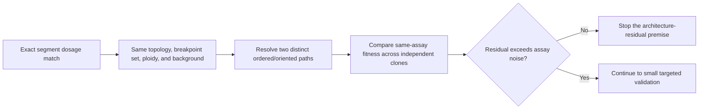

# Matched-dosage synVII architecture: scoped triage — 2026-10-16

**3 November qualification:** this scout is preserved as written. The
[independent review](2026-11-03-synvii-investment-review.md) corrects its
ambiguous “same breakpoint set,” overly strict structural conditioning and
noise-only meaningful-effect rule. The
[actual archive crosswalk](2026-11-03-synvii-archive-crosswalk.md) establishes
metadata membership, not an eligible contrast. Use those later qualifications
for investment decisions.

## Decision

**CONTINUE one cheap, conditional contrast audit. Do not promote this to a publication claim yet.** A dosage-matched comparison could answer a real, narrow question: does the resolved order/orientation of synVII segments explain fitness variation after exact segment dosage and the known topology, breakpoint, ploidy, and background effects are held fixed?

The broad claim that chromosome architecture can affect yeast fitness at unchanged gene content is already established. The remaining value is specific to the aneuploid synVII background and to an architecture residual not explained by dosage or the obvious structural features. No prior result of a failed contrast is needed before this low-cost check.



## Closest prior work

| Primary study | What it already establishes | Remaining gap for this question |
|---|---|---|
| **Exact system: 2023 synVII SCRaMbLE study** ([Cell Genomics](https://doi.org/10.1016/j.xgen.2023.100364)) | It screened 219 fitness-selected synVII derivatives, separated circular and linear forms, related chromosome retention and a specific del20K region to growth recovery, and reconstructed the del20K deletion. The local source census found the published Table S3 is an inventory, not a full 219-row replicate phenotype and path matrix. | It does not report a test between different ordered/oriented paths with the same copy number at every segment. The paper is the nearest source that could still enable that exact contrast after the CNP0002230 crosswalk. Its selection scheme limits inference to recovered derivatives unless the full screened denominator is available. |
| **Different chromosome orders in budding yeast, 2025** ([Genome Biology](https://doi.org/10.1186/s13059-025-03689-1)) | Three *S. cerevisiae* strains, derived from the same two-chromosome parent, fuse the original chromosomes into one chromosome in different orders and retain CEN15. The study measured growth and stress phenotypes; some strains differed. This is the closest precedent for changing order with largely unchanged genome content. | The order variants also differ in fusion points and chromosome-arm geometry. The study does not isolate order/orientation from those positional effects, does not use a synVII disome, and does not report the exact segment-dosage matched SCRaMbLE contrast. Its growth results narrow the novelty claim; they do not close the synVII-specific residual question. |
| **2025 nonlinear dosage study** ([PMC12678449](https://pmc.ncbi.nlm.nih.gov/articles/PMC12678449/)) | SCRaMbLE loss-of-function screens plus dosage increases in euploid yeast identified nonlinear multi-gene dosage effects for heat tolerance and rapamycin resistance, using extra synthetic chromosome III. | It tests dosage combinations, not alternative chromosome paths at identical segment dosage. This closes broad dosage-mechanism novelty, not the narrow path-residual question. |
| **Balanced rearrangements in budding yeast, 2019** ([PLOS Genetics](https://doi.org/10.1371/journal.pgen.1008332)) | Markerless, scarless reciprocal translocations produced fitness variation across stress conditions. One sequenced rearranged genotype had no gene disrupted or duplicated and showed significant growth variation in 13 conditions. This already supports a general architecture-at-constant-content effect. | It compared rearranged strains with controls, not distinct synVII paths within an exact segment-dosage stratum. The work does not isolate order/orientation from synVII aneuploidy, topology, or its local rearrangement context. |
| **Engineered rearrangements in fission yeast, 2013** ([Nature Communications](https://doi.org/10.1038/ncomms3235)) | Two inversions and eight translocations were made without changing coding sequence. They changed mitotic growth and meiotic fitness, with strong genotype-by-environment effects. | This further rules out a broad architecture novelty claim. It does not test the exact synVII conditional contrast. The accessible primary page supports this summary at abstract level. |

The synVII study itself reports 195 circular and 24 linear derivatives, with different retention and recovery patterns. That comparison does not isolate topology from dosage. The source census found Table S3 is a strain inventory, not a complete numeric fitness-replicate or dosage/path matrix. See [the local source census](2026-10-16-synvii-source-census.md) and [the controlled scout](2026-10-16-controlled-sv-opportunity-scout.md).

## Smallest useful contrast

Define the target before looking at outcomes:

> Among fitness-selected synVII derivatives, does one resolved ordered/oriented path have a different same-condition fitness outcome from another path when every segment has the same absolute copy number, and topology, breakpoint set, ploidy, parent/background, and assay are matched?

Use exact integer copy number at every designed interval. Total retained length, total chromosome dosage, or a deletion count is not a substitute. Include other genome-wide copy-number changes in the dosage fingerprint. Exclude spontaneous whole-genome-doubled derivatives from the primary stratum or analyze them separately; the synVII paper reports such ploidy changes among recovered strains.

Require the candidate paths to be assembly-supported. Mark unresolved junctions and orientation calls as unknown. Use orthogonal checks only when an assembly cannot resolve the feature that defines the contrast. Hold circular/linear topology and breakpoint locations/count fixed where possible. If these features differ, the result is a broader structural association, not evidence for an order/orientation effect beyond the known position/topology effects.

Use fitness values measured for both paths in the same assay, condition, and batch. The starting synVII disome is the key background control; use the euploid parent only where it was measured in that same assay. Treat independent clones as the biological units. Repeated colonies or wells improve measurement precision, but they do not create independent architecture replicates. One clone per path gives a descriptive contrast only; clone-specific mutations and path are then inseparable. Causal attribution needs independent clones per path or an isogenic reconstruction.

The 2023 derivatives were selected for improved growth on cycloheximide. Therefore, report the selected-cohort estimand only. If the available phenotype is the same selection endpoint, its range is truncated by selection. A non-selection condition can be a useful endpoint only if the source actually measured it. Do not generalize from recovered clones to all induced SCRaMbLE derivatives without the screen denominator and an explicit selection model.

## Simple model and stop rule

For available independent clone measurements, fit a small mixed model:

```text
fitness = exact-dosage-stratum + ordered/oriented-path + condition
        + topology/breakpoints + ploidy/background + assay-batch + clone error
```

Use a path-by-condition term only if more than one condition is part of the frozen question. If topology or breakpoint set is not fixed by design, include those terms only when there is enough overlap to estimate them; regression cannot repair perfect confounding. For one matched pair, report the paired difference and measurement uncertainty; do not claim a general path effect from technical repeats.

Before fitting, set a minimum meaningful fitness difference from assay repeatability. Stop this premise if there is no eligible exact-dosage pair, if path or ploidy is unresolved, if each path is represented by only one clone and the claim is causal, or if the adjusted path difference falls within the predeclared negligible-effect band. Continue to small validation only if independent clone measurements show a residual larger than that band and it survives the topology, breakpoint, ploidy, background, and selection checks.

## Scope of this triage

I used three targeted discovery queries. Firecrawl's paper reader returned no full-text passages for three attempted reads; I used Exa and publisher-hosted primary pages as alternatives. I read the 2025 dosage paper through its PMC page, the 2025 chromosome-order and 2019 PLOS papers through their publisher pages, and the 2013 Nature abstract. The 2023 paper and supplement findings above also rely on the existing local census and scout. I did not inspect CNP0002230, retrieve archive data, download raw reads, or claim that any eligible contrast exists. Model/effort assignment was not independently attested, so this is not a reviewer sign-off.
