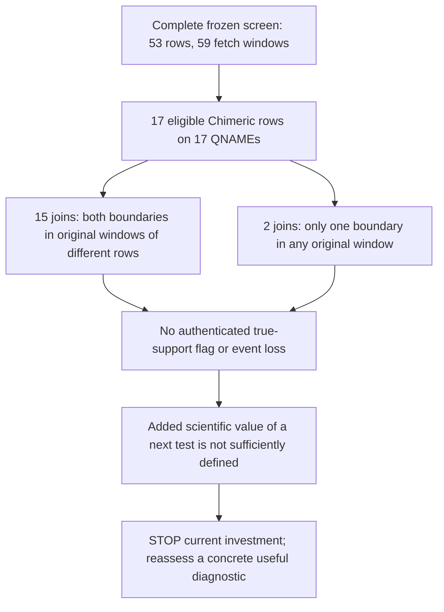

# Tier2 after the completed screen: finite investment decision

16 October 2026, Asia/Tomsk. Scientific investment note. Requested model and
effort are not independently backend-attested. Main owns evidence retention
and integration; Euclid retains the independent actual-result review.

## Decision

**STOP the available-HiFi filter-error lead at the current investment point.
Select no additional experiment now.** The recommended additional allocation
to this lead is zero. No replacement campaign is selected here.

This is a scientific allocation recommendation, not a project-wide
authorization limit. The project permits new data, compute, realignment and
other experiments when scientifically useful. This agent's assignment to
inspect evidence and edit only this note, without SSH or experimental
execution, limits this review's actions. It is not a reason to reject an
otherwise useful experiment.

The completed screen found native flags. It therefore cannot receive the
protocol's zero-flags conclusion. Its scientific yield is a fixed set of
unresolved candidates, with no authenticated filter error and no demonstrated
loss of a truth allele. Further inspection of the same mapping paths has low
added value for resolving those biological classes. Obtaining independent
labels could change the candidate state. However, the follow-up currently
specified offers a selected candidate hazard, without a defined test of a
distinct mechanism or useful event decision. That limits its priority for
the publication goal. It does not establish that decisive new evidence is
unobtainable, that the flags are correct, that real rearrangements are absent,
or that filtering is safe.

## Evidence used and accepted scope

I read the full attached
[goal](/Users/akm/.codex/attachments/2fa04b13-b328-4023-872e-0c4cc9dbfaee/goal-objective.md),
the [pivot integration](/Users/akm/aayushkrm-AlignSSL/repo/docs/research/2026-10-14-pivot-integration.md),
[frozen protocol](/Users/akm/aayushkrm-AlignSSL/repo/docs/research/2026-10-14-tier2-geometry-screen-protocol.md),
[post-trace investment decision](/Users/akm/aayushkrm-AlignSSL/repo/docs/research/2026-10-14-inversion-post-trace-investment.md),
[summary implementation review](/Users/akm/aayushkrm-AlignSSL/repo/docs/research/2026-10-16-tier2-summary-review.md),
and completed [independent actual-packet review](/Users/akm/aayushkrm-AlignSSL/repo/docs/research/2026-10-16-tier2-result-review.md).
I also inspected the actual local `summary.json`, `plan.json`, complete
`collection/manifest.json` and `collection/groups.jsonl`, native report,
native stdout and local execution/control receipts under
`/Users/akm/aayushkrm-AlignSSL/runs/tier2-geometry-result-20261016.5z8G6B`.
The native report and stdout are at the packet root.

Local read-only recounts used all 15,460 group entries and all 1,648 native
breakpoint rows. They reconciled group/status counts, all 53 event censuses
and the 17 candidates' direct endpoint intersections. I also checked every
native Pass row sharing any flagged QNAME. This was packet inspection; no new
scientific experiment was run.

Euclid **ACCEPTS the completed accounting**, with no positive biology. Its
review independently rebuilt original endpoint associations and all
event/window censuses, checked the reported strand boundaries, verified all
six available local receipt hashes, and reproduced the full saved summary.
Main supplies scheduler COMPLETE/0:0 for job1604949 and the full raw packet's
preservation and byte/hash checks in cluster HOME. I use those custody facts
as supplied; I did not access a study BAM or recheck remote storage. Packet
acceptance supplies no biological labels or scientific case for a campaign.

| Observation | Accepted count and meaning |
|---|---|
| Frozen selection | All 53 source rows; 106 original endpoint windows; 59 merged fetch windows; 3,692,176 bp |
| Collection | COMPLETE; all 59 fetch EOFs; group EOF/complete; stable recorded source stats |
| Records | 19,227 fetch observations; 19,206 distinct physical records after 21 repeat retrievals |
| Observed QNAME groups | 15,460: 11,290 eligible and 4,170 UNKNOWN; every source row has eligible groups |
| Native breakpoint rows | 1,648: 1,627 Pass, 21 Chimeric, zero Foldback |
| Eligible breakpoint rows | 1,378 Pass and 17 Chimeric |
| UNKNOWN breakpoint rows | 249 Pass and four Chimeric; these remain unresolved |
| Native stdout | 9,818 reads pass its MAPQ/length filters; 1,648 breakpoints occur on 1,032 QNAMEs |

These units are distinct. Collector eligibility does not authenticate an
allele or complete molecule. Native Pass does not authenticate true support.
QNAMEs, source rows and shared endpoint windows are not independent biological
replicates. None of these counts estimates sensitivity, error prevalence or
genotype accuracy. The four UNKNOWN flags stay in the record.

## What the complete eligible population shows

All 17 eligible flagged rows have distinct QNAMEs. Thirteen join chromosomes;
four join remote sites on one chromosome: two chr1 joins between 16,680,841
and 146,052,339, and two chr7 joins between 60,985,169 and 62,432,906.
All satisfy the fixed native Chimeric contig/distance rule. Their labels do
not expose a software inconsistency.

The exact direct-window result is **15 two-sided hits and two one-sided
hits**. For QNAME suffixes `/90179958/ccs` and `/234358165/ccs`, the
chr7:60,985,169 native boundary lies outside every original endpoint window.
Their alignments overlap row17's POS window, which explains group selection.
That overlap does not put the flagged boundary in that window. Group selection
at two loci must not be reported as two direct breakpoint hits in all 17 cases.
None has both native boundaries in windows of one source row, including an
opposite POS/END pair. The comparison uses frozen original half-open windows.

There is one mixed-label group:
`m84039_230418_220405_s4/195495556/ccs`. It has a Chimeric chr4-to-chr22 join
and a Pass breakpoint at chr22:12,173,872 to 12,175,017. Both Pass boundaries
intersect only row51's END window. The other 16 eligible flagged groups have
no reported Pass breakpoint. This closes a simple accounting loophole:
checking only the flagged breakpoint could miss other reported junctions on
the same read. The mixed group remains unresolved; its Pass row does not
establish support for the printed row51 inversion or a lost allele.

The zero same-row result bounds the observed geometry. Printed endpoints
have uncertainty, some relevant segments can remain unobserved, and a
flagged read could contain useful evidence beyond its flagged join. Repeated
coordinates, opposite read orientations, small query-boundary gaps and high
MAPQ cannot distinguish paralog placement from a real rearrangement or a
library chimera. Interchromosomal placement alone cannot make that choice.

## Competing investments

| Choice | Best decision-relevant output | Judgment now |
|---|---|---|
| Stop this available-input lead | Preserve a completed nonzero presence screen and its unresolved population | **Select now.** The specified follow-up has limited added scientific value; a useful diagnostic could change this allocation |
| Adjudicate all 17 from the retained mapping paths | More detail about observed joins, repeatability and proximity | Reject as the next experiment. The same mapping evidence supplies no independent biological class |
| Count nearby Pass reads or repeat joins as controls | A contrast between native geometry classes | Reject. Native labels and proximity cannot serve as artifact/support truth; missing report rows are not Pass reads |
| Obtain orthogonal labels, including suitable new data, realignment or assembly | Could distinguish biological rearrangement, paralog placement and library chimera, or expose a first filter error | Not selected now. No concrete bounded test is specified with enough added scientific value to justify reopening this lead. These approaches are authorized at project level and could supply useful evidence |
| Expand windows or tune native thresholds without an independent label endpoint | A different selected population or classification | Reject as a rescue of this screen. A changed count alone does not resolve the current candidates' biological identity |

The complete set of 17 is small enough to inspect. Size alone does not give
the inspection an informative endpoint. A plausible positive from mapping
inspection would be a recurrent, coherent join. A plausible negative would
be a suspected paralog placement or chimera. Both leave the decisive class
unresolved when inferred from the same alignments that produced the flag.
No candidate may be promoted to true support because it is near a Tier2 row,
has a strong MAPQ, recurs, or has the most persuasive path.

An independently authenticated real rearrangement could establish a first
candidate hazard and justify another finite decision. This packet contains
no measurement that the tool removed its evidence or changed an event
decision. A reported Chimeric label alone does not establish either effect.
Those distinctions limit the present result; they do not require a cheap
diagnostic to demonstrate a downstream failure in advance.

No pre-proved novelty, authenticated positive candidate or demonstrated
caller failure is required before every cheap diagnostic. Such a test may
discover the first failure or reveal the useful research question. Its case
rests on a credible decision it could change, suitable controls and bounded
cost. The current STOP is a judgment about the added value of the follow-up
defined so far, not a claim that all possible tests have been exhausted.

## Next-test and stop rule

**No next scientific test is selected now.** The existing metadata supplies
no independent biological endpoint for separating paralog mapping, real
rearrangement and library chimera. The native ABI controls verify the software
route; the 53 truth rows describe source inversions; the Pass set describes
a native output. None provides those missing candidate labels. Repeating
the 17-case inspection under a new score or calling UNKNOWN negative would
not supply them. This is a limit of the current metadata. New orthogonal
labels could be obtained; their availability, cost and discriminating power
have not been established or ruled out by this review.

Apply the stop now, without a favourable-case exception or automatic replay.
Keep all 17 eligible candidates, the four UNKNOWN flags, every other group
and the null Foldback observation under their existing scope. A later
proposal can start from these same unresolved candidates. It need not bring
a pre-existing failure or prove novelty before testing. It should specify
the decision-changing endpoint, complete evaluation population, appropriate
controls, finite budget and stop rule. This note queues no experiment and
does not restrict main's existing project authority.

Harvey's separately assigned search for new experimental evidence belongs
to broader opportunity selection. No finding from that unfinished search is
assumed here. The earlier S10 STOP remains in force. The publication goal is
active and unmet; DeepSV remains historical.

Only this file was written. No Git, SSH, job action, source acquisition,
caller/native execution, threshold change or other file edit was performed.
