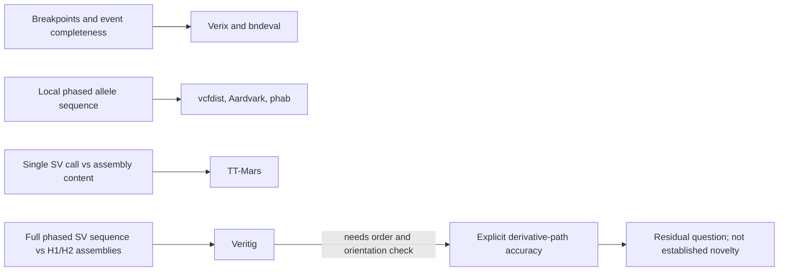

# Complex-SV path prior art — 2026-11-03

## Decision

Broad novelty in phased variant comparison, local haplotype sequence comparison, assembly-based SV validation, event grouping, or breakpoint orientation is not supportable. These areas have strong prior art.

A narrower question remains open: **when a caller explicitly reports a phased, multi-junction derivative path, can the reported ordered and oriented adjacencies disagree with an independent phased assembly path even though the component breakpoints are present?** The reviewed tools do not all score that object. This is a residual hypothesis, not an absence claim or a confirmed caller failure.

The current objective remains publication-worthy science, independent of preserving AlignSSL or a particular method. The updated objective hash recorded in the project notes is `624de4ace478d0476cc8d899197c61db22a32c55543edb61f79ac7e9bd4145a0`.

## Comparator map

“Author claim” below means the paper, documentation, or source describes that function. “Inference” marks my reading of what the representation and score can establish.

| Comparator and exact version | Native inputs and author-described scope | Phased path and alternate adjacency assessment |
|---|---|---|
| **Veritig v1.0.0** — [release](https://github.com/asylvz/veritig/releases/tag/v1.0.0), tagged commit `a4a6a6d1a6238ad5af27ed5094c74d0b82375381`; [tagged README](https://github.com/asylvz/veritig/blob/v1.0.0/README.md); [concordance source](https://github.com/asylvz/veritig/blob/v1.0.0/src/concordance.cpp). First stable release, 2026-06-25. | Author accepts SV-bearing FASTA sequences; phased use supplies separate H1 and H2 sequence files plus H1/H2 assemblies. Concordance reports each sequence against each haplotype. The README describes local SV contigs, usually a few kb to tens of kb, that capture a full allele. | **Closest sequence-input fit.** Inference: if one FASTA record spells the complete caller-reported derivative path, a different pairing that changes the spelled sequence can be tested against both assembly haplotypes. But the built-in score is not an adjacency/path score: source sums aligned bases across primary and supplementary alignments, then reports mapping ratio, mean primary-alignment identity, and MAPQ. It does not report or require a correct ordered edge chain. Separate component FASTAs also do not preserve their grouping as one path. Read the PAF chain and each junction; do not use VeriScore alone to claim path correctness. No peer-reviewed paper was found in this bounded search. |
| **vcfdist v2.6.4** — [release/tag](https://github.com/TimD1/vcfdist/releases/tag/v2.6.4), commit `655025b`; [2024 paper](https://doi.org/10.1186/s13059-024-03394-5); [official overview](https://github.com/TimD1/vcfdist/wiki/01-Overview). The upstream release page labels v2.6.4 a pre-release. | Query and truth VCFs, reference FASTA, and optional evaluation BED. Authors describe joint SNP, indel, and SV benchmarking using phased local sequence alignments; local phase is required, and the tool evaluates phase flips and switches. The current README describes SVs up to 10 kb; the paper also reports memory and scale costs. | **Strong prior art for local phased sequence equivalence and phase errors.** It can separate alternative local cis/trans haplotypes when the input variants encode them. The paper and docs reviewed do not define a cross-chromosome derivative-path or BND mate-pair score. That boundary is an inference from its VCF and local sequence comparison model. The >10-kb guidance is a practical cost warning; size alone does not prove a scientific scope gap. |
| **Aardvark v1.0.0** — [release](https://github.com/PacificBiosciences/aardvark/releases/tag/v1.0.0), commit `0d25bcc`; [tagged methods](https://github.com/PacificBiosciences/aardvark/blob/v1.0.0/docs/methods.md); [paper](https://doi.org/10.1186/s13059-026-04165-0). | Query/truth VCFs, reference, and BED regions. Its primary BASEPAIR comparison uses edit distance between reconstructed haplotype sequences. The tagged methods say it retains pre-phased truth, but ignores query phase and finds the query diplotype that minimizes distance. It splits regions at gaps greater than 50 bp. | **Strong sequence-level prior art, not explicit reported-phase scoring.** A local alternate sequence difference can change BASEPAIR. Inference: a long path with separated joins, or a cross-chromosome BND pairing, is not scored as one phased derivative path by the documented local-region workflow. Query phase is intentionally optimized, so this is not a test of whether the caller assigned that path to the reported homolog. |
| **Truvari phab, in Truvari v5.5.0** — [release](https://github.com/ACEnglish/truvari/releases/tag/v5.5.0), commit `fa97db4`; [phab guide](https://github.com/ACEnglish/truvari/wiki/phab). | Phased query and truth VCFs plus reference context. Phab reconstructs haplotypes, aligns them, and recalls variants to harmonize representation; it is a representation tool in the Truvari workflow. | **Established local haplotype-representation prior art.** It does not report a whole derivative graph or score an ordered set of cross-locus adjacencies. Inferring that limit from the described inputs and output is not an author claim that phab cannot be extended. |
| **TT-Mars** — [2022 paper](https://doi.org/10.1186/s13059-022-02666-2); [official repository](https://github.com/ChaissonLab/TT-Mars). The paper’s exact software build was not pinned in the sources checked. | Candidate SV VCF plus haplotype-resolved assembly and a reference-to-assembly orthology map. Authors validate each candidate independently as an edit operation against assembly content. Their HG002 analysis ignored translocation/break-end calls. | **Strong assembly-truth prior art for per-call content.** It does not test whether several calls form the right phased derivative path or pair the right breakends. The paper explicitly says each SV is considered independently; the path limit follows from that design. |
| **Verix** — Rohlicek et al., [Bioinformatics paper and PDF](https://doi.org/10.1093/bioinformatics/btag803); [official code](https://github.com/PopicLab/verix); [software archive DOI](https://doi.org/10.5281/zenodo.22998063). Published 2026-10-29; no separate software version was verified here. | Authors group events by ID, represent breakpoint coordinates by chromosome and aggregate SV type, and allow oriented breakend matching. They define complete, partial, aggregate, and spurious matches and fragmentation diagnostics. The reported demonstration uses 1,000 simulated truth events. | **Strong prior art for event completeness, splitting/merging, breakpoint sets, and orientation.** The methods reviewed do not report phased derivative-path concordance. This distinction is an inference from the described event representation and metrics. |
| **RTG bndeval in RTG Core 3.13** — [official command reference](https://realtimegenomics.github.io/rtg-core/rtg_command_reference.html); [release notes](https://github.com/RealTimeGenomics/rtg-tools/blob/master/installer/ReleaseNotes.txt). RTG Core 3.13 release date: 2025-05-27. | Truth and call VCFs with BND records, optional BED, positional tolerance, and orientation matching. The manual says other record types are ignored and describes intersection of truth and called breakend regions. | **Breakend-position and orientation control only.** The docs do not describe comparing mate pairing, phase, or complete derivative paths. This is an inference from the region-intersection method. |

**Other close sequence comparator.** SVanalyzer SVbenchmark v0.36 [guide](https://svanalyzer.readthedocs.io/en/latest/svbenchmark.html) accepts test/truth VCFs and a reference, then aligns alternate haplotypes for nearby sequence-specified variants within its max-distance rule. It is useful evidence that local sequence equivalence is established. It does not report phased, long-range derivative-path connectivity.

## One recommended baseline for the cheap screen

Use **Veritig v1.0.0** as the one-event sequence-to-assembly screen, because its native input can carry one complete spelled path per reported haplotype and it compares those sequences to both independent haplotype assemblies.

1. Use only a caller path that is explicitly reported as grouped and phased. Spell the whole path, with unique flanks, as one FASTA record per homolog. Use the independently resolved H1 and H2 assemblies as the two references.
2. Run the documented phased concordance mode: separate H1/H2 path FASTAs, both assembly FASTAs, and the phase option. Retain the PAF output. A global H1/H2 label swap may be allowed if the truth labels are arbitrary; do not reassign components independently.
3. Report Veritig’s mapping ratio and identity for each path against both haplotypes. Also inspect the full PAF alignment chain and each junction for order, orientation, and complete junction-spanning support. The path readout is **ordered adjacency concordance**, not VeriScore alone.
4. If the caller reports components but no grouping or path, label path status **UNKNOWN / not evaluated**. Do not infer a wrong path from absent connectivity.

This screen does **not** require a caller failure to be known in advance. Once the other workstream supplies a finite candidate with independent phased truth, the fixed comparison can return a mismatch, a match, or not-evaluable. A null result is useful. The baseline is not runtime-validated in this review, and Veritig’s built-in summary alone does not prove path topology.

## Novelty boundary

Do not claim novelty for “haplotype-aware SV benchmarking,” “sequence-level allele accuracy,” “assembly-based validation,” “complex-event completeness,” or breakpoint orientation. The tools above already cover these claims in different scopes.

A defensible candidate claim is narrower and conditional: **a method or result that evaluates an explicitly reported, phased multi-junction derivative path against independent phased assembly truth, including ordered and oriented adjacency pairing, after component and breakpoint controls accept the parts.** The contribution would need to show that the path result adds information beyond local sequence/haplotype scores and event-completeness scores. It would not establish that such errors are common, clinical, or missed by all existing tools.

The cheap screen should test the first fixed, finite, eligible path as soon as that path and independent truth exist. It should not wait for a previously proven caller error. If no explicit path exists, report non-evaluability rather than caller failure. If a path mismatch appears, first compare the complete path against each comparator within its native scope; do not label an out-of-scope result from vcfdist, Aardvark, phab, TT-Mars, or Verix as a comparator failure.

## Source and task record

- Read the repository’s updated-goal note, the supplied 2026-11-03 literature delta, and the supplied 2026-10-14 complex-event opportunity note.
- Used official papers, manuals, releases, documentation, and version-pinned source where available. Scite searches were attempted twice but the connected MCP refused access because the account requires a paid plan or active trial. Exa and the public primary sources supplied the evidence used here.
- Requested worker configuration: **GPT-6 Luna / maximum effort**. This is the request only; actual backend model and effort were not independently attested. No subagent was dispatched for this assignment.
- No real-sample discovery, genomic-data analysis, caller run, experiment, code edit, SSH action, or Git mutation was performed. Only this note was written.
