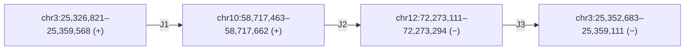

# COLO829 der(3): concrete first-falsification resource

**Date:** 2026-11-03

**Requested worker model/effort:** GPT-6 Luna / max, as requested in the governing objective. Actual backend model and effort are not independently attested.

## Finding

COLO829’s three-junction derivative chromosome 3, named `der3_RARB_BICC1_TRHDE`, is a finite real-human fixture. A 39,549 bp assembly contig is public, and a public same-named tumor `nanomonsv` VCF contains the three corresponding BND pairs. A separate multi-platform COLO829 truth VCF also contains those three junction pairs.

This is suitable for a first **adjacency and orientation** falsification. It is not yet a strict independent-data test of phased path accuracy. The contig is a consensus of 29 tumor reads from the ONT source used for the caller VCF. The 2022 truth VCF has unphased `0/1` genotypes. The ONT VCF reports three `MATEID` pairs, but no event-group, whole-path, or phase-set field. A caller path error therefore remains **unknown / not evaluated** from that VCF alone.

## Path and breakpoints

The JBrowse resource labels this allele a derivative chromosome 3 assembled from pieces of chromosomes 3, 10, and 12. The segment BED and PIF align it to GRCh38 as follows. Segment coordinates below are BED labels (0-based, half-open); VCF `POS` values are 1-based.

| Junction | Public ONT caller VCF | Public 2022 truth VCF |
|---|---|---|
| J1 | `chr3:25,359,568` ↔ `chr10:58,717,464` (`r_12_1` / `r_12_0`) | `3:25,359,568` ↔ `10:58,717,464` (`truthset_8_1` / `truthset_8_2`) |
| J2 | `chr10:58,717,662` ↔ `chr12:72,273,294` (`r_13_0` / `r_13_1`) | `10:58,717,662` ↔ `12:72,273,295` (`truthset_43_1` / `truthset_43_2`) |
| J3 | `chr12:72,273,112` ↔ `chr3:25,359,111` (`r_24_0` / `r_24_1`) | `12:72,273,112` ↔ `3:25,359,111` (`truthset_7_1` / `truthset_7_2`) |

J1 and J3 have matching printed breakend coordinates. J2 differs by one base at the chr12 end. Do not score this as a biological disagreement until BND orientation, inserted sequence, and coordinate conventions are normalized against the reference. The assembly path contains 1 bp and 11 bp between aligned segment blocks; reconcile those bases with the BND alleles.

## Public files and provenance

| Object | Source and access | What is established |
|---|---|---|
| Derivative contig | [FASTA](https://jbrowse.org/demos/cancer_sv/der3_RARB.derivative.fa.gz), [segment BED](https://jbrowse.org/demos/cancer_sv/der3_RARB.derivative_segments.bed.gz), [GRCh38 alignment](https://jbrowse.org/demos/cancer_sv/der3_RARB.vs_reference.pif.gz); described in the [JBrowse tutorial](https://jbrowse.org/jb2/docs/tutorials/cancer_sv/) | Contig `der3_RARB_BICC1_TRHDE`, 39,549 bp. The documentation says it was assembled from tumor reads spanning all three loci. The pinned [JBrowse build script](https://github.com/GMOD/jbrowse-components/blob/62134b768714e1d970c499276c5dbb0188fb68d9/scripts/build_cancer_sv_demo.sh) says it is a consensus of 29 tumor reads; the builder is not shipped there, and the script fetches the contig. |
| Caller callset | [ONT open-data VCF](https://ont-open-data.s3.amazonaws.com/colo829_2024.03/wf_somatic_variation/sup/COLO829.wf-somatic-sv.vcf.gz) | Header: sample `COLO829`, `nanomonsv-0.7.1`, file date `20240308`, reference `GCA_000001405.15_GRCh38_no_alt_analysis_set.fasta`. Six BND records form three `MATEID` pairs. Actual record FORMAT fields are `DP:AF:AD:NDP:NAF:NAD`; no `PS` or `EVENT` grouping is present. |
| Multi-platform truth calls | [GRCh38-lifted truth VCF](https://zenodo.org/records/4716169/files/truthset_somaticSVs_COLO829_hg38lifted.vcf?download=1); [Zenodo record](https://zenodo.org/records/4716169); [primary paper](https://doi.org/10.1016/j.xgen.2022.100139) | VCF sample `COLO829T`; the three pairs above are present with unphased `GT=0/1`. The paper describes a curated, multi-platform, experimentally validated 68-SV truth set. This establishes component junction evidence at the resource level; I did not verify the assay-by-assay support for each of these three rows, and the VCF does not phase the derivative path. |
| Original study accession | ENA project [PRJEB27698](https://www.ebi.ac.uk/ena/browser/view/PRJEB27698) | The 2022 paper links its genomic data to this project and its processed truth/call VCFs to Zenodo. The 2024 ONT S3 VCF has no ENA run accession in its header; the direct file URL and sample name are the verified handles for that callset. |
| Independent COLO829 phasing data to check later | 2023 HiFi run [SRR22761284](https://www.ncbi.nlm.nih.gov/sra/?term=SRR22761284) and Hi-C run [SRR22761283](https://www.ncbi.nlm.nih.gov/sra/?term=SRR22761283); [primary study](https://pmc.ncbi.nlm.nih.gov/articles/PMC10011606/) | The study reports chromosome-scale COLO829 phased assemblies from HiFi/Hi-C. I did not verify this exact der(3) path in its source data or find a directly released haplotype-path file for this allele. Passage identity versus the ONT tumor data is also unverified. |

**Reference and phase:** use GRCh38/hg38 for the coordinates above. The ONT callset names the GRCh38 no-alt FASTA; the truth VCF is explicitly lifted to hg38. The truth VCF uses contigs `3`, `10`, `12`; the caller VCF uses `chr3`, `chr10`, `chr12`. The assembly names a physical derivative path, but it has no parent-of-origin label or H1/H2 phase-set identifier. Treat this as tumor-derivative phase, not maternal/paternal phase.

## What a first falsification can test

Compare the three caller BND adjacencies, orientations, and inserted sequence with the contig path and the three truth VCF pairs. Normalize the J2 one-base difference before scoring. A missing or incompatible edge would falsify adjacency concordance for this case. A full match would be a useful null result.

Do not claim a wrong caller path from this VCF: it has paired breakends but does not group all three pairs into a named derivative path or phase. Under the existing project rule, whole-path status is **unknown** until a caller-native path/grouping is found or the same path is independently confirmed from a phased assembly built from a separate data source.

## Independence and limits

- **Separate analysis outputs:** the contig is assembly-derived; the VCF is from `nanomonsv`. They are not the same representation.
- **Shared input:** both are tied to the same named COLO829 ONT tumor data. The contig is not an untouched held-out test; its original assembly builder is unavailable in the pinned JBrowse repository.
- **Independent junction support:** the 2022 truth resource contains all three pairs and was built from multiple platforms, including ONT. Do not assume every truth-set observation is independent of the ONT platform; its run-level overlap with the 2024 S3 callset is unresolved. Its `0/1` calls do not establish which phased chromosome carries the full path. Event-specific validation modalities for the three exact pairs remain unchecked.
- **Sample naming:** `COLO829`, `COLO829T`, and the matched normal `COLO829BL` are the source labels. The direct ONT VCF and 2022 truth VCF were not joined by a run-level accession or passage identifier. Same cell-line naming does not prove same aliquot or passage.
- **Independent phase lead:** the 2023 HiFi/Hi-C accessions could test this path with separate reads, but this pass did not establish that the exact derivative is present in that assembly. This is the remaining gap for a strict independent phased-path falsification.

## Checks and scope

- Downloaded only small records: caller VCF (262,838 bytes), truth VCF (80,158 bytes), derivative FASTA (12,390 bytes), segment BED (223 bytes), and small Zenodo metadata/validation archives. The caller VCF MD5 `8467fa76e0fb842548abdd315fc91076` matches its S3 ETag. The truth VCF MD5 `4be6de0f1bb6a5aa81fdc83951a63a3f` matches Zenodo metadata. The derivative FASTA MD5 is `253db38b2102f155a33e8f727618b9ab`.
- The tumor CRAM is 78,825,527,141 bytes by HTTP HEAD. It was not downloaded. The >200 MB raw-calling archive was not downloaded. No caller was run, no assembly was rebuilt, and no cluster job, account, or Git mutation was used.
- Bounded search used Exa and Parallel Search (26 targeted query strings), plus the Life Sciences Literature NCBI Entrez record for PMID 36778136 and focused retrieval of the primary article, JBrowse data page, Zenodo metadata, and official files. This is not an exhaustive resource-absence claim.
- I checked the supplied Oct 14 opportunity note, Nov 3 literature delta, Oct 9 COLO829 mixture note, and the current Nov 3 complex-path prior-art note. This does not reuse the stopped S10 simple inversion, HG008 repeat branch, geometry screen, or synVII yeast branch. The Oct 9 COLO829 note checked mixture availability; this note adds event-level contig and VCF records.

**Conclusion:** a concrete COLO829 resource is available for the first caller-to-assembly adjacency check. A strict independent phased-path test is **not yet verified**. The exact remaining gap is an independently sourced phased assembly path for this same der(3), or a caller-native output that explicitly reports its grouped phased path.
