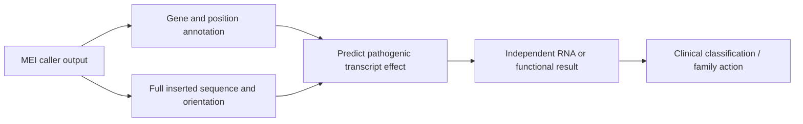

# Independent SV opportunity scout — 2026-11-03

**2026-11-04 update:** Subsequent primary-source checks found that two cited
clinical studies already applied sequence-aware SpliceAI to long MEIs, one
with specific predicted sites. The generic proposal below is therefore not a
new method. See the [follow-up and investment decision](2026-11-04-mei-prior-art-check.md).
The earlier scout is retained as a historical conditional proposal.

## Decision

**Conditional lead: test whether the full sequence of a mobile-element insertion (MEI) improves clinical splice-effect interpretation after the insertion has already been called.** Start with a source-only falsification. Do not start a model, genome-wide analysis, or cluster job yet.

### Research question

For a clinically relevant MEI, does its exact inserted sequence and orientation predict an experimentally observed splice defect or transcript loss better than the current call plus gene, exon, and position annotation?

This is a functional and clinical interpretation question. It does not score breakpoint-to-adjacency distance, phased paths, or generic expression-model predictions. It uses cases where DNA callers already report the insertion. The possible added value is whether the allele changes transcript function and clinical classification after discovery.

## Why this could matter

An insertion call does not by itself establish what the allele does. A full-length LINE-1 inserted into APC can create a pseudo-exon, a premature stop, and near-complete loss of transcript from that allele. If sequence-aware interpretation finds similar effects in independent MEIs that current clinical annotation leaves unresolved, it could change diagnosis, cascade testing, cancer surveillance, or treatment eligibility. That would add a functional result after discovery; it would not only find more insertions.

The contribution is still uncertain. MEI detection and clinical diagnosis have strong prior art. A positive result must show added, independently tested transcript information beyond existing callers and ordinary clinical interpretation.

## Exact public evidence

| Artifact and date | Sample and allele | Baseline and independent support | Limit |
|---|---|---|---|
| [Baumann et al., *Long-read genome and RNA sequencing resolve a pathogenic intronic germline LINE-1 insertion in APC*](https://pmc.ncbi.nlm.nih.gov/articles/PMC11968988/), published 2025-04-04 | Index patient **IV:3**; heterozygous full-length LINE-1 in APC intron 7, reported as `chr5:g.112800732_112800733insN[6116 ± 1]`. The same allele was found by long-range PCR in affected relatives III:4 and V:1, but not unaffected relative IV:1. | Short-read WGS called an insertion but did not resolve its sequence. PacBio long-read WGS detected it with **SVIM, pbsv, and Sniffles2** (three of four callers). Eight of 29 mapped reads spanned the insertion. Long-range PCR and amplicon sequencing supported the sequence. RNA work found pseudo-exonization and NMD; less than 10% of APC wild-type transcript was attributed to the insertion-bearing allele. | One family and one allele. The DNA call, validation, RNA result, and segregation were reported in the same study. Lymphoblastoid-cell RNA is not colon-tissue RNA. The poly-A tract has a small sequence uncertainty. These facts support the allele but do not establish a general predictor. |
| [Bouras et al., *New Alu insertion in BRCA1 exon 14*](https://www.mdpi.com/2073-4425/12/11/1736), published 2021-10-13 | Patient **II-4**; BRCA1 `c.4475_c.4476insAluYb8`, reported at 22% VAF in the clinical panel result. The article reports an AluYb8 sequence and an abnormal exon-14-skipped transcript. | The clinical HCS panel detected the insertion; PCR and Sanger sequencing characterized the inserted element. RT-PCR showed exon 14 skipping, a frameshift, and a premature stop. The paper reports segregation in the cancer family. | This is a case report. The article's data-availability statement says “Not applicable”; raw reads and a reusable sample-level result file were not verified. The reported 202-bp call and PCR-derived element description use different length representations; preserve the source fields and resolve the representation before any comparison. |
| [Wijngaard et al., Table 2, *Mobile element insertions in rare diseases*](https://www.nature.com/articles/s41431-023-01478-7/tables/2), published 2023-10-19 | Table 2 reports ten disease-associated entries from Solve-RD and Radboudumc. Nine are MEIs; one is a 450-bp COL11A1 deletion with MEI type and strand listed as not applicable. The table gives gene, genome/transcript HGVS, exon/intron, element family, strand, cohort, and tool. | This gives a public caller-output anchor across independently diagnosed alleles. The parent study benchmarked six MEI tools and reports ten diagnoses among 63,514 exomes. | The table is not an RNA truth set. The paper reports complementary validation, but this source does not show a sample-specific RNA outcome for every row. Keep the COL11A1 deletion separate from the MEI set. A correction dated 2023-11-16 adds consortium members; it does not change the Table 2 results. |

The APC example is the clearest seed because the short-read caller already detected the allele. The unresolved question is what its sequence does to the transcript, not whether the reference contains the insertion. The BRCA1 case is an independent element family and disease context, but its public article does not provide raw sample data. Treat both as motivating examples, not as a validated test cohort.

## Prior art and closest alternatives

| Direction screened | Primary evidence | Decision |
|---|---|---|
| Generic MEI discovery in rare disease | The 2023 study benchmarks MELT, SCRAMble, Mobster, ERVcaller, TEMP2, and xTea; it applies MEI calling to 10,890 Solve-RD and 52,624 Radboudumc exomes and reports ten diagnoses. [Article](https://www.nature.com/articles/s41431-023-01478-7). A separate study analyzed **89,874 clinical exomes** for MEIs. [Torene et al.](https://pmc.ncbi.nlm.nih.gov/articles/PMC7200591/). | Do not pitch a new MEI caller benchmark or a generic claim that exome pipelines miss MEIs. Those questions have substantial prior art. |
| CYP2C19 structural deletion and drug response | The 2026 Estonian pharmacokinetic recall study used long-read calls and `pb-StarPhase`; it measured omeprazole and metabolite concentrations at ten time points. It reports clinical evidence for CYP2C19*37 and *42, including two *42 carriers, and no apparent activity difference from *37 in the same allele background. [Krebs et al.](https://www.nature.com/articles/s41525-025-00549-6). | High clinical value, but the paper already tests the proposed deletion-function question. A “missed deletion marker” lead would also be too close to the obvious marker problem. |
| Low-VAF clinical mosaic SV sensitivity | The 2026 HiFi clinical study reports 479/481 pathogenic variants detected automatically; its two misses include a 5,594-bp mosaic deletion at 13% and a mosaic trisomy 18 at 23%. [Devaney et al.](https://www.cell.com/ajhg/fulltext/S0002-9297(26)00151-5) and [supplement](https://www.cell.com/cms/10.1016/j.ajhg.2026.04.001/attachment/165056df-7d20-4231-b365-ccb8543cba16/mmc1.pdf). | This is useful clinical evidence, but a single missed SV would become a generic caller-sensitivity rebenchmark. Do not rename the already-triaged MIMS/mosaic-mixture question. |
| Mosaic SV effects in hematopoietic progenitors | Grimes et al. report 1,133 Strand-seq single-cell genomes from 19 donors, 51 mosaic alterations, and cell-type effects using scTRIP/scNOVA. The paper already reports additional-SV enrichment and myeloid-progenitor enrichment. Data are listed under controlled-access accession **EGAS00001006567**. [Article](https://www.nature.com/articles/s41588-024-01754-2). | Interesting biology, but the broad causal association is already reported and the raw cohort is controlled-access. No new public residual was established in this scout. |
| MARCHF6 repeat mosaicism | A 2025 FAME3 case report uses TRGT and TRGT-instability for one proband and three affected relatives. The paper says detailed clinical and bioinformatics information is available on request. [Perera et al.](https://link.springer.com/article/10.1007/s10048-025-00835-6). | The public source does not provide the sample-level files needed for an independent first test. The paper already reports repeat mosaicism in the family. |

The APP-triplication mosaic rearrangement was not treated as a candidate because it depends on a complex chromosome-rearrangement resource and risks overlap with the separate phased-path scout. This note does not evaluate its breakpoint, adjacency, or path representation.

## Cheapest first falsification

Do a **source-only manifest and baseline check** before any data acquisition:

1. Transcribe the nine MEI rows in Table 2 into a small manifest: reported allele, MEI family/strand, discovery tool, validation type, and whether sample-specific RNA evidence exists. Retain the COL11A1 deletion as a separately labeled non-MEI control.
2. Add the APC IV:3 and BRCA1 II-4 cases. Preserve their original allele representations, including the APC poly-A uncertainty and the BRCA1 length discrepancy.
3. For each RNA-supported allele, record the result that a clinical interpretation must predict: exact abnormal junction, frame consequence, and evidence for transcript loss/NMD. Count independent alleles/families, not reads or relatives.
4. Compare two frozen baselines: (a) published caller plus position/size/gene-overlap annotation; and (b) interpretation with the full inserted sequence and orientation. Use the published RNA result only as held-out truth. Do not train or tune on these examples.

**Stop early** if the public materials yield only the two selected case reports with RNA outcomes, if the ordinary clinical annotation already states the same allele-specific splice consequence, or if the exact inserted sequence cannot be joined to independent RNA evidence. That would leave a useful clinical mechanism but not a defensible new computational contribution. If the inventory finds a broader set of independent, sample-linked RNA outcomes, then define a blinded, gene/family-held-out evaluation and cost the required access.

### Expected effort and data needs

- First falsifier: a few hours of article, table, and supplement review; no raw reads, installs, cluster job, or model download.
- Follow-up if it survives: exact allele sequences, sample-level caller outputs, and RNA assays from more than one independent family or cohort. Some patient-level data may require access or new assays. The source census must determine this before estimating storage, CPU, GPU, or wet-lab cost.
- No arbitrary project-wide compute cap is proposed. Full resources remain available for a justified study after the label and access audit.

## Uncertainty and claim limits

- RNA evidence supports a molecular effect. It does not by itself prove disease causality, penetrance, or tissue-specific consequence.
- APC has segregation and a clinical phenotype; it remains one family. BRCA1 has a clinical-panel result and RNA assay; raw sequence files were not verified open.
- The 2023 cohort's ten diagnoses are not ten independent RNA truths. Its table supports allele and caller provenance, not a transcript-effect label.
- The APC long-read caller agreement is not four independent truth methods. PCR, RNA, and segregation are the separate evidence streams; their limitations remain visible.
- A positive result matters only if sequence-aware interpretation improves a real clinical decision over the strongest current annotation. More calls alone do not establish the contribution.
- No exhaustive MEI literature review or field-wide novelty claim was performed.

## Search and execution record

- Search date: **2026-11-03**. I read the requested project brief, current [PROGRESS.md](../../PROGRESS.md), [2026-10-16 scout](2026-10-16-new-evidence-opportunity-scout.md), and [2026-10-12 regulatory-SV note](2026-10-12-regulatory-sv-opportunity.md). I also checked the earlier structural-transcript, exon-deletion, and breakpoint-uncertainty triage notes to avoid relabeling those directions.
- Exa and Parallel Search found candidate papers and source artifacts. Claims above were checked against primary paper pages, full-text excerpts, and the public Table 2. The source search was bounded, not exhaustive.
- Firecrawl and NCBI/Life Sciences Literature tools were not exposed in this session. Scite refused the literature calls because the connected account has no paid plan or active trial. Exa and Parallel were the working fallback.
- The requested Luna/max configuration is not independently attested by runtime metadata. No model-routing claim is made.
- No raw genome data, source datasets, or supplementary sequence files were downloaded. No code was run, no job was submitted, and no Git or SSH operation was performed. This note is the only file changed.
