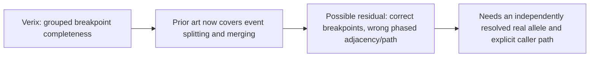

# Bounded literature delta — 2026-11-03

**Window:** first public release from 2026-10-17 through 2026-11-03. **Observed in this scout:** 2026-11-03. This is a bounded literature check, not a field-wide absence claim.

## Finding

**One material prior-art update; no new independently validated SV truth set or new study lead selected.** The new Verix paper covers multi-breakpoint event completeness, fragmentation, and aggregation. Its published demonstration uses simulated HiFi reads. It changes the prior-art boundary for the existing complex-event question, but does not supply a new real-world orthogonal truth resource.

## Verified in-window sources

| Primary source | Public date; first observed | Verified evidence and limit | Overlap with prior work |
|---|---|---|---|
| Rohlicek et al., [“Verix: a toolkit for benchmarking and harmonization of complex structural variants”](https://doi.org/10.1093/bioinformatics/btag803), *Bioinformatics*. [Publisher full-text PDF](https://academic.oup.com/bioinformatics/advance-article-pdf/doi/10.1093/bioinformatics/btag803/72584641/btag803.pdf); [open code](https://github.com/PopicLab/verix); [archived software](https://doi.org/10.5281/zenodo.22998063). | **Published:** 2026-10-29 (publisher page). **Observed:** 2026-11-03. | MIT-licensed toolkit. In Methods §2.1, each complex event is represented by its ID, a set of breakpoint coordinates grouped by chromosome, and aggregate SV type. Matching uses breakpoint-set alignment; optional breakend matching requires position and orientation. Methods §2.1.1 defines complete, partial, aggregate, and spurious classes and fragmentation diagnostics. The Results demonstration benchmarks SVision, Sniffles2, and Severus against **1,000 simulated truth events** on simulated PacBio HiFi reads. This verifies an evaluator and software release, not an independently validated biological cohort. The paper describes event/breakpoint matching; I found no phased derivative-path score in that formulation. | Direct overlap with the Oct 14 [complex-event opportunity note](2026-10-14-complex-event-evaluation-opportunity.md): claims about breakpoint completeness, splitting, or merging are now covered by a published tool. The earlier residual—wrong phased path despite detected components—remains only as a narrower question. The path distinction is an inference from Verix’s reported representation and metrics. |
| Olbrich et al., [“The Emirati pangenome featuring a diploid chromosome-level reference”](https://www.nature.com/articles/s41467-026-78776-3), *Nature Communications*. | **Published:** 2026-10-20 (publisher page). **Observed:** 2026-11-03. | Reports one trio-based diploid chromosome-level assembly plus 57 HiFi chromosome-scale assemblies, 27 trio-based, and short-read genotyping in an independent Emirati cohort. The article links three supplementary XLSX datasets. This is a new population sequence resource. The article page and abstract do not establish orthogonal validation for specific rare or complex SV alleles; I did not inspect or download the supplements. | Potential assembly and population resource, but a generic pangenome or reference-coverage rerun is not a new claim. Exact public accession, event-level truth, and a validated allele-to-independent-cohort join remain unverified. Trio status alone does not establish orthogonal validation of a caller result. |

## Scientific delta and prior-art boundary

The October 14 note already asked whether a real, assembly-resolved multi-junction allele can have all components detected but the wrong phased derivative path, with a consequential change in interpretation. Verix now supplies a direct event-level control for breakpoint completeness and fragmentation. A remaining discriminating question is narrower: **can a caller report the correct breakpoint set (and, where required, orientations) yet connect those breakends to the wrong phased path on an independently resolved allele?** The comparison must use an explicit caller grouping/path and an independent phased truth path. “Missing from a callset” is not evidence of a false negative.

This is an update to an existing residual, not a new result or a selected experiment. HitSV and the SMaHT 1:49 mixture benchmark appeared in search results but were published on 2026-10-15, outside this window; the Oct 16 notes already cover the relevant overlap. No synVII archive audit was performed in this scout.

## Resource question

**Does any public, Verix-compatible fixture pair a real complex-SV callset with independent phased path truth and explicit caller path/grouping?** The Verix article’s demonstration is simulated. The Emirati article exposes supplementary datasets, but their event-level contents and independent truth status were not checked. This is a resource question; the literature screen does not require a previously proven caller failure.

## Search and handling record

- Five unique targeted query strings: two Exa, two Parallel Search, and one Scite query. Scite denied access because the connected account requires a paid plan or trial; the retry used the same query. Exa and Parallel Search supplied the screen. No Firecrawl-only source was used.
- Verified primary pages: the OUP Verix article and its full-text PDF, extracted with Parallel Search `web_fetch` at the linked PDF URL above; the Exa DOI-page fetch returned the abstract only. The Nature Communications Emirati pangenome page was also checked. Search-result dates were checked against publisher publication dates where available. For Verix, the linked Zenodo archive’s separate deposit date was not checked.
- No raw data, supplementary files, or archives were downloaded. No code was read or run. No Git, SSH, or compute jobs were used. No synVII audit was performed. Requested Luna/max model and effort were not backend-attested.

## Main integration check

Main independently reads the author [README](https://github.com/PopicLab/verix)
and [user guide](https://github.com/PopicLab/verix/blob/main/docs/user_guide.md).
The observed main commit is `7cb8524a941ce0d81dd04b0de51e009199386614`.
The README describes breakpoint-set matching and the 1,000-event simulated
demo. The guide documents `--breakend_mode` for position and orientation,
VCF record grouping, and breakpoint-derived output classes. This supports
the overlap with event completeness/fragmentation work. Main's DOI/PDF web
fetches fail; Exa returns the abstract even for the PDF URL. The full-paper
Methods/HiFi demonstration claims above remain the scout's primary-PDF read,
not a second full-paper verification by main. The Nature abstract and date
are independently retrieved through Exa; its supplements remain uninspected.

Do not equate matched cut-site positions, matched oriented breakends,
matched adjacency pairs and matched phased derivative paths. They are
different claims. Before selecting an evaluator project, inspect what the
native parser retains and whether a tiny diagnostic actually distinguishes
alternative valid structures under both default and applicable strict
settings. A known representation limit alone would not establish a strong
new scientific contribution. No native run, new evaluator or campaign is
selected by this literature update.
