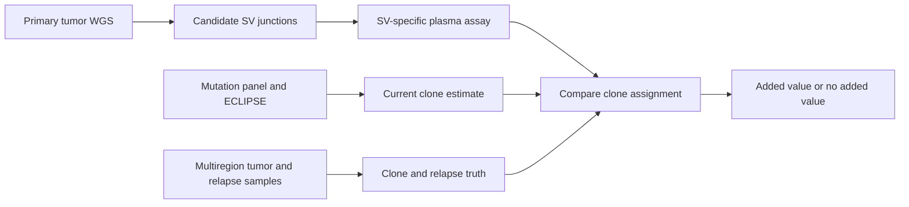

# Independent SV research direction scout — 2026-11-06

## Decision

**Conditional lead: test whether tumor-specific structural-variant (SV) breakpoints add information about relapse-seeding clones in early-stage non-small-cell lung cancer (NSCLC), beyond the current mutation-based ctDNA analysis.**

This is a clinical and tumor-evolution question. It does not test callset formatting or generic expression associations. The TRACERx data are named and requestable, but the required patient-level join is not verified. Run a source and access check first. Do not start an assay, data analysis, or experiment until that check passes.

### Research question

When plasma contains DNA from more than one tumor clone, do exact SV junctions identify which clone seeds a later relapse more clearly or earlier than the current mutation panel and ECLIPSE analysis?

The possible benefit is better identification of patients who carry an early metastatic clone after surgery. This could improve risk groups for adjuvant treatment. A positive result would not show that SV-guided treatment improves survival.

## Prior art and novelty boundary

| Primary source | What it already shows | Limit for this question |
|---|---|---|
| [Abbosh et al., Nature (2023)](https://www.nature.com/articles/s41586-023-05776-4) | In 197 TRACERx patients, the team tracked a median of 200 mutations across 1,069 plasma samples. ECLIPSE estimated subclonal composition and identified clones that later seeded metastases. | This is a strong mutation-based lineage baseline. It does not test whether SV junctions improve clone assignment. The article says the cfDNA and multiregion tumor data are in controlled-access EGA records. |
| [Noorani et al., Nature Genetics (2020)](https://doi.org/10.1038/s41588-019-0551-3) | Whole-genome sequencing and phylogenetic analysis of 388 samples from 18 esophageal adenocarcinoma cases showed early spread by multiple tumor subclones. The analysis reports structural variants in the primary and metastatic genomes. | Tumor WGS phylogeny and SV analysis are established. This study does not establish the proposed SV-breakpoint ctDNA comparison in early NSCLC. |
| [Comparison of tumor-informed and tumor-naïve ctDNA assays, EMBO Molecular Medicine (2023)](https://pmc.ncbi.nlm.nih.gov/articles/PMC10245040/) | The study compared SV and SNV assays in 54 plasma samples from seven breast-cancer patients. In that set, every sample detected by the SV multiplex assay was also detected by the SNV hybrid-capture assay; two more samples were detected by the SNV assay after its INVAR analysis. | A broad claim that SV markers outperform mutation markers is already unsupported by this direct, small comparison. The proposed question is clone-level information in NSCLC, not general ctDNA sensitivity. |
| [Elliott et al., Clinical Cancer Research (2025)](https://aacrjournals.org/clincancerres/article/31/8/1520/754517/Ultrasensitive-Detection-and-Monitoring-of) and [extended TRACER analysis (2026)](https://doi.org/10.1016/j.esmoop.2026.108337) | These studies report an SV-based digital PCR assay in early breast cancer. The first included 100 patients and 568 plasma timepoints. The extension included 121 patients, 30 recurrences, and reported that 79% of primary-tumor SV markers remained detectable in plasma at recurrence in 17 evaluable patients. | SV-based ctDNA detection and recurrence association are already reported. These studies do not test whether an SV marker assigns a relapse-seeding clone beyond ECLIPSE in NSCLC. The 2026 report is an extension of the same TRACER cohort, not an independent replication. |

**Novelty claim to test:** the possible contribution is a matched, patient-level comparison of SV-junction clone assignment with the mutation-based TRACERx lineage result, with relapse tissue as truth. Do not claim a new SV ctDNA assay or general SV superiority. A bounded search found no direct study of this exact comparison. That does not prove that no such study exists.

## Dataset and baseline

| Resource | What the record supports | Access and open question |
|---|---|---|
| [TRACERx cfDNA and multiregion exome study, EGAS00001006494](https://ega-archive.org/studies/EGAS00001006494) | The EGA record lists cfDNA sequencing and multiregion tumor exome data. The associated 2023 study includes plasma, primary tumor, and relapse analyses. | Controlled access. The public record does not establish a sample-level join to every WGS case or confirm that raw cfDNA reads cover any SV breakpoint. |
| [TRACERx multiregion exome dataset, EGAD00001009825](https://ega-archive.org/datasets/EGAD00001009825) | The EGA record lists 2,193 samples from the 421-patient cohort. | Controlled access. Exome data do not guarantee that a breakpoint is covered or that an SV can be assigned to each region. |
| [TRACERx tumor-normal WGS dataset, EGAD50000001693](https://ega-archive.org/datasets/EGAD50000001693) | The record lists paired tumor and normal WGS for 260 patients (520 samples). It says the cohort had serial blood collection and about five years of follow-up. | Controlled access through DAC `EGAC00001000632` and a data-access agreement. Public metadata do not verify exact overlap with the ECLIPSE cohort or access to stored plasma for a new SV assay. |

The primary baseline is the published patient-specific mutation panel plus [ECLIPSE](https://github.com/amf71/ECLIPSE). The 2023 article reports a median of 200 tracked mutations and lineage estimates from plasma. The authors state that ECLIPSE is for academic, non-commercial use. A new study must use the published analysis as a fixed comparator, not weaken it.

The SV arm would use patient-specific junctions from tumor WGS. It would need plasma reads that span those junctions or stored plasma for a validated junction-specific assay. Existing mutation-panel reads may not cover the SVs. The data record alone does not prove that a new SV measurement is possible.

## Cheapest falsification test

Do a **metadata and source-only check** before any raw-data request or assay:

1. Confirm the patient IDs that overlap EGAD50000001693, EGAS00001006494, and the published ECLIPSE cohort.
2. For those patients, confirm that primary tumor WGS, serial plasma, relapse tissue, and clinical recurrence labels are available under the same approved access path.
3. Check whether the cfDNA files already contain molecules across the candidate SV junctions. If they do not, confirm that stored plasma is available for an SV-specific assay and that its use is allowed by the data agreement and consent.
4. Freeze the mutation-panel/ECLIPSE result and the criteria for an SV marker before viewing any new SV result.

**Stop** if there is no same-patient join, no independent relapse-tissue label, or no permitted plasma material. Treat missing access as a feasibility result, not a biological null. Do not download raw genomes to answer a metadata question.

If the gate passes, compare clone assignment in held-out patients at a fixed false-positive rate and matched plasma input. Count patients and independent relapse clones, not plasma timepoints, as the biological units. Test whether SVs add a correct seeding-clone assignment beyond ECLIPSE. Do not use a gain in ctDNA positivity alone as the primary result.

## What results would mean

| Result | Meaning |
|---|---|
| **Positive:** SV junctions identify additional relapse-seeding clones or make the assignment earlier, and the result agrees with relapse tissue in held-out patients at the fixed error rate. | SV junctions add lineage information to mutation-based ctDNA in this NSCLC cohort. This would support a complementary marker strategy. It would not show that treatment selected from the marker improves outcomes. |
| **Negative:** SV junctions add no correct clone assignments or no lead-time gain over ECLIPSE. | The current mutation panel may be sufficient, or SV markers may be too few, unstable, or hard to assay. This does not refute tumor SV biology or the published SV ctDNA results in breast cancer. |
| **Inconclusive:** required patient joins, plasma, or relapse tissue are missing, or the SV assay cannot meet the prespecified error rate. | The dataset cannot answer this question. Do not report this as evidence for or against a biological role. |

## Main risks and remaining uncertainty

- The SNV baseline is strong and already identifies relapse-seeding clones. The expected added value may be small.
- The direct SV-versus-SNV comparison in breast cancer found no overall SV sensitivity advantage in its seven-patient set. The proposed endpoint must remain clone assignment, not a claim that SVs are more sensitive.
- The breast-cancer SV assay studies report persistence of many primary-tumor markers, but also show that some markers are not detected at recurrence. A missing plasma marker could reflect tumor evolution, low shedding, or assay dropout. It is not proof that a clone disappeared.
- TRACERx records are controlled. Public metadata do not prove the exact patient-level overlap, consent for a new assay, or availability of relapse tissue WGS. This is the main feasibility risk.
- Tumor tissue phylogenies already use SV information. The narrow contribution would be a test of SV junctions in plasma against a strong mutation-based lineage baseline and independent relapse tissue. A wider review could still find closer prior art.

## Search and work record

- Search date: **2026-11-06**. I reviewed the repo's recent direction notes and searched its research files for ctDNA, circulating tumor DNA, MRD, and breakpoint tracking. I found no prior ctDNA direction in those notes. The closest existing work concerns complex-path evaluation, MEI interpretation, RNA data feasibility, inversions, ecDNA, and mosaic or repeat questions; this proposal is separate from those directions.
- I used Exa and Parallel Search to find primary papers and EGA records. I used the local Life Sciences Literature NCBI Entrez workflow for PubMed searches and metadata. The primary article pages, EGA records, PubMed records, and the ECLIPSE repository were checked directly.
- Plugin discovery found Firecrawl and Scite installed. The Firecrawl search and scrape tools were not exposed in this session; I did not treat Firecrawl as a CLI. Scite search calls were blocked because the connected account has no paid plan or trial. Plugin search found no separate Life Sciences Literature connector; the local NCBI Entrez skill was available. Exa, Parallel Search, and NCBI Entrez were the working alternatives.
- The search was bounded. It supports a conditional lead, not a field-wide novelty claim. The active model and effort were not independently attested by runtime metadata.
- No raw genome or plasma data were downloaded. No repository code, raw-data analysis, experiment, test, or compute job was run. No historical result was edited. This scout is the only file written for this task.
