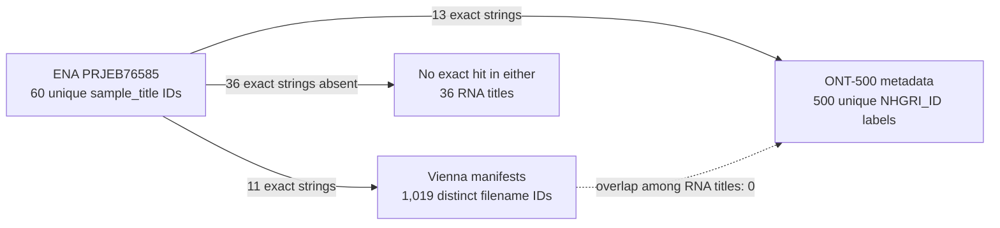

# Independent audit: paired DNA/RNA source crosswalk

**Date:** 2026-11-06

**Scope:** [feasibility note](2026-11-04-paired-dna-rna-feasibility.md), both `analysis/crosswalk_*metadata.py` scripts, and the `results/paired_dna_rna_*` packets.

**Result:** the reported exact-match counts reproduce. They describe metadata labels and listed objects. They do not establish that DNA and RNA came from the same aliquot or cell-line passage, that an SV is present, or that a usable RNA outcome exists.

## Counts and exact identifiers



| Check | Independent result | Assessment |
|---|---:|---|
| ENA read-run rows / unique run IDs | 60 / 60 | Confirmed |
| Distinct ENA `sample_title` values | 60 | Confirmed; one title per run |
| Vienna IDs across the three manifests | 1,019 | Confirmed after exact filename parsing and set union |
| RNA titles exactly in Vienna | 11 | Confirmed |
| ONT-500 metadata rows / unique `NHGRI_ID` | 500 / 500 | Confirmed |
| ONT-500 exact RNA-title matches | 13 | Confirmed |
| Exact RNA-title matches in both DNA sources | 0 | Confirmed; the 11 and 13 sets are disjoint |
| RNA titles with neither exact match | 36 | Confirmed; this is not evidence that no other DNA source exists |

**Vienna exact matches (11):** `HG00098`, `HG00099`, `HG00100`, `HG00101`, `HG00103`, `HG00111`, `HG00117`, `HG00124`, `HG00128`, `HG00149`, `NA10851`.

**ONT-500 exact matches (13):** `HG00102`, `HG00110`, `HG00112`, `HG00115`, `HG00116`, `HG00119`, `HG00121`, `HG00126`, `HG00142`, `HG00238`, `HG00253`, `HG00262`, `HG00263`.

**Neither source (36):** `HG00104`, `HG00118`, `HG00138`, `HG00249`, `HG00260`, `HG00265`, `NA06985`, `NA07037`, `NA07051`, `NA07357`, `NA10847`, `NA11831`, `NA11840`, `NA11894`, `NA11918`, `NA11992`, `NA11993`, `NA11994`, `NA12005`, `NA12156`, `NA12249`, `NA12275`, `NA12286`, `NA12383`, `NA12489`, `NA12750`, `NA12760`, `NA12761`, `NA12762`, `NA12763`, `NA12776`, `NA12812`, `NA12813`, `NA12814`, `NA12815`, `NA12873`.

The full per-run rows and source hashes remain in the [Vienna crosswalk](../../results/paired_dna_rna_crosswalk_20261104_run01/crosswalk.json) and [two-source crosswalk](../../results/paired_dna_rna_ont500_crosswalk_20261104_run01/crosswalk.json).

## Join and source alignment

- The ENA query is for `PRJEB76585` read runs. The two saved reports have the same 60 unique run accessions. For every run, `study_accession`, `sample_accession`, `sample_alias`, `secondary_sample_accession`, and `library_strategy` agree. All study accessions are `PRJEB76585`; the reported strategy is `OTHER`.
- `sample_alias` contains labels such as `LCLs-1`. The join correctly uses the ENA `sample_title`, which contains the `HG...` or `NA...` label. The title report and the authors’ pinned transcript-quantification script both contain 60 unique IDs, with exact equality. The pinned script is at commit `70f64b309fd3325ec518857270b78d5f4e2a80f9`; its fetched bytes have SHA256 `6edabdef945f36a2445a004dffcd259574c5cfcf81b212973ec191e72b8132df`, matching the crosswalk record.
- The Vienna parser accepts only listed filenames under `hg38/`, `t2t/`, or `gaf/`, with the expected `HG`/`NA` sample-name and file suffix patterns. The three manifests contain overlapping snapshots. The union has 1,019 distinct labels; it is not a count of manifest rows. Each of the 11 exact RNA matches has a listed hg38, T2T, and graph-alignment filename. The file bodies were not checked.
- The ONT-500 join uses only exact `sample_title == NHGRI_ID` string equality. The table has 461 `HG` labels, 39 `GM` labels, and no `NA` labels. No `GM`↔`NA` conversion or digit-based alias is justified by these inputs, and none was applied.
- The S3 listing contains 1,000 unique keys for the `ALIGNED_TO_HG38/SNIFFLES_v2.6.2/` prefix. Its XML says `IsTruncated=false` and has no continuation token. Direct parsing finds one `.vcf.gz` object and its `.csi` for each of the 13 exact ONT-500 matches. This verifies listed object names and metadata only. No variant body or index was downloaded; ETags do not verify content.

## Provenance, assembly, and limits

- The [ENA project record](https://www.ebi.ac.uk/ena/browser/view/PRJEB76585) and the saved ENA Portal API response identify the RNA source. ENA labels and an author-code list support a sample-name match; they do not prove donor identity, aliquot identity, passage, or assay comparability.
- The official [Vienna manifest set](https://ftp.1000genomes.ebi.ac.uk/vol1/ftp/data_collections/1KG_ONT_VIENNA/1KG_ONT_VIENNA_manifest_20240215.tsv) lists hg38, T2T, and graph paths. The pinned RNA author script sets `gencode.v46lift37.annotation.gtf` and `hg19.fa` ([source lines 87–89](https://github.com/aline2593/DRS-LCLs-qtl-analysis/blob/70f64b309fd3325ec518857270b78d5f4e2a80f9/scripts/02_transcript_quantification/04_bambu_transcript_quantification.R#L87-L89)); [GENCODE release 46](https://www.gencodegenes.org/human/release_46lift37.html) is mapped to GRCh37. The ONT-500 S3 prefix is hg38; its [README](https://s3.amazonaws.com/1000g-ont/PROCESSED_DATA/READ_ME.txt) also describes GRCh38 and CHM13 v2.0 resources. A locus-level comparison therefore needs an explicit reference choice and verified coordinate reconciliation.
- The Vienna [data-reuse statement](https://ftp.1000genomes.ebi.ac.uk/vol1/ftp/data_collections/1KG_ONT_VIENNA/README_1KG_ONT_VIENNA_datareuse_statement.md) says users should cite the project and reserves first presentation/publication of global analyses until the first major project paper. The [Nature paper](https://doi.org/10.1038/s41586-025-09290-7) was published in 2025. The saved note appropriately leaves study-specific reuse conditions for review.
- **Provenance wording risk:** the feasibility note links the 2024 [ONT-500 paper](https://pmc.ncbi.nlm.nih.gov/articles/PMC11610458/), whose abstract and methods describe the first 100 samples. The S3 [metadata table](https://s3.amazonaws.com/1000g-ont/PROCESSED_DATA/1kGP_LRSC_500_ONT_Metadata.tsv) and adjacent README describe the first 500 samples. The 500-row exact-name count is verified from that metadata file, but the paper should not be read as validating all 500 rows or all 13 listed VCF/CSI pairs.
- The counts do not establish call quality, allele presence/absence, read depth at a locus, transcript coverage, usable outcomes, independent samples, power, novelty, or publication readiness. The 36 exact non-matches are non-matches to these two metadata sets only. Relatedness and haplotype correlation remain unresolved.

## Receipts, errors, and integrity checks

- All source-file SHA256 values and byte counts that could be checked against the Vienna/ENA and ONT retrieval receipts matched. The ONT local-curl and cluster-curl files are byte-identical: metadata `14,811` bytes, SHA256 `cb7721f68f524a1d7cda4fa25bbe8da0f357998a129a720601a3f5252763acb0`; README `2,252` bytes, SHA256 `f3c5a68cb76d62cf22935ca205177181682971922d724afe825b6570c1d96846`.
- The source packets record retrieval on 2026-11-03 UTC. The counts below apply to those snapshots; I did not re-download the Vienna, ENA, or ONT tables to refresh them.
- Both crosswalk receipts match the current script SHA256 and saved `crosswalk.json` SHA256. Vienna output/script SHA256: `5b214a19e2d5066c91ca2eb9a9a8f6b8829130b9e3b0fa3eedf13a990f11bc2c` / `4e00e7333a24fe2029a94b0e85a2fc2905a3c988f16c35873530fa10a278f151`. ONT output/script SHA256: `2f9203808324b4e08b07d99f50272cc54730f5a1454762327b4d13d3248f7eb7` / `07bb900b725f9927193f3a92951e99638f6584bdbc3226e45015b8514d022331`. All eight retrieval/crosswalk script hashes in the local receipts also match the current scripts. The two-source crosswalk’s input hash matches the saved Vienna crosswalk.
- The raw S3 XML matches its recorded size (`378,290` bytes) and SHA256 `38b365a2421f62967f63f5cc10c90ad552fffc7c3c2b96806526391ddb1439e1`. Its `summary.json` script and crosswalk hashes match. This packet uses `summary.json` as its retrieval record; it has no separate `receipt.json`.
- **Recorded retrieval errors:** the first Python ONT-500 request timed out for both URLs. The local curl metadata stderr records a 35-second timeout before the successful retry; the resulting file has HTTP 200, the recorded byte count, and the expected hash. The cluster-curl receipt records exit code 0 and matching bytes/hashes but does not record an HTTP status. An Exa fetch of the ENA browser page returned `SOURCE_NOT_AVAILABLE`; the exact saved ENA API report was available and used for row checks.
- Plugin discovery found Scite and Firecrawl installed; Exa and Parallel Search tools were callable. No Firecrawl tool appeared in the active tool inventory, so Exa was used for external source discovery and retrieval. The facts above are tied to primary records: ENA, IGSR/EBI manifests and policy, the original ONT archive README/table, the pinned authors’ repository, GENCODE, and the original papers.

## Read-only audit commands and evidence

From the repository root, the audit used `git status --short --branch`, file listings, source/script inspection, SHA256 recomputation, and direct table/set parsing. The following compact command reproduces the three principal label counts without writing files:

```sh
python3 - <<'PY'
import csv, re
from pathlib import Path
r = Path('results')
def rows(p):
    with p.open(newline='') as f:
        return list(csv.DictReader(f, delimiter='\t'))
rna = rows(r/'paired_dna_rna_ena_titles_20261104_run01/ena_titles.tsv')
titles = {x['sample_title'] for x in rna}
pattern = re.compile(r'(?:^|/)(?:hg38|t2t|gaf)/((?:HG|NA)\d{5})\.(?:hg38\.cram|t2t\.cram|gaf\.gz)$')
vienna = set()
for name in ('vienna_manifest.tsv','vienna_manifest_20240112.tsv','vienna_manifest_20240215.tsv'):
    with (r/'paired_dna_rna_metadata_20261104_run01/sources'/name).open(newline='') as f:
        for row in csv.reader(f, delimiter='\t'):
            if row and (m := pattern.search(row[0])): vienna.add(m.group(1))
ont = {x['NHGRI_ID'] for x in rows(r/'paired_dna_rna_ont500_metadata_20261104_run02/ont500_metadata.tsv')}
v, o = titles & vienna, titles & ont
print('runs/titles/vienna/ont500:', len(rna), len(titles), len(vienna), len(ont))
print('Vienna exact:', sorted(v))
print('ONT exact:', sorted(o))
print('both/either/neither:', len(v & o), len(v | o), len(titles - (v | o)))
PY
```

No tests, sequencing-data downloads, model runs, or expensive jobs were run. The only write from this audit is this report. The shared worktree status changed during the audit; the named source files remained present, and those concurrent changes are not attributed to this report.

**Runtime note:** the available session tools do not expose independent model or effort telemetry. I cannot verify a runtime model or effort setting from a requested tool setting, so I make no such claim.
