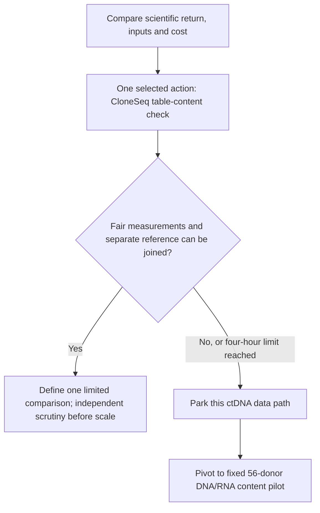

# Scientific investment decision — 6 November 2026

**Preservation note, 2026-11-22:** The requested Sol/max agent wrote this
document, then its runtime reported a usage-limit error; a clean completion
status was not observed. Treat it as a substantive draft, not a completed
or backend-attested decision. The objective file cited below was an older
version; the current objective is
`/Users/akm/.codex/attachments/34af66bd-92f0-4bb5-a643-a923e8175fd8/goal-objective.md`,
SHA256 `838c0d99de12aa10d9d4ee26bd14e9c89fe75e12853de0f050b26132d8553a3c`.
The versions differ in the requested orchestrator/reviewer model settings;
their stated scientific goal is otherwise unchanged. Independent review of
the proposed content check is being requested.

**Select exactly one next action: a four-hour content check of the public CloneSeq-SV supplementary tables, with a fixed denominator of 24 patients.** Test whether these tables can support a fair comparison of added clone information from SVs over a strong SNV analysis. Use the existing workbook. Do not start with TRACERx access applications, raw sequencing, a new assay, or model training.

This is a bounded missing-content check, not acceptance of ctDNA as the project thesis. The important uncertainty is now the meaning and linkage of available measurements. A separate metadata check has established that small public tables exist. Another filename inventory would add little. No experiment was executed for this decision.

Stop the current interoperability case as a publication lead. Keep paired population DNA/RNA as the concrete fallback. Its accessible inputs justify a cheap pilot; neither the age of HGSVC2 nor moderate compute is a scientific reason to reject it. Its broad proposed contributions, however, have much closer prior work than a sample-overlap count suggests.

**Basis and read scope.** The governing [objective](/Users/akm/.codex/attachments/2fa04b13-b328-4023-872e-0c4cc9dbfaee/goal-objective.md) has SHA256 `74ba6450712e7f0e763cd81de896d3a71ca73f9c4a10fec3f1ecab59b3f1b0b8`. It prioritizes useful, novel science, permits a broad pivot, excludes DeepSV as the new foundation, and asks for cheap falsification before large compute. I read the current authoritative checkpoint in [PROGRESS](../../PROGRESS.md), its relevant earlier investment stops, the [corrected direction scout](2026-11-06-independent-direction-scout.md), [paired feasibility](2026-11-04-paired-dna-rna-feasibility.md), [interoperability review](2026-11-06-independent-interop-review.md), [Vienna header report](2026-11-06-vienna-vcf-header-feasibility.md), and [HGSVC2 header protocol/result](2026-11-06-hgsvc2-vcf-header-protocol.md). I also read relevant complex-path, mixture, engineered-SV and yeast decisions. I did not read the separate Terra paired-science review.

**Investment comparison.** These are judgments about the present opportunities, not measured probabilities of success. Scientific value, chance of obtaining a useful result, and access cost are separate columns.

| Direction | Significance if a distinct claim works | Likely return from the present evidence | Access and cost | Decision now |
|---|---|---|---|---|
| Existing BND interoperability case | A demonstrated change to a real analysis decision could matter. | High chance of reproducing a serialization mismatch; low chance that this known mechanism alone supports a new paper. Prevalence and practical harm are unmeasured. | Existing small fixtures and callsets; inexpensive. A real independent production chain is missing. | Retain the regression case; stop publication investment in this case. |
| Population SVs and direct-RNA transcripts | A new, reproducible mechanism or correction to a consequential interpretation could be important. | A large common effect could be measurable in 56 donors. Rare effects, conditional attribution and a distinct contribution are much less secure. Generic associations are already established. | Public DNA genotypes and small RNA products. Coordinate and allele reconciliation need work, but are tractable. | Best accessible fallback; do not launch another generic SV-QTL study. |
| SVs for relapse-seeding clones in NSCLC | High clinical and evolutionary value if they add correct, timely assignments beyond ECLIPSE. | Unknown added value over strong SNV methods. CloneSeq-SV removes broad novelty. A new cancer label alone is insufficient. | Controlled patient joins; existing mutation-targeted plasma assays may not measure the junctions. New capture or stored plasma could dominate time and cost. | Do not fund a TRACERx campaign now. |
| A narrower CloneSeq-SV reanalysis | Useful if it establishes when junctions add clone information at a defensible assay budget, beyond the published comparison. | Uncertain scientific residual, but the public workbook makes the next feasibility question cheap and decisive. Summary frequencies alone would be insufficient. | About 19 MB for the retained workbook. Raw data remain controlled; processed-data permissions and semantics need checking. | Allocate the one four-hour check below. |
| Explicit complex-path or minority-specific-allele inference | A material error in an asserted derivative path or minority allele could support a strong methods contribution. | Important residual questions remain, but the repo has not verified the needed explicit caller paths or an independent hard-allele contrast. | Public calls and selected sequence may suffice; bulk genomes are not automatically necessary. | Keep as alternatives, not an automatic continuation of existing cases. |
| Engineered rearrangements and dosage-matched yeast architecture | A controlled causal contrast can be stronger than an observational QTL. | Existing repo sources do not yet join exact alleles/ordered paths, segment dosage and adequate quantitative outcomes. | Some public small tables exist. Missing joins, rather than file age, block the specific contrasts. | No repeat inventory or campaign now. |

The last two rows are not dismissed because no caller error is known in advance, because a phenotype rescue is absent, or because compute could exceed a scout's small allowance. A sequence-inference question needs suitable sequence evidence; it does not universally need clinical outcomes. The [complex-path review](2026-11-03-complex-path-prior-art.md) identifies strong existing comparators and the missing explicit path. The [MIMS resource](https://github.com/BCM-HGSC/SMaHT_MIMS) already supplies physical-mixture benchmarking and important allele-matching controls. A new confidence curve needs a residual beyond those controls. The [synVII crosswalk](2026-11-03-synvii-archive-crosswalk.md) supplies archive membership, not the required structure/dosage/fitness contrast. The [edited-SV checkpoint](2026-10-13-comparator-checkpoint.md) also warns against relabeling guide abundance as confirmed allele fitness.

**Why the interoperability lead stays closed.** The primary reports are [SnpEff issue 237, opened in 2019](https://github.com/pcingola/SnpEff/issues/237) and [issue 516, opened in 2024](https://github.com/pcingola/SnpEff/issues/516). They already describe BND ALT uppercasing; the earlier report discusses downstream consequences. The repo adds useful version-specific comparator and validator examples. It does not establish a new producer mechanism, biological FP/FN counts, or clinical harm. The independent review also found stale `ANN` alleles in all 66 altered records. That transformed file is not an annotation-consistent corrected release. Consumer exact-string matching is not itself evidence of a bug. A wider production-impact study could be worthwhile with new evidence, but another synthetic replay is not the best next investment.

**What the paired names establish.** Keep these denominators separate:

| Evidence | Count and interpretation |
|---|---|
| Direct-RNA names and FLAIR header | 60 distinct names; count-file header covers all 60. No usable RNA feature is established by a column name. |
| HGSVC2 PanGenie VCF header | 56 of the 60 names among 3,202 columns. These are short-read genotypes of assembly-discovered variation, not 56 individually assembled DNA genomes or truth labels. |
| Vienna phased VCF header | Nine names: `HG00099`, `HG00100`, `HG00101`, `HG00103`, `HG00111`, `HG00117`, `HG00128`, `HG00149`, `NA10851`. All nine are within the 56. Thus 56 plus nine still means 56 distinct RNA donors. |
| Other long-read DNA metadata | Eleven Vienna alignment names plus 13 disjoint ONT-500 names give 24 metadata matches. Alignment membership differs from membership in the checked phased VCF. |
| Three-source union | 58 names, mixing VCF-column and metadata evidence. This is not 58 verified matched alleles, aliquots or independent observations. |

The HGSVC2 VCF is about 1.75 GB; the Vienna phased file is about 73.8 MB; the retained FLAIR count file is 7,577,751 bytes. These are reasonable inputs for bounded work. The HGSVC2 release's age affects ascertainment and comparison, not eligibility by itself. The nine Vienna samples can help check allele representation; they do not automatically validate the other 47 donors or make the callset ground truth. Its CHM13/graph context, HGSVC2's GRCh38-based discovery, and the RNA workflow's GRCh37 coordinates need explicit reconciliation. A chain-file position match alone does not establish allele identity. [Primary HGSVC2 study](https://pmc.ncbi.nlm.nih.gov/articles/PMC8026704/), [Vienna study](https://doi.org/10.1038/s41586-025-09290-7), [RNA analysis repository](https://github.com/aline2593/DRS-LCLs-qtl-analysis).

The prior work is substantial:

| Primary source | Occupied contribution | Residual a new pilot would have to earn |
|---|---|---|
| [Ebert et al., Science 2021](https://pmc.ncbi.nlm.nih.gov/articles/PMC8026704/) | SV expression and splicing QTLs in 427 donors, including comparison with linked small variants. | A specific transcript or inference problem beyond repeating SV-QTL discovery. |
| [Logsdon et al., Nature 2025, HGSVC3](https://www.nature.com/articles/s41586-025-09140-6) | Donor-haplotype Iso-Seq analysis in 12 individuals, SV-containing gene isoforms and nearby expression differences. | A demonstrated consequence beyond simply combining phased SVs and long-read isoforms. |
| [Lu et al., 2026 preprint](https://www.biorxiv.org/content/10.64898/2026.07.01.735728v1.full) | Pangenome versus standard-call expression association, fine-mapping and prediction in 430 AFGR donors; also a 201-sample HPRC analysis with Kinnex RNA data. | Neither a generic pangenome-expression advantage nor the mere addition of long RNA reads is enough. |
| [Réal et al., version 2 preprint](https://www.researchsquare.com/article/rs-4613444/v2) and [public data](https://zenodo.org/records/18763244) | The actual 60-donor resource already studies transcript-SNP QTLs and alternative transcript quantification. Version 2 reports 87 trQTLs. | A precise SV-specific question with linked-SNV, mapping and transcript-ascertainment controls. |

The repo also records gene-assignment exclusions in the RNA analysis. An excluded or newly observed transcript is not automatically an SV effect or a publication contribution. A common large effect can be tested with 56 donors without pretending to have rare-variant fine-mapping power. Sparse carrier counts must yield wide uncertainty or non-evaluability, not a biological null. Repeated runs, relatives, correlated alleles and transcript rows cannot inflate the independent denominator. The public [GTEx MEI study](https://doi.org/10.1186/s13059-020-02101-4) and the repo's [MEI review](2026-11-04-mei-prior-art-check.md) further limit generic insertion/splicing claims.

**The corrected ctDNA boundary.** [Williams et al., Nature 2025](https://www.nature.com/articles/s41586-025-09580-0) is direct clone-level prior art. CloneSeq-SV combines single-cell tumor WGS and targeted SV capture in longitudinal ovarian-cancer cfDNA. It reports both SV- and SNV-derived clone frequencies and off-target error rates. It uses raw SV reads and duplex-consensus SNVs. Its cfDNA-WGS validation covers 12 samples from six patients; 11 samples had concordant dominant-clone assignments. This is internal orthogonal validation, not 12 independent patients or proof of incremental relapse-seeding accuracy. The article's 24 tissue patients and 18 longitudinal recurrence patients are different denominators. Its published frequency processing includes calibration, normalization, smoothing and an SV-based low-tumor-fraction exclusion. The paper lists raw data at dbGaP `phs002857.v3.p1` and processed data at Synapse `syn66399325`; neither statement establishes unrestricted access to every required field.

The remaining high-value question is conditional: **when material or sequencing is limited, do SV junctions add independently correct clone assignments beyond an optimized SNV analysis, at a stated error rate and assay cost?** The previous study may already contain much of that answer. Its methods and code must be checked before claiming the residual. A change to NSCLC or to the name of the comparator is not enough.

[Abbosh et al., Nature 2023](https://pmc.ncbi.nlm.nih.gov/articles/PMC7614605/) already uses ECLIPSE to track subclonal composition and metastatic dissemination. Its patient-specific anchored-multiplex PCR panels target selected mutations identified from tumor exomes. These reads must not be assumed to cover arbitrary SV junctions. [The later 260-patient tumor/normal WGS record](https://ega-archive.org/datasets/EGAD50000001693) does not prove overlap with the relevant plasma, relapse samples or assay targets. Access approval cannot create molecules that were never captured. New capture could be scientifically justified, but that is an assay and material investment, not a cheap computational reanalysis. The separate [2023 breast-cancer assay comparison](https://pmc.ncbi.nlm.nih.gov/articles/PMC10245040/) also demonstrates why optimized mutation integration is a necessary sensitivity control.

**The selected four-hour check: exact question and inputs.** Test this feasibility premise:

> The published CloneSeq-SV products contain enough linked measurement, control and reference information to support a fair, patient-level test of added SV clone information, without using the SV estimate as its own truth.

The user's separate [metadata packet](../../results/cloneseq_workbook_metadata_20261106_run01/metadata.json) changes the practical decision. Its [receipt](../../results/cloneseq_workbook_metadata_20261106_run01/receipt.json) records a complete 18,466,636-byte public archive, matching publisher MD5 `053c2a18cbd1da4a250efc78e49b57e7`, and two verified member CRCs. I read the metadata and receipt, not the workbook rows, and did not independently repeat those binary checks. Fourteen sheet names and their declared dimensions are verified metadata. Dimensions are not observed record counts, complete joins, measurement definitions or usable truth.

Use only these concrete inputs initially:

| Input | Purpose in the proposed check |
|---|---|
| `/Users/akm/aayushkrm-AlignSSL/runs/cloneseq_workbook_metadata_20261106_run01/SupplementaryTables.xlsx` | S1 coverage; S2 tumor fractions; S3/S4 published SV/SNV frequencies; S5 clone features; S6 error rates/LOD; S7/S8 individual read counts; S9/S10 marker metadata; S11–S14 clinical, recurrence, CA125 and surgery annotations. These roles are from metadata/legends, not inspected patient values. |
| `SupplementaryTables-legends.docx` in the same directory | Establish units, keys, inclusion rules and field definitions. |
| [Williams methods](https://www.nature.com/articles/s41586-025-09580-0) and [author figure code](https://github.com/shahcompbio/spectrum_cfdna_figures) | Trace derived quantities, exclusions and reference provenance. Pin the inspected code revision; do not execute bundled analysis. |
| The named Synapse record, metadata only if needed | Locate a specifically missing field or independent-reference product. Do not assume public download permission or request controlled sequencing to complete this check. |

**Fixed denominator and scope.** The screening denominator is all **24 diagnosis/tissue patients** reported by Williams, including patients with no usable paired measurement. Recover and freeze the complete roster from the metadata sheets before assessing quantitative comparisons. Retain unmatched or conflicting IDs. If the roster does not reconcile to 24, report that discrepancy; do not silently substitute another subset. The 18 longitudinal patients are a prespecified nested group. The six patients with cfDNA WGS are another nested group, with two samples each. They are not 12 independent patients.

Build one **24-by-8 status table**, with PRESENT, ABSENT, or UNRESOLVED for each field below, plus the exact supporting file, key and definition. Retain all 192 status cells. A declared sheet or a nonempty cell cannot alone earn PRESENT.

| Required information | What the content check must establish |
|---|---|
| 1. Patient, specimen, time and clone keys | Exact joins across marker, count, frequency and clinical tables; distinguish technical repeats and off-target patients. |
| 2. Marker-to-clone evidence | Which markers are private, shared or truncal; baseline clone assignments and copy-number/calibration information; missing or failed marker designs if supplied. Do not infer exclusivity from a label alone. |
| 3. Measurements and denominators | Per-marker alternate and reference/total counts for both classes; raw, simplex, duplex and molecule units; zero count versus an unmeasured target. Do not manufacture a zero for an absent row. |
| 4. Comparable assay effort | Same plasma specimen/input where available, target numbers, coverage and raw sequencing or library accounting. Determine which budget can actually be matched. Average coverage alone does not prove equal input or cost. |
| 5. Error controls | Off-target exposure denominators, patient/marker assignment and processing type; whether controls can be separated from threshold fitting. Patient-level error summaries may not support marker-level resampling. |
| 6. Analysis timing and exclusions | Availability of unsmoothed measurements, observed sampling times, low-fraction exclusions and calibration provenance. Determine whether eligibility was selected using the SV result. |
| 7. A separate reference | Patient/timepoint-linked cfDNA-WGS or other independently measured clone evidence; what distinguishes the competing clones; library and label provenance. A published aggregate concordance or the targeted-SV frequency itself is insufficient. |
| 8. Reuse and reproducibility | Accessible required products, applicable reuse conditions, source versions and a complete exclusion/missingness record. Record controlled-only fields explicitly. |

Read all relevant public count and marker rows for this check once its protocol is accepted; do not choose favorable patients or a convenient prefix. Validate count meanings and joins with the legends and code. Report distinct patients, clones, paired specimens and controls separately. Keep clinical outcome values out of any feature or threshold construction. Published S3/S4 frequency tables can check how quantities were derived; they cannot supply independent labels for their own accuracy.

This is a content/eligibility falsifier. It does not fit a new predictor, compute an SV-versus-SNV performance claim, tune a cutoff, or treat missing fields as negative biology. It must end with an explicit answer about which comparison is estimable, its patient denominator, and exactly what information is missing. It is more than another declaration that files are listed.

**Controls the check must make possible.** These are proposed controls for the eventual comparison; the selected check establishes their availability and meaning.

| Threat | Necessary comparison or control |
|---|---|
| Weak SNV baseline | Preserve the native multi-marker SNV analysis and its error correction. Compare SNVs alone with SVs plus SNVs; SVs alone are a secondary arm. Do not substitute TP53 alone. ECLIPSE is mandatory for an eventual compatible NSCLC claim, not an assumed drop-in method for the ovarian data. |
| Unequal material or sequencing | Pair specimens. Match the observable material/sequencing budget and report marker count as a separate sensitivity axis. Do not equate raw SV reads with independent molecules or discard legitimate duplex processing to make SNVs weaker. Normalized frequencies cannot be downsampled as reads. |
| Background and amplification | Use off-target controls, copy-number calibration and private versus truncal markers. Report amplified-marker effects explicitly; they can be a real advantage, but cannot silently become evidence of better clone specificity. Zero observed errors do not imply a zero population error rate. |
| Circular truth or future leakage | Freeze clone definitions/calibration from baseline material. Keep a separate reference measurement and all future information out of prediction. Evaluate only clone contrasts that the reference can distinguish. No interpolation across future visits for a prospective claim. |
| Reuse of this cohort | All public rows are development evidence for this project. Patient-disjoint fitting can reduce leakage within reuse; it is not external replication. Repeated visits, markers and raw reads do not increase the independent patient count. |

An independent recurrence-tissue phylogeny is required to claim correct **relapse-seeding lineage**. A distinguishable cfDNA-WGS clone signal can support a narrower dominant-clone measurement comparison. It is not the same truth object. Neither label is needed merely to audit count definitions or assay background. Thus missing clinical truth restricts the claim; it does not make every useful molecular diagnostic impossible.

**Outcomes and hard end point.** Allocate at most **four analyst hours, two CPU-hours and 4 GiB RAM**, within one working day after release of this proposed check. The existing workbook fits ordinary laptop analysis. Allow at most 100 MiB of additional small source/code/reference metadata; no cluster job, GPU, raw BAM/FASTQ, new assay or controlled-data application belongs to this action. These are limits on this next investment, not limits on the project or evidence that moderate compute is inappropriate.

| Outcome | Required report and decision |
|---|---|
| **Success: a fair limited comparison is identifiable** | Show the exact joined patients/specimens, measurement units, available budget, independent-reference provenance and control separation. State the supported endpoint. One fully linked case establishes case feasibility only; it does not establish cohort power or publication readiness. Proceed to one concrete analysis design and independent scrutiny, not an automatic campaign. |
| **Negative for this public-data path** | Show which essential information is actually absent or irretrievably derived, or that the proposed endpoint merely repeats the published comparison. Close this route for the current investment. A failed feasibility premise is not evidence that SVs add no biological information. |
| **Inconclusive** | An ambiguous key, access restriction, unresolved count unit or unavailable reference remains at the time limit. Record its exact identity and the cost/access route needed to resolve it. Close the bounded check and use the fallback; do not wait indefinitely for access or keep issuing inventories. |

There is no requirement that all 24 patients be complete, no arbitrary two-of-three success rule, and no requirement to prove an error before a diagnostic. Conversely, a few complete cases cannot support a population effect claim. If the joined subset is too small to distinguish a useful effect from no effect, that is a limitation to quantify in the subsequent design, not permission to call a null. Error targets, prediction horizon and a useful effect size must be set before comparative outcome inspection; this source check cannot honestly choose them from unseen assay units.

**Concrete fallback, conditional on failure or expiry of the selected check.** Park this ctDNA data path. Pivot the next bounded effort to a **chromosome-22 SV/transcript content pilot in the fixed 56 HGSVC2/RNA donors**. Use the named HGSVC2 biallelic no-SNV VCF, retained FLAIR counts, the deposited FLAIR transcript BED and RNA source annotation. Before RNA values, freeze all chromosome-22 sequence-resolved insertions/deletions of at least 50 bp that intersect annotated gene bodies, with every excluded or unresolved allele retained. Count carrier/noncarrier availability, missing GTs, transcript-ID/coordinate links and measurable RNA contrasts; do not select by QTL significance. Use the nine Vienna samples only as overlapping allele checks after reference reconciliation, with disagreement unresolved rather than automatically assigning one source as truth. The first deliverable is an allele/feature/callability table for all 56 donors, not another sample-name join. A later effect test needs linked-SNV, reference-mapping and transcript-discovery controls. The deposited BED may be only feature coordinates; do not assume it supplies exon chains or haplotype linkage.

This fallback has named public inputs and a fixed donor/locus rule. It can be attempted without new DNA calling or a genome-wide RNA remapping campaign. The public RNA [deposit](https://zenodo.org/records/18763244) lists the count and BED products; their biological suitability remains unverified. A useful residual could emerge from allele-specific measurement or interpretation, but a generic association or annotation omission would not suffice. This is the specified fallback, not a second action selected for execution now.

**Publication path and risk.** A fair result about when SV junctions improve correct clone assignment could guide assay design and tumor-evolution studies. A substantial clinical claim would additionally need the appropriate relapse truth, enough independent patients, realistic sampling and a strong ECLIPSE/SNV baseline. The important contribution would be added information under a defensible decision budget, not a new name for junction tracking. The main risks are an already-answered question, selected-marker ascertainment, unequal measurement units, calibration shared with the reference, non-distinguishable clones, low shedding, and too few independent reference patients. A weakly powered absence of gain is not a strong negative publication. A successful data join is not a publication result. The chosen small investment can establish whether a real test exists or prevent a much more costly misinvestment.

**Tools, runtime and authority.** I used the Exa research skill and its working search/fetch tools for primary papers, author issue reports and repositories. Three targeted searches requested 17 result slots; these are not 17 independently read papers. I read selected methods, results and availability passages. A PMC HGSVC3 fetch returned a browser check; the publisher primary source supplied the relevant analysis. An initial RNA DOI extraction mixed in version 1; the explicit version-2 page supplied the version-2 claims used here. The search is bounded and does not prove absence of closer work. Firecrawl tools were not exposed in this session; I did not presume a Firecrawl CLI or treat it as the exclusive research route.

The objective's Sol/Luna model and effort roles, the requested Sol/max decision role and the separate Terra reviewer label are configuration requests, not actual runtime attestations. I have no independently verified exact backend model/effort record for this decision or those reviewers. Working Exa calls and readable local metadata attest those operations only. This memo does not claim to contain the independent Terra review or authorize an expensive campaign or acceptance of a major positive result.

Only this decision note was written by this task. No final-test data, VCF variant rows, RNA values or CloneSeq patient rows were inspected. No experiment, test suite, cluster job, installation, commit or push was run. Other concurrent worktree files were left untouched.
