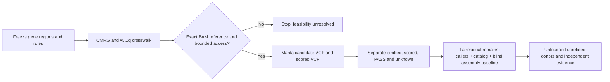

# Independent review of the hard-region candidate proposal

**Date:** 22 November 2026
**Scope:** Scientific critique and one inexpensive diagnostic. This is not a second investment decision.

## Assessment

The proposal identifies a worthwhile failure mode, but it has not yet shown a new method or an uncovered scientific contribution. A caller's emitted VCF can miss a truth allele for several reasons. The absence of a record does not show that the caller failed to generate an internal hypothesis. Also, blind insertion discovery from short reads and sequence assembly are established prior art.

The strongest remaining question is narrower: **can a frozen, blind method recover sequence-supported hard-region alleles beyond strong callers and an independently constructed population catalog, at a comparable and useful review burden?** Even a positive HG002 result would be development evidence. The question is conditional on an independent catalog, a valid sequence reference, a suitable negative evaluation domain and untouched donors. None is established by the NovaSeq packet alone.

The cheapest informative next experiment is a **small Manta candidate-versus-scored-output diagnostic on the pinned HG002 reads**, after the existing truth crosswalk and input-provenance gates. It tests whether a particular public caller emits eligible candidates before scoring. It does not test a new proposer, establish a caller-union ceiling, or prove novelty. Do not run it if its input identity or modest resource cap cannot be met.

## Check: what the NovaSeq packet establishes

The saved [header receipt](../../results/hg002_illumina_header_20261122_run01/receipt.json) pins the public 30× PCR-free HG002 BAM at generation `1607665356367383`, with 43,667,905,004 bytes. Its header has one Illumina HG002 read group, coordinate sort order, 3,366 contigs and BWA/duplicate-marking program records. The recorded ordered contig-name-and-length digest agrees with two published GRCh38 FASTA indexes. The header has **no contig sequence MD5s**. Name and length agreement does not prove base-for-base reference identity, and an `SM:HG002` label is not an independent sample fingerprint.

The accompanying [packet README](../../results/hg002_illumina_header_20261122_run01/README.md) reports a separately pinned 9,390,960-byte BAI, verification against its publisher MD5, and an indexed query that returned 299 alignment records in one chr22 kilobase. That count is an access control, not an SV result, read-depth estimate or count of independent molecules. The machine-readable receipt covers BAM header ranges; it does not itself contain the BAI-query transcript or a whole-BAM checksum. I did not repeat the network probe. The source note also says the relation of this BAM to dicast's accuracy-run reads is unresolved.

Manta requires the **same FASTA sequence used for mapping**, not merely a matching dictionary. Establish that provenance and pin the FASTA and index before interpreting a caller comparison. If that cannot be done, stop the bounded pilot or separately justify a realignment from verified matching FASTQs; the packet lists roughly 52.3 GB of compressed FASTQs, so realignment is a different and more expensive experiment. An indexed query at one locus does not prove that the caller can efficiently consume the remote BAM or all necessary mates, nor does it measure runtime or transfer cost. [Manta input requirements](https://github.com/Illumina/manta/blob/master/docs/userGuide/README.md#input-requirements).

## Check: novelty and the actual prior-art boundary

| Primary source | What is already demonstrated | What remains to be shown here |
| --- | --- | --- |
| [MindTheGap](https://doi.org/10.1093/bioinformatics/btu545) | Given reads and a reference, it detects insertion sites from read k-mers and assembles the inserted sequence. It reports simulated and real Illumina examples, including NA12878. It does not need a truth coordinate. | A new blind insertion assembler needs a specific, measured advantage beyond this mechanism or an applicable stronger current equivalent. “Blind” and “assembly-based” are not themselves novel. |
| [Pamir](https://pmc.ncbi.nlm.nih.gov/articles/PMC5870608/) | It discovers novel insertions using orphan-read assembly, one-end-anchored clusters and strand-aware local assembly, and genotypes them in one or multiple genomes. Repeats and assembly are explicit problems in the paper. | Compare the same discovery domain and sequence endpoint. A locus-only match is not equivalent to a reconstructed insertion. Unsupported, unrun or infeasible baselines must be reported as such. |
| [dicast](https://pmc.ncbi.nlm.nih.gov/articles/PMC13584385/) | It scores unfiltered caller and population-catalog candidates, evaluates multiple technologies and genomic contexts, and reports 44/101 deletions and 10/57 insertions in CMRG; with predefined regions it reports 91/101 and 30/57. It explicitly discusses expanding candidate sources. | The contrast is consistent with a candidate-access limitation under those configurations. It does not isolate the causal effect of candidate generation, establish the cost of a blind search, or prove an improvement beyond a sample-excluded catalog. The 91/30 figures use supplied regions and are not blind discovery. |
| [Qin and Li](https://doi.org/10.1093/gigascience/giaf154) | Hard-region error and matching/allele-resolution problems were already measured in HG002 long-read SV calls. Their LCR set uses population assemblies and omits HG002 when counting common nonreference alleles. | A hard-region label or another caller ranking is insufficient. Short-read proposal behavior and sequence-resolved, budgeted incremental value remain possible questions. |
| [Kim et al.](https://doi.org/10.1038/s41525-026-00555-2), March 2026 | Read-length-dependent paralog mappability predicts resolution, with empirical HiFi mapping-quality evidence from 66 samples and HG002 SNP/indel benchmarking. | This is close prior art for predicting difficult loci. It does not establish calibrated SV-allele discoverability or SV error rates. A proposed abstention method must beat simple mappability and its relevant predictions. |
| [Li's panmask](https://doi.org/10.1093/gigascience/giaf103), published 2025; [arXiv version](https://arxiv.org/abs/2507.03718) | A sample-agnostic easy-region mask uses hundreds of assemblies and sequence uniqueness; the paper evaluates short-read SNP and indel calling and provides lenient and strict masks. | Sequence-derived, blind callability masks are established. Their small-variant results do not validate an SV-specific abstention rule. Use both masks as baselines, after checking their sample provenance, and measure the coverage and error tradeoff for SVs. |

These sources are a targeted primary-source challenge, not an exhaustive novelty search. Before a method claim, also compare current assembly, caller-union and graph/force-calling methods for the chosen variant classes. A method may be valuable if it supplies a reproducible **incremental** result or calibrated abstention, but a gap in one model's inputs is not evidence that no other method can fill it.

## Check: candidate generation, catalogs and matching

Manta documents `candidateSV.vcf.gz` as unscored candidates that meet a minimal evidence condition; scored calls derive from candidates, but the candidate VCF is still an **emitted subset**, not a log of every graph edge or internal hypothesis. Its `diploidSV.vcf.gz` contains scored germline calls. Compare the two plus the PASS/non-reference subset, retaining filtered, reference-genotype and no-call states separately. A truth allele missing from `candidateSV` is **not emitted in that file**; internal pruning and representational failure remain possible. [Manta output definitions](https://github.com/Illumina/manta/blob/master/docs/userGuide/README.md#structural-variant-predictions).

Match records one-to-one at the allele or local-haplotype level, with predeclared representation and boundary rules. Manta can emit symbolic or partially assembled insertions. Count a plausible locus match separately; do not call it a sequence match or a definite miss when sequence is unavailable. Inspect equivalent repeat placements, multiple records and complex alleles as ambiguous unless the frozen matcher can resolve them. The [shared-scope protocol](2026-11-22-cmrg-shared-scope-protocol.md) deliberately uses exact trimmed sequence and position without reference-based left shifting. Thus an exact match is a useful conservative lower bound for that crosswalk; an exact nonmatch is not proof that the alleles differ.

A population catalog has two different roles. An **oracle candidate-availability** check asks whether a compatible catalog allele exists. A **usable comparator** must also decide, from the same sample reads, whether the allele is present and must pay for the candidates it exposes. A catalog can have high oracle coverage and poor precision or high review cost. Conversely, a genuinely private allele may be absent for ascertainment reasons. Report both outcomes.

For the held-out sample, rebuild or select the catalog with documented donor and pedigree provenance: exclude the test donor and relevant relatives **before discovery and aggregation**, and audit joint calling, haplotype panels, training, model selection and public truth reuse. Do not remove every common allele merely because the test donor also carries it; that would artificially weaken the baseline. If contributors cannot be audited or removed, label the catalog transductive or provenance-unknown. No suitably excluded catalog is verified in the saved packet. Apply equivalent evidence, ranking and candidate budgets to catalog force calls and blind proposals; report raw-catalog oracle coverage separately.

## Cheapest real-data experiment

**Question:** In a predefined set of difficult-gene intervals, how many eligible, cross-supported HG002 insertions and deletions are present in Manta's emitted candidate VCF, and how many survive to its scored and PASS outputs?

1. **Freeze the design.** Before looking at allele-level results, fix Manta version/configuration, input generation and checksums, reference identity, matching rules, and all GRCh38 autosomal CMRG gene intervals expanded by 2 kb. Derive intervals from the gene list and reference annotation, not from truth variant coordinates. Keep the proposer blind to truth alleles. Fix insertion and deletion length **greater than 50 bp**; retain unknown-length and complex records as unresolved rather than silently dropping them. Record the interval source and its hash.
2. **Run the no-read crosswalk first.** Use the already written [CMRG/v5.0q protocol](2026-11-22-cmrg-shared-scope-protocol.md): official paired VCF/BED releases, the proposed 64 MiB transfer and two-CPU-minute caps, and separate exclusion counts. Cross-supported exact alleles inside both masks are a conservative primary development set. Keep CMRG-only, v5-only, representation-conflicting and out-of-mask alleles as separate unknown groups. The truth sources can share upstream assembly evidence; agreement is not independent confirmation. A small or empty exact-match set limits this particular pilot; first check representation and masks before treating it as a biological finding.
3. **Only after the reference and access gates pass**, use the full indexed NovaSeq BAM with Manta's native `--callRegions` option and a bgzip/tabix-indexed BED for the frozen gene intervals. Do not create truth-centered read windows. Keep the normal whole-genome configuration for these WGS reads. The option restricts VCF output, while some input statistics are not restricted to the BED; many small intervals may reduce efficiency. Preserve both candidate and diploid VCFs, logs and versions. Set an initial stop cap of **2 CPU-hours, 8 GiB RAM and 2 GB of BAM transfer**; these are proposed limits, not measured costs. If local materialization, remote access or the tool requires more, stop and report a feasibility failure, not a biological null. [Manta call-region documentation](https://github.com/Illumina/manta/blob/master/docs/userGuide/README.md#call-regions).
4. **Score the frozen eligible set.** Require the event and its prescribed flanks to be inside the calling territory and the applicable truth masks; explicitly count boundary and representation exclusions. For each type and prespecified hard-region label, report the number of truth alleles and the numbers sequence-matched in `candidateSV`, in any scored record, and in a PASS non-reference call. Also report candidate-only, filtered, no-call, locus-only and unresolved counts. Reconcile any apparent scored record without its candidate before categorizing it. The candidate figure is an emitted-file recall, not sensitivity of all internal candidates.
5. **Measure burden.** Deduplicate event hypotheses with a frozen rule and count every emitted candidate in the calling territory, including candidates outside the paired truth masks. Report candidates per megabase and counts of assessed, unknown and excluded calls. Since `--callRegions` restricts output, this is targeted-territory burden, not genome-wide burden. Retain CPU time, peak RAM, bytes transferred and tool failures.

No caller run or crosswalk was performed in this review. If the pilot finds no eligible emitted-file gap, it does not rule out a different caller, truth set or method. If it finds a gap, it only motivates a follow-up: compare a high-sensitivity Manta configuration, other strong callers, an audited catalog with force calling, and MindTheGap/Pamir or a demonstrated current equivalent. Use their native supported inputs; do not feed an assembler a truth-centered crop and call it a blind whole-genome run. Fix a ranking without test truth and compare recall at the same prespecified candidate counts, for example 1, 10 and 100 unique candidates per megabase, as well as the full burden. These are pilot operating points, not established acceptable clinical workloads. A candidate already supplied by the combined baseline is a scoring or representation result, not a new-candidate gain.

## Check: masked-region precision and held-out donors

A benchmark BED is an evaluation boundary, not a guarantee that every unlisted difficult-region allele is absent. Within the paired masks, report **benchmark-relative** matches and unmatched calls; represent truth-set disagreements, incomplete insertion sequences and uncertain complex events as unknown. Do not relabel those as biological false positives. Independent evidence can adjudicate some unmatched calls, but must not be the same feature or data used to choose the candidate. Report the adjudicated subset and its selection rules. Outside the masks, do not score accuracy; still count all emitted hypotheses as review burden.

If `T` and `F` are independently adjudicated true and false **distinct** candidate events and `U` are the remaining unadjudicated events in a defined set, the possible precision lies between `T/(T+F+U)` and `(T+U)/(T+F+U)`, conditional on stable one-to-one assignments. A benchmark-unmatched call alone does not qualify as an adjudicated `F`. Report the unknown fraction and the scope of these bounds; they do not estimate genome-wide precision from a selected CMRG panel. For an abstention proposal, compare risk versus retained territory and retained truth alleles against panmask, simple repeat/mappability tracks and native caller quality; select thresholds on development data only.

CMRG and v5.0q are both HG002; more alleles, reads or technical replicates do not create more donors. HG002 is also extensively studied and may enter public catalogs, model training or reference-derived resources. A follow-up needs at least one genuinely untouched, unrelated donor with compatible short reads, an independently constructed sequence-resolved truth and callable regions, and catalog/training exclusions established **before** evaluation. [Platinum Pedigree](https://doi.org/10.1038/s41592-025-02750-y) is a lead, not proof that a specific donor, catalog and read packet satisfy these conditions. Check pedigree and provenance, including HG002/NA12878 reuse, before selecting it. One second donor is a necessary replication step, not evidence of performance across ancestries. For broader claims, use several independent donors and locus/repeat-family groups; report donor-level variation and uncertainty without treating nearby repeat alleles as independent replicates.

## Check: contrast with other directions

- **Calibrated abstention:** potentially cheaper than a new proposer because existing calls and masks can be compared first, but Kim and panmask occupy the general idea. An SV-specific gain needs external, allele-level error evidence and a useful coverage–risk tradeoff.
- **CloneSeq incremental value:** the corrected audit supports metadata availability, while published CloneSeq and cfClone comparisons, reference dependence and unmatched assay budgets limit a new accuracy claim. Its independent-cohort problem is not solved by more keys. See the [content review](2026-11-22-cloneseq-content-independent-review.md) and [literature update](2026-11-22-cloneseq-literature-update.md).
- **Low-VAF mosaic/somatic calling:** the saved [source screen](2026-11-22-mosaic-sv-opportunity.md) identifies relevant physical mixtures, but not an independently established SV-positive and negative denominator for the separate COLO829 1:49 material. An unmatched 58-event tumor truth set does not fill that gap.
- **Paired DNA/RNA:** a concrete allele-linked, sequence-aware residual could be interesting, but matching sample names and VCF headers alone does not establish genotypes, phase, informative RNA or a novel effect. See the [paired-source review](2026-11-06-paired-scientific-review.md).

These contrasts describe different evidentiary obstacles. They do not imply that a failed HG002 pilot settles any of the other questions.

## Check: CloneSeq run03 corrections from retained artifacts

I compared the saved [run02](../../results/cloneseq_content_audit_20261122_run02/audit.json), [run03](../../results/cloneseq_content_audit_20261122_run03/audit.json), [run03 receipt](../../results/cloneseq_content_audit_20261122_run03/receipt.json), source, tests, protocol and independent review. I did not reopen or hash the workbook. Direct aggregation of the saved patient evidence gives **23/24 patients with an exact shared key and 149 shared keys** in both runs. All 24 saved patient status maps match. Both retain 156 S8 incomplete join-key rows and 342 S7 rows touching ambiguous duplicate metadata groups.

Run03 reports **16 incomplete S10 metadata rows**: 13 missing `Hugo_Symbol` and 3 missing `clonality`; complete S10 keys have zero duplicate groups. It reports zero incomplete S9 rows and five duplicate complete S9 key groups. The new same-time diagnostic reports zero mixed groups and retains three SV-only sample/time keys. These values agree with the independent review's stated observations. The source keeps incomplete keys unresolved and records separate missing and invalid flags, even when both apply. The correction does not establish biological clone identity, independent WGS truth or an assay budget.

I recomputed and matched the receipt's SHA-256 values for the saved run02 and run03 outputs, run03 README, schema and schema receipt, audit scripts, protocol, independent review and synthetic tests. The protocol at preregistration commit `3d04c13` has the recorded hash, and that commit is an ancestor of the receipt's recorded run-time HEAD. I executed the four retained synthetic test functions using an in-memory minimal `pytest.raises` substitute; all passed. This was not a full pytest run or an independent workbook reanalysis. The receipt separately reports its earlier full four-test pytest run.

**Provenance limit:** the run03 audit script and synthetic test file are absent from the receipt's recorded run-time Git commit `1442e4d`. Their current bytes match the receipt, but the retained evidence does not show that those source bytes were committed before the workbook read. The current gate checks the frozen input hashes, author checkout and preregistration ancestry before opening the workbook with the Excel parser; it does not check an expected source hash or a clean analysis worktree before reading workbook rows. Computing the workbook hash itself requires reading its bytes. The protocol was preregistered, and the result is consistent with the prior independent review; neither fact turns the source receipt into independent execution attestation. Future runs should freeze and verify the exact script and tests before reading inputs. The saved hashes do not independently verify the workbook's present bytes, execution time or remote push.

## Review record

I used the saved project notes, aggregate artifacts, code and receipts for the run03 check, and inspected the cited public primary articles and Manta documentation for the prior-art challenge. I did not inspect restricted or raw clinical data, download sequencing reads, launch a caller or cluster job, or change Git. The NovaSeq indexed-read assertion remains a reported result of the earlier packet. The actual model and reasoning effort for this review are not independently attested.
