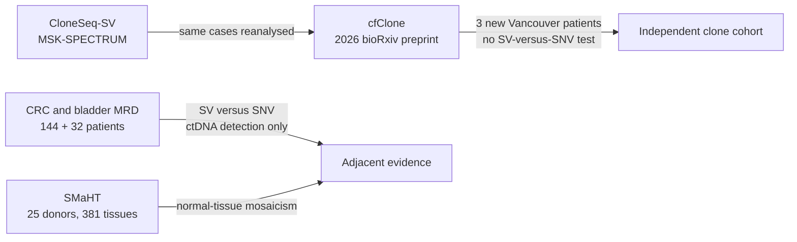

# CloneSeq-SV literature update

As of 2026-11-22. This note reviews primary papers and data resources for the 2025 CloneSeq-SV paper. I searched for direct follow-ups and for independent tests of structural-variant (SV) versus single-nucleotide-variant (SNV) clone identification.

## Finding

A direct follow-up exists: the 2026 cfClone preprint. Its SV-versus-SNV comparison reuses the original MSK-SPECTRUM patients. It adds three patients from a separate Vancouver cohort for cfClone analysis, but it does not compare SV and SNV clone identification in those patients.

This bounded search found no independent study that tests clone identity with both marker classes while matching marker count and an established measure of sequencing effort. That is not proof that no such study exists. The broader claim that SVs can mark clones is already established. Whether a valid, adequately powered independent comparison can be built remains open.

## Evidence map

## What the papers show

### CloneSeq-SV: the reference study

Williams et al. studied high-grade serous ovarian cancer in MSK-SPECTRUM. The cohort included 24 patients at baseline and 18 followed to recurrence. They generated single-cell WGS from 21,916 tumor cells. For 21 baseline plasma samples with enough SNVs, both SVs and SNVs detected tumor DNA, and their variant-allele-frequency distributions agreed. Truncal SV estimates of tumor fraction correlated with TP53 estimates (Pearson R = 0.95).

The same bespoke duplex-capture assay tested both variant classes. The paper reports mean raw coverage of 14,137× and mean duplex-consensus coverage of 919×. For clone-frequency estimates, its methods use uncorrected raw reads for SVs and duplex-consensus reads for SNVs; these are different processing and error regimes. In off-target patient samples, SV error rates were lower than SNV error rates. The article reports duplex error rates of about 1×10⁻⁷ for SVs and 6.7×10⁻⁶ for SNVs.

For longitudinal clone tracking, the authors checked six patients at baseline and recurrence with about 70× plasma WGS. The dominant clone agreed with the WGS read-depth and B-allele-frequency signals in 11 of 12 samples. In patients with at least five clone-specific SNVs per clone, SNV- and SV-derived trajectories correlated (R = 0.88). These are useful internal checks. The paper does not describe a benchmark that equalizes the number of markers and per-marker duplex molecules between classes. [Nature paper](https://www.nature.com/articles/s41586-025-09580-0).

### cfClone: direct follow-up, same test cohort

Kabeer et al. introduced cfClone, a Bayesian model that combines single-cell clone copy-number profiles with plasma WGS read-depth and phased-allele signals. The current DOI record is a bioRxiv preprint, posted 2026-07-30. The version 4 text reports three results that matter here:

- Of six MSK-SPECTRUM cases with bulk WGS, only three had clone sets that could be distinguished with both SV and SNV markers.
- In those three cases, cfClone prevalence estimates correlated with CloneSeq-SV estimates from SVs (Spearman ρ = 0.76) and SNVs (ρ = 0.89). CloneSeq-SV’s own SV/SNV estimates correlated at ρ = 0.83. These are same-cohort concordance checks. They do not provide independent truth labels.
- In SPECTRUM-OV-107 after recurrence, one SV marker led CloneSeq-SV to assign 100% prevalence to clone D. The SNV estimate was 73% clone A and 27% clone D. cfClone’s two-clone model estimated about 58% clone A and 42% clone D. This is a concrete warning about single-marker clone calls.

The preprint also analyzes three separate Vancouver HGSOC patients. That cohort gives independent evidence for cfClone’s CNV-based plasma tracking. It does not test SV-versus-SNV marker performance. The version 4 data statement says raw plasma, buffy-coat and bulk-tumor WGS will go to EGA upon acceptance. It lists prior single-cell WGS under [EGAS00001006343](https://ega-archive.org/studies/EGAS00001006343), with no new raw-WGS accession in that statement. The [cfClone code](https://github.com/Roth-Lab/cfclone) is public. [bioRxiv version 4](https://www.biorxiv.org/content/10.64898/2026.07.29.741620v4).

### Independent, adjacent SV-versus-SNV evidence

Sørensen et al. published a 2026 study of SV-based ctDNA detection in 144 stage III colorectal-cancer patients, with 1,564 serial plasma samples. They validated the method in 32 patients with muscle-invasive bladder cancer. The comparison used the same plasma samples as prior SNV-based analyses. It reported greater than 99% specificity and strong agreement with SNV-based ctDNA calls (Pearson r > 0.93).

This is useful independent evidence for SVs as plasma tumor markers. Its endpoint is sample-level ctDNA detection and recurrence. It does not assign tumor clones. The paper does not report an equal-number, equal-depth marker comparison. The raw data remain under the access terms of the source studies; the paper provides public supplementary SV catalogs and [SVrecon code](https://github.com/lindbjerg-group/SVreconManta) and [SVreconDELLY code](https://github.com/lindbjerg-group/SVreconDELLY). [Open-access paper](https://pmc.ncbi.nlm.nih.gov/articles/PMC12983592/); [data structure](https://genome.au.dk/library/GDK000005/).

### Additional independent-cohort search

- Li et al. (2026) tested personalized breakpoint ddPCR using multisite
  biopsies from four ovarian-cancer patients and pretreatment plasma. The
  paper reports feasibility of SV detection, rather than a longitudinal,
  matched-SV/SNV clone-accuracy benchmark. Its data statement says sequencing
  data will be deposited in EGA, without giving an accession in that
  statement. [Primary paper](https://www.oncoscience.us/article/645/text/).
- Schmid et al. (2025) compared SNV and breakpoint detection for sarcoma,
  including dilution series and plasma from three patients. This is related
  assay-level evidence, not an independently established clone-truth cohort.
  The paper says sequencing data are available on reasonable request.
  [Primary paper](https://onlinelibrary.wiley.com/doi/full/10.1002/cam4.70704).
- Zhang et al. (2025) analyzed mutations, immunoglobulin rearrangements and
  clonality in 57 lymphoma patients' liquid-biopsy samples. These
  rearrangements and the study's disease-monitoring aim do not by themselves
  supply an independent solid-tumor SV-versus-SNV clone-accuracy reference.
  Its data statement says datasets are available on reasonable request.
  [Primary paper](https://pmc.ncbi.nlm.nih.gov/articles/PMC12689601/).

These are candidate leads and constraints, not proof that no suitable cohort
exists. No access request was sent, and no patient-level data were acquired.

### Other relevant resources

- The 2026 SMaHT integrated mosaicism map profiles 25 postmortem donors across 381 tissue samples and up to 20 tissue types, using short-read, long-read, duplex and selected single-cell assays. It is a valuable independent human-mosaicism resource. It is not a treatment-time ovarian plasma cohort. The paper directs users to the [SMaHT Data Portal](https://data.smaht.org/). [Paper](https://pmc.ncbi.nlm.nih.gov/articles/PMC13684657/).
- Sc-TUSV-Ext, published before CloneSeq-SV, combines SNVs, copy-number alterations and SVs in single-cell tumor phylogeny. It reports synthetic-data comparisons and examples on published data. This means that integrating variant classes is established prior art. It does not test whether SV markers outperform SNVs for clone detection in plasma under matched marker counts and coverage. [Paper](https://doi.org/10.1089/cmb.2024.0613).

## Data and reproduction

| Resource | What is available | Access note |
| --- | --- | --- |
| CloneSeq-SV raw reads | dbGaP study [phs002857.v3.p1](https://www.ncbi.nlm.nih.gov/projects/gap/cgi-bin/study.cgi?study_id=phs002857.v3.p1) | Controlled access; request approval through dbGaP. |
| CloneSeq-SV processed data | Synapse [syn66399325](https://www.synapse.org/Synapse:syn66399325) | Project and archive metadata are publicly visible. The 2026-11-22 [anonymous access check](../../results/cloneseq_synapse_metadata_20261122_run01/) returned HTTP 403 for the download reference. Authenticated access and the archive contents have not been tested. |
| CloneSeq-SV code | [DLP+ pipeline](https://github.com/mondrian-scwgs), [duplex pipeline](https://github.com/msk-access/nucleo), [figures](https://github.com/shahcompbio/spectrum_cfdna_figures) | Public repositories. |
| cfClone independent cohort | Prior scWGS at EGA [EGAS00001006343](https://ega-archive.org/studies/EGAS00001006343) | The preprint says raw cfDNA, blood and tumor WGS will be deposited upon acceptance; its version 4 statement gives no accession. |
| CRC/bladder MRD study | Supplementary SV catalogs and the [GDK000005 overview](https://genome.au.dk/library/GDK000005/) | Raw WGS access follows the original studies. The paper directs data requests to those study teams. |

The article points to Synapse for processed data and dbGaP for raw sequencing reads. Public metadata visibility does not establish anonymous download access. The measured 403 does not establish that an authenticated user will be denied, or identify the legal access terms. No claim is made that the archive alone permits a new analysis.

## Novelty judgment

A real, narrow question remains:

> Under a predeclared and defensible assay budget, do SV markers add clone information beyond a strong SNV analysis in an independent longitudinal cohort with a suitable reference?

This question is distinct from asking whether SVs have lower background error. CloneSeq-SV supports that result. The 2026 CRC/bladder study supports SV-based ctDNA detection in other patients. Neither shows that an SV panel assigns clone identity better after marker count and depth are matched. cfClone’s same-cohort reanalysis flags a single-SV failure mode, but it does not resolve the comparison.

The question might support a focused evaluation if the independent cohort has appropriately measured marker-level data, defensible clone labels and sufficient independent patients. The significance and feasibility are unproven. The workbook's counts have not been established as independent molecules or equal-cost observations. A new method is not required for an initial diagnostic; external evidence is required before claiming clinical value.

## Cheapest falsifier

The following is a conditional design sketch, not an approved experiment. It requires a new prospective protocol, accessible suitable data and independent review; do not start a training run.

1. Select the MSK-SPECTRUM patient, clone and timepoint records with both SV and SNV markers. Keep only clones that both classes can identify.
2. If molecule-level data and comparable assay costs can be established, define a fair marker and sequencing budget before evaluating any outcomes. Counts in the workbook must not be assumed to be independent molecules. Keep patient, clone and timepoint paired.
3. Assess whether the ~70× plasma-WGS read-depth and B-allele-frequency evidence and cfClone estimates provide useful, explicitly non-independent comparators. Neither automatically supplies ground truth: they share source material and tissue-derived clone models.
4. Resample patients, not individual variants. Report the accuracy-versus-depth curve and the one-SV OV-107 case separately.

An inconclusive or underpowered study would not establish a biological null. Any promising result needs an independent cohort. The Vancouver cfClone cohort is a possible lead if its relevant data become accessible and can be shown suitable; the CRC/bladder study is an independent ctDNA-detection cohort, not a clone-identity validation set. The 3/6 figure is a report from the preprint, not a new patient-level result from this repository.

## Search notes and limits

The researcher used Firecrawl paper search and full-page retrieval, Exa search and fetch, Parallel web search, Consensus search and record fetch, SciSpace search and fetch, and public NCBI E-utilities/OpenAlex citation endpoints. In that worker session the packaged Life Sciences Literature helper was unavailable, so the worker queried NCBI E-utilities directly; that does not establish its availability in other sessions. Parallel Research required OAuth. Elicit reported that this account’s plan does not include API access. AlphaXiv’s listed index excludes biomedical journal papers, so it was not useful for this question.

A follow-up on 2026-11-22 used the Life Sciences Literature PubMed helper for
three targeted searches of rearrangements, plasma and clone tracking, followed
by publication summaries and primary-paper checks. Its first invocation lacked
`requests`; an isolated `uv` environment with that dependency worked. A Scite
query returned a paid-plan/trial requirement, so Consensus and the primary
articles supplied alternative leads. Search terms and result limits constrain
this screen; it was not a systematic review.

The literature worker was requested with GPT-6 Luna at maximum effort; the effective model and reasoning setting are not independently attested by runtime metadata available to this research run.

The initial literature worker did not read the project workbook, run an
experiment or cluster job, or change Git history. The separate, prospectively
specified content audits did read permitted workbook fields, as documented in
the [content result](2026-11-22-cloneseq-content-result.md). The additional
cohort search above used publications and data statements only.
