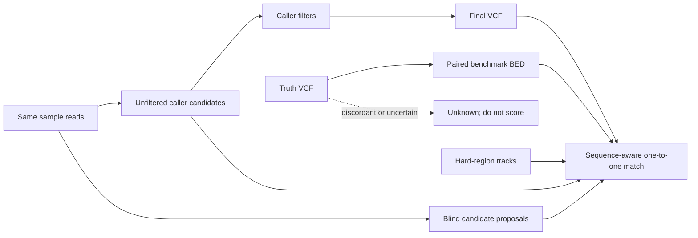

# Hard-region SV candidate recall: opportunity scout

**Date:** 22 November 2026
**Decision:** Conditional go for one small evidence gate. Do not repeat a general caller benchmark.

## Finding

One possible residual is **de novo candidate generation** in hard regions. Existing callers and classifiers already show that these regions have more SV errors. The open question is narrower: **Can a method propose a supported SV beyond strong caller and population-catalog baselines, without being given the truth coordinate?**

This could matter if a method can propose new loci from reads. It does not fit a model that only scores VCF records from other callers; no particular existing AlignSSL-SV architecture is required.

The gap is explicit in recent work. The 2026 *dicast* paper scores candidates supplied by other methods and can also take population-catalog variants. Its maximum recall is limited by its available input candidates, and it names candidate expansion as future work. The paper reports 44 of 101 deletions and 10 of 57 insertions detected in the HG002 CMRG benchmark; when supplied predefined regions, it reports 91 deletions and 30 insertions. This contrast suggests a candidate-location ceiling under the tested configurations. It does not establish a blind de novo gain or that a new method can improve on the full caller-plus-catalog baseline. [Alavi et al., 2026](https://doi.org/10.1186/s13059-026-04280-y)

## Recent project decisions checked

- The [22 November independent investment review](2026-11-22-independent-investment-review.md) and the [6 November investment decision](2026-11-06-scientific-investment-decision.md) set the current CloneSeq and paired-DNA/RNA priorities. This note does not reopen those decisions.
- The [Parliament2 source gate](2026-09-28-parliament2-header-gate.md) rejected a controlled candidate-generation claim from old final VCFs. It requires the same donor, reads and reference, plus documented candidate-stage inputs.
- The [Zenodo package gate](2026-09-28-zenodo-sv-package-gate.md) found that a 3.33-GB archive did not expose individual component-caller candidate streams. It rejected a general candidate-ceiling benchmark from that package.
- The [16 October evidence review](2026-10-16-new-evidence-scout-review.md) says that completed benchmarks do not settle every allele-level residual. It also says not to repeat a general benchmark without a named unanswered question.

The present path is different only if it tests **new candidate proposals** against assembly-supported, difficult-region positives. A new ranking table from old final VCFs would repeat the rejected path.

## Best narrow question

> Among HG002 deletion and insertion alleles larger than 50 bp in the difficult-gene CMRG benchmark, can a blind proposal method add sequence-compatible candidates beyond strong short-read callers **and a fair, sample-excluded population-catalog baseline**, at a fixed candidate-review budget, when truth disagreements are marked unknown?

Use only events inside the matched GRCh38 benchmark regions. Cross-support from the CMRG and v5.0q assembly-derived sets can define a conservative primary tier. Keep CMRG-only, v5.0q-only, representation-conflicting and out-of-region events as separate uncertainty groups. The two benchmarks describe the same person. They are different evidence sources, not independent donors.

Count three outcomes separately:

1. **Not emitted:** no matching record appears in any available pre- or post-FILTER caller VCF or allowed catalog. This does not prove that a caller never generated an internal candidate: it may have pruned it before VCF output.
2. **Emitted but filtered:** a caller VCF has a matching record that does not pass its published filter. This is measurable only when the file preserves those records and its filter semantics are documented.
3. **Matched:** a caller, allowed catalog, or proposed method emits a sequence-compatible candidate that passes the frozen rule. Retain the candidate's origin and uncertain matches.

Do not label events outside the paired benchmark BED as false negatives or false positives. Count all proposed candidates, including those outside scored territory, in the review-burden denominator. Use one-to-one, sequence-aware matching. A coordinate-only match can confuse different alleles in repeats.

## Close prior art

| Study | What it already shows | Residual for this path |
|---|---|---|
| Qin and Li, *Challenges in structural variant calling in low-complexity regions* (2025) | In one HG002 long-read analysis, 35.4 Mb of low-complexity regions held 69.1% of confident SVs. The regions held 77.3–91.3% of caller errors. Some callers missed about half of the truth SVs in LCRs at least 2 kb long. The study compared Q100 v1.1 with the older SV v0.6 truth and showed that allele resolution changes counts. | This is already a direct hard-region caller benchmark. It used one donor and long reads. It did not establish a general short-read candidate-stage method. Its authors also found Truvari could accept some imprecise repeat alleles as correct. [Paper](https://doi.org/10.1093/gigascience/giaf154) |
| Alavi et al., *dicast* (2026) | Built a manually curated, multi-technology SV set from nine samples and compared 15 methods. The authors report about 35 million raw calls, 3.9 million after quality filtering, 11,511 manually reviewed events and about 1% of truth calls added by manual discovery of missed calls. They stratified performance by genomic context. The model scores candidates from other callers and is explicit that the caller union caps recall. | This is the closest prior art. It already shows a large gap between de novo calling and scoring at known CMRG loci. A new contribution must add candidates without known coordinates and keep the false-candidate cost usable. Its evidence-tier percentages are provenance classes, not calibrated probabilities. [Paper](https://pmc.ncbi.nlm.nih.gov/articles/PMC13584385/) |
| Maden et al., *Structural Variant benchmarking frameworks* (2026) | Compared Truvari, EvalSVcallers and SVbenchmark on HG002 and NA12878. Matching rules and parameters change TP, FP and FN assignments. | Do not present a matcher-default comparison as new science. Freeze a sequence-aware primary matcher and report a sensitivity analysis. [Paper](https://doi.org/10.1371/journal.pcbi.1014824) |
| Slimmer et al., *Towards standards for analysing SVs from short-read WGS* (2026 preprint) | Compares 16 tools against HG002 T2T-Q100 and Platinum Pedigree truth, and tests caller merging at base-pair resolution. | This is another reason to avoid a broad short-read ranking. It is a preprint and does not resolve whether a new proposal stage can recover alleles absent from all input candidates. [Preprint](https://doi.org/10.64898/2026.10.13.758836) |

The 2025 *Platinum Pedigree* release adds a possible later check in NA12878 and relatives: 24,315 SVs across about 2.77 Gb, with open-consent data, assemblies and calls. It can support an independent-person follow-up if the input read type and candidate-stage files match. It does not make HG002 an external test. [Paper](https://doi.org/10.1038/s41592-025-02750-y), [data repository](https://github.com/Platinum-Pedigree-Consortium/Platinum-Pedigree-Datasets)

## Public data assets

| Asset | What is available | Use and limit |
|---|---|---|
| [NIST CMRG v1.00](https://data.nist.gov/od/id/mds2-2475) | A benchmark for 273 challenging medically relevant genes in HG002. The GRCh38 [SV VCF](https://ftp-trace.ncbi.nlm.nih.gov/ReferenceSamples/giab/release/AshkenazimTrio/HG002_NA24385_son/CMRG_v1.00/GRCh38/StructuralVariant/HG002_GRCh38_CMRG_SV_v1.00.vcf.gz) is paired with its [benchmark BED](https://ftp-trace.ncbi.nlm.nih.gov/ReferenceSamples/giab/release/AshkenazimTrio/HG002_NA24385_son/CMRG_v1.00/GRCh38/StructuralVariant/HG002_GRCh38_CMRG_SV_v1.00.bed). | Best fixed, clinically relevant first denominator. It is a selected set of genes, not a genome-wide population sample. Use the BED with the VCF. |
| [NIST HG002 v5.0q](https://ftp-trace.ncbi.nlm.nih.gov/ReferenceSamples/giab/release/AshkenazimTrio/HG002_NA24385_son/v5.0q/) | GRCh38 SV truth VCF, paired benchmark BED, exclusion statistics and a [README](https://ftp-trace.ncbi.nlm.nih.gov/ReferenceSamples/giab/release/AshkenazimTrio/HG002_NA24385_son/v5.0q/NIST_HG002_v5.0q_variant-benchmarksets_README.md). The release is assembly-based on T2T-HG002 v1.1. | Strong second evidence source. It is still a draft. NIST warns that assembly alignment can remain ambiguous, recommends the VCF/BED pair, and asks users to curate disputed FPs and FNs. Do not turn truth-set disagreement into a caller error. [Benchmark paper](https://doi.org/10.64898/2026.09.23.752440) |
| [GIAB v3.6 stratifications](https://ftp-trace.ncbi.nlm.nih.gov/ReferenceSamples/giab/release/genome-stratifications/v3.6/) | BED tracks for contexts such as low complexity, segmental duplication, repeats and low mappability. The [source repository](https://github.com/usnistgov/giab-stratifications) documents the files and supported references. | Use the GRCh38 tracks to label context only inside the eligible truth BED. The tracks describe genomic context; they do not prove an individual call. [Resource paper](https://doi.org/10.1038/s41467-024-53260-y) |
| Qin and Li LCR set | GRCh38 `hg38.lcr-v4.bed.gz` and CHM13 `chm13v2.lcr-v4.bed.gz` at [Zenodo](https://doi.org/10.5281/zenodo.10903864); construction code at [GitHub](https://github.com/lh3/lcr-sv). | Useful sensitivity stratum. This is a paper-defined LCR set, not the same as the GIAB v3.6 LCR track. Preserve both labels. |
| [DICAST Zenodo record](https://zenodo.org/records/19794240) and [supplement tables](https://doi.org/10.6084/m9.figshare.33919171) | The record lists code/model and visualization archives, including 1.8 GB and 150.2 MB files. I inspected only the two small `00_ground_truth.zip` and `01_variant_database.zip` files in memory; they contain pipeline source/configuration, not caller VCFs or truth rows. | No per-caller candidate VCFs or matched read files were verified in the small bundles. The larger archives were not downloaded. A separate [range-based archive check](../../results/dicast_archive_metadata_20261122_run01/) inspected the entire central directory of the 1.8-GB archive without fetching it. The timing script names five formatted placeholder VCF paths. Neither the exact BAM nor those caller files is located by that script. |

## Cheapest falsification

**First gate: one VCF/BED crosswalk.** Use the official GRCh38 CMRG and v5.0q VCF/BED pairs plus the GIAB and paper LCR tracks. Count every CMRG deletion and insertion over 50 bp, and separately enumerate v5.0q-only events in the defined CMRG territory. Classify events as supported by both sets within both benchmark regions, CMRG-only, v5.0q-only, representation or complex-event disagreement, or outside either benchmark region. Report denominators and exclusions for each source separately. Then label the eligible events by CMRG gene, LCR, segmental duplication and other v3.6 contexts. The two truth sources may share assembly evidence and are not independent validations.

This check can reject the plan before compute. Stop if there are no usable cross-supported events in hard contexts, or if most apparent cases are representation or region-mask disagreements. It cannot prove a candidate-generation gain.

**Second gate: candidate-source availability.** Find the same-sample pre- and post-FILTER VCFs and their read, reference, caller-version and filter manifests from the DICAST run or an equivalent public run, plus the applicable sample-excluded population catalog. If those inputs are unavailable, determine the cost of reproducing them on matching reads; do not describe final VCFs as complete internal candidate streams. A bounded archive inspection or larger cluster download is reasonable when source metadata indicate it can resolve this specific gap; a byte limit alone is not a scientific stop rule.

If both gates pass, freeze the assessment protocol before scoring outputs. Compare the caller union, caller PASS outputs, a strong population-catalog/force-calling baseline and blind proposals on the same read evidence and comparable budgets. Exclude the test individual and related individuals where necessary from any discovery catalog, training or tuning; check the actual source history instead of assuming this was done. Do not pass truth coordinates to the proposal stage. Have a reviewer adjudicate any proposal-only candidate against independent evidence where available and the two potentially overlapping truth sources. Report candidate recall, uncertain calls, false candidates and total candidate burden separately. A result on this extensively studied HG002 panel is development evidence, not external validation.

## Why it could matter

Caller confidence models can rescue a weak or filtered call only when the locus is available as an input candidate, whether from a caller or a catalog. A proposal method could expand that input set. That matters most when the missing allele lies in a medically relevant gene and its sequence has suitably independent support. A reproducible gain in blind candidate recall, at a workable review burden, could improve detection where strong existing inputs omit candidates.

The novelty claim must stay narrow: **candidate generation in hard regions**, not “SV callers fail in repeats.” Qin and Li and DICAST already establish the latter. Before a broad claim, test a second person with compatible short-read data and an independent truth source, such as the Platinum Pedigree set.

## Scientific limits

- **One genome:** CMRG and v5.0q are both HG002. Their agreement does not show performance across people or ancestries.
- **Truth is uncertain:** v5.0q is a draft. A 2025 analysis removed 943 `ALT=*` records from its initial Q100 truth count and described allele-resolution differences from v0.6. Treat disputed records as unknown until resolved.
- **Selection:** CMRG targets 273 challenging genes. It cannot estimate genome-wide recall or prevalence.
- **Candidate labels:** DICAST's curated set uses caller, technology and database support, plus manual review. These support classes are not error probabilities. Its manually added FNs are not a census of every missed SV.
- **Matching:** breakpoints, size and sequence can differ across equivalent events. The choice of matcher can change FN counts. Keep complex or unresolved events out of the primary score.
- **Input provenance:** The DICAST paper used 30× HG002 Illumina WGS and five named callers. The small Zenodo source bundles do not provide those call VCFs. This scout did not verify a public, same-run candidate manifest or download reads. A separate [source check](../../results/hg002_illumina_header_20261122_run01/) verified a distinct, public 30× HG002 NovaSeq GRCh38 BAM via an indexed range query. This can support a fresh, matched-read baseline if the research design warrants one.
- **Project fit:** The repository describes SV calling and genotyping but does not define the current implementation as a de novo proposer. This question requires a new capability, not an evaluation of the current model.

## Stop rule

Stop this specific CMRG route after the VCF/BED gate if there is no nontrivial set of CMRG events supported by both truth sources, inside both benchmark regions and overlapping a prespecified hard-region track. Stop before comparison if no same-run pre/post-filter outputs or reproducible way to produce them is available. Stop the proposed method path if it receives truth coordinates, only rescues candidates already supplied to a strong caller-plus-catalog baseline, or produces no independently supported novel candidate at a usable false-candidate burden.

Treat an HG002-only positive as a pilot. Do not claim general improvement without an untouched person and independent evidence.

## Search scope and source checks

The targeted literature window was **22 November 2022 through 22 November 2026**. Older sources appear only where they define a current benchmark or dataset. Search facets were: (1) SV caller errors in low-complexity or hard-to-evaluate regions; (2) candidate-stage misses versus downstream filtering; (3) truth-set uncertainty and allele matching; and (4) official HG002 CMRG, v5.0q and genomic-stratification assets. The search was bounded. It was not a systematic review.

I reviewed primary papers and official NIST, PMC, journal, Zenodo, Figshare and GitHub records. I used Parallel Search, Exa, Consensus, SciSpace and Firecrawl. Parallel deep research required OAuth and did not run. Elicit and Scite returned `INVALID_ARGUMENT` for the two submitted query forms. A Life Sciences Literature/Entrez search tool was not exposed in this session. I used the successful search tools as alternatives, then checked key claims against the primary paper or official dataset page.

No caller job, benchmark, test or model run was performed. No large data were downloaded. Only the two small DICAST source archives noted above were read in memory. No historical result was changed. This file is the only workspace file written for this scout.
