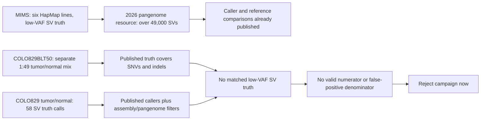

# Low-VAF somatic and mosaic SV opportunity

Date: 2026-11-22

## Decision

**Reject this as a publication direction now.** I found no existing resource that joins low-allele-fraction structural-variant (SV) reads to independent, sample-matched SV truth and a complete negative denominator. The strongest apparent route joins two COLO829 resources. That join is unverified, already overlaps a published caller/filter study, and has no verified file-level access path here. Do not start a caller campaign from it.

A useful question exists: **at a defined low tumor fraction, does a current somatic-SV filter reduce false calls while retaining independently confirmed tumor SVs?** This could affect whether a lab reports a low-fraction tumor junction. The available data do not support an honest answer yet.

I read the October 9 post-native decision, the October 7 mosaic-identifiability triage, the October 9 independent-mixture check, the November 3 opportunity review, the November 22 investment reassessment, and the current PROGRESS/RESTART_STATE. The earlier decision already rejected another MIMS caller ranking, another VAF/depth curve, and a confidence model without a second mixture. Current progress parks CloneSeq and has no selected publication direction. The new sources below do not clear the missing-truth gate.

Requested model/effort: **GPT-6 Luna / max**. This records the requested configuration only. The active backend and effort are not independently attested.

## Evidence map

| Resource | What it gives | What it cannot answer |
|---|---|---|
| [SMaHT MIMS paper](https://pmc.ncbi.nlm.nih.gov/articles/PMC12458932/) and [official v2 benchmark](https://github.com/BCM-HGSC/SMaHT_MIMS/tree/main/benchmark_v2) | One physical six-HapMap-line mixture, expected SV fractions down to 0.25%, assembly-derived truth, and multi-center/platform sequencing. The paper tests 12 caller pipelines. | It is the already-studied mixture. Center and platform runs are technical replicates, not independent mixtures. Another caller leaderboard, threshold curve, or read-support model repeats the published question. |
| [Kong et al., 2026](https://doi.org/10.1016/j.xgen.2026.101358) and [official benchmark release](https://doi.org/10.5281/zenodo.19636324) | A newer pangenome benchmark for the same named HapMap mixture and donor proportions. It supplies more than 49,000 SVs, plus SNVs, indels, and mobile-element insertions. It evaluates callers and reference choices, including CHM13. | This strengthens the existing benchmark. It does not establish a second independently prepared mixture or an unoccupied generic SV-calling effect. Hard-region and reference-choice work also overlaps the separate germline direction. |
| [Ha et al., 2026](https://pmc.ncbi.nlm.nih.gov/articles/PMC13781593/), [analysis repository](https://github.com/parklab/SMaHT_SNV_COLO829BLT50_HAPMAP), and [SMaHT COLO829 data table](https://data.smaht.org/data/benchmarking/COLO829) | A distinct 1:49 COLO829 tumor/COLO829BL physical mixture. The paper reports five-center data at about 170–470× and a high-confidence SNV/indel reference, with negative and culture-derived controls. | The published reference is for SNVs and indels. It does not give an SV truth set for the mixture. A second mixture without SV labels cannot measure SV recall or precision. |
| [Qin et al., 2026](https://aacrjournals.org/cancerrescommun/article/6/9/2282/788607/Improving-Long-Read-Somatic-Structural-Variant) and [author data archive](https://doi.org/10.5281/zenodo.14715664) | A 58-event COLO829 SV truth set. The paper compares SAVANA, Severus, and nanomonsv, with normal self-assembly and pangenome filters. Its archive includes filtered caller outputs and Sniffles2 results. The authors note that passage and DNA-source differences can explain extra or missing COLO829 calls. | These are tumor/normal data, not a 1:49 mixture. The 58 events were already used to evaluate the filtering method. The archive does not supply independent low-fraction mixture truth. Matching these labels to the SMaHT mixture would require exact material and passage identity. |
| [Höijer et al., 2026](https://pmc.ncbi.nlm.nih.gov/articles/PMC13587479/), [ENA PRJEB110416](https://www.ebi.ac.uk/ena/browser/view/PRJEB110416), and [SIQ results file](https://doi.org/10.6084/m9.figshare.33918928) | An open, experimentally edited zebrafish dataset. It has 30 usable samples, seven targeted regions, about 1,168× mean target depth, a 1% VAF cutoff, an uninjected control, and reported mosaic SVs. | SIQ derives the event calls from the same PureTarget reads. Only one uninjected control supplies negative evidence. The paper already reports the assay and biological findings; a caller reanalysis would have a small, selected truth set and weak error denominator. It does not support a general human mosaic-SV claim. |

A 2026 preprint also reports mosaic repeat SVs across 47 people and 168 normal-tissue samples, with nearly half of breakpoints independently validated, and repeat variation in tumors. This is important biological prior art, not a complete caller benchmark with an independent false-call denominator ([Annapragada et al.](https://doi.org/10.64898/2026.09.22.753313)).

## Nearest possible test, and why it fails

The nearest design is a locked cross-resource test on the COLO829 1:49 mixture. It would ask whether current caller-plus-filter pipelines preserve true tumor SVs at low fraction.

**Exact assets**

- Query reads: the COLO829BLT50 data table on the [SMaHT portal](https://data.smaht.org/data/benchmarking/COLO829).
- Candidate truth and existing calls: the [58-event COLO829 archive](https://doi.org/10.5281/zenodo.14715664).
- Existing filters: the normal self-assembly and pangenome workflows in the [Qin et al. paper](https://aacrjournals.org/cancerrescommun/article/6/9/2282/788607/Improving-Long-Read-Somatic-Structural-Variant).
- Relevant caller baselines: native SAVANA, Severus, Sniffles2, and nanomonsv outputs; compare each unfiltered with the published self-assembly and pangenome filters. Do not tune thresholds on the 58 truth events.

**Endpoint if a valid matched truth existed**

- Positive numerator: unique, sequence-resolved truth SVs recovered by each caller/filter.
- Positive denominator: only truth SVs independently confirmed in the exact 1:49 tumor and normal materials, with adequate read coverage and empirically measured VAF. Do not assume all 58 events qualify.
- Error endpoint: false calls divided by all evaluated calls, but only inside a complete, sample-matched negative truth mask. Report event-family-blocked intervals. Do not count reads, nearby records, or technical centers as independent biological events.
- Decision contrast: compare the best native caller against each frozen filter at the same positive-event sensitivity. A filter result matters only if it lowers false calls without removing confirmed low-VAF SVs. Runtime and peak memory must be measured on the exact files before claiming a compute tradeoff.

**Current denominator: unavailable.** The 2026 COLO829 mixture paper supplies no SV positive set or SV-negative mask. The 58-call truth comes from a separate tumor/normal data source, and the paper itself warns about passage/source differences. Thus TP/eligible truth and FP/negative opportunities cannot be computed honestly. SMaHT lists COLO829 sequence and variant data as open. The file-level login, permissions and availability of the specific low-fraction files were not tested. [Portal policy](https://data.smaht.org/docs/access/data-availability-and-access). The published open code and VCF archive do not replace the missing mixture reads and truth.

**Leakage and stop rules**

1. Treat the 58-event COLO829 set as development evidence. The published filter study used it to compare filters. A repeat analysis of those same events is not an untouched validation.
2. Stop before caller execution if the exact sample, passage, reference, and mixture provenance cannot be joined. Stop if independent SV labels and a negative-callability mask are absent.
3. Stop if the only available result is a re-ranking of callers or filters on MIMS, the 58 COLO829 events, or selected CRISPR targets.
4. Reopen only when a low-VAF mixture has sample-matched, independently established SV positives and negatives, and the decision and minimum useful effect are fixed before scoring. The present sources do not permit a credible compute budget or effect-size test.

## Retrieval and execution record

I used Life Sciences Literature through NCBI Entrez PubMed search, summary, and abstract retrieval. I also used Exa search and fetch to inspect primary papers, official data pages, code repositories, and data releases. The Elicit API search was unavailable under the connected account plan; I did not use it as evidence. This was a targeted search, not an exhaustive novelty review.

The worker wrote this search note before the agent runtime returned a usage-limit error. The orchestrator checked the primary COLO829BLT50 paper and portal policy and corrected the access statement. This is a scout draft with a provisional assessment. The worker read publication text and metadata only. I did not download sequence files, inspect VCF rows, request protected access, read credentials, run callers, submit jobs, or change Git state. This file is the only requested workspace output.
