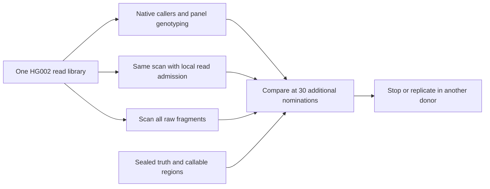

# AlignSSL-SV scientific direction decision

22 November 2026

**Invest in one HG002 test of blind deletion discovery in difficult genes.** Test whether short reads already contain deletion junctions that a standard alignment routes away from the correct locus. If a direct sequence scan can recover those alleles beyond strong callers and a population panel, it could increase the yield of existing short-read data at a measurable review cost. Use one public Illumina library, one reference, and one frozen comparison. The first result will decide whether to invest in independent replication.

## COLO829 centromere check

Close the fixed three-case route. The reported exact breakpoints for `i(4)(q10)` and `t(14;16)(p10;p10)` are absent from both GRCh38 and CHM13. The earlier, twice-published single-breakend signal is relevant to `t(1;3)(q12;p21)`. LINX reported a satellite-linked chr3 end near 25.3 Mb and inferred a likely chr1 partner. The exact allele, passage match, and shared benchmark scope are unresolved. None of the three supports a new exact paired-breakend comparison in shared territory. [Project source screen](2026-11-22-colo829-centromeric-source-screen.md) · [Donor-specific assembly, Fig. 1](https://pmc.ncbi.nlm.nih.gov/articles/PMC13722029/#F1) · [LINX, Fig. 6B](https://pmc.ncbi.nlm.nih.gov/articles/PMC9903802/#fig6) · [Earlier nanomonsv single-breakend study](https://doi.org/10.1093/nar/gkad526)

## Competing investments

| Question | Smallest informative comparison | Decision |
| --- | --- | --- |
| **Germline candidate discovery.** Do raw paired-end reads yield exact deletions at difficult loci that callers and an external panel miss? | Compare a sequence scan with the same scan limited to locally mapped fragments, plus strong native callers and panel genotyping on the same library. Use long-read-derived truth and a fixed review budget. | **Select.** There is a public, matched input path and a direct test of where usable evidence is lost. |
| **Low-fraction somatic SVs.** Can normal-assembly or pangenome filtering lower false calls at the same minority-junction sensitivity? | Use COLO829BLT50 at 1:49 tumor to normal. Compare native long-read calling with the published filters. Verify breakpoints and callable negatives on the exact source materials. | **Park.** The physical mixture has published SNV/indel truth. The separate 58-event COLO829 SV set lacks a verified passage and material join to that mixture. MIMS and its pangenome follow-up already cover broad rankings and depth curves for the same six-donor pool. [Mosaic review](2026-11-22-mosaic-sv-opportunity.md) · [COLO829BLT50](https://pmc.ncbi.nlm.nih.gov/articles/PMC13781593/) · [Somatic filtering study](https://doi.org/10.1158/2767-9764.CRC-25-0769) · [MIMS](https://pmc.ncbi.nlm.nih.gov/articles/PMC12458932/) |
| **Allele-linked splicing.** Does an exact non-reference insertion supply sequence to a splice junction that linked small variants and existing predictors fail to explain? | Find callable carriers and non-carriers with the same DNA/RNA provenance. Require direct long RNA reads through the inserted sequence and junction, with phase and matched mapping controls. | **Park.** The 56 matching names are a source frame. Informative molecules, allele identity, and a specific unexplained junction are unverified. Broad SV expression and splicing associations have close prior art. [Paired review](2026-11-06-paired-scientific-review.md) · [HGSVC primary study](https://doi.org/10.1126/science.abf7117) |
| **Clone tracking.** At equal assay input and cost, does adding SV markers improve clone assignment over a strong multi-marker SNV method? | Compare both arms against a separate molecular clone reference on independent mixtures or patients. | **Park.** The cfClone preprint already compares SV- and SNV-derived estimates in the reused cohort. Three of six WGS patients met its joint marker-distinguishability criterion. Independent reference measurements and comparable assay budgets remain unresolved. [Investment reassessment](2026-11-22-investment-reassessment.md) · [cfClone v4](https://www.biorxiv.org/content/10.64898/2026.07.29.741620v4) |
| **Genotype confidence.** Can a score retain more accurate neighboring-SV genotypes on transfer from ultra-long ONT to HiFi? | Compare matched scored outputs and an optimistic selection ceiling at 1% label discordance. | **Keep the finite archive route closed.** The header check did not establish the paired technology outputs. SVUPP already tests matched coverage and genotype-quality ranking. The October Sawfish test stopped at its canonical positive control before it could measure the planned contrast. [Post-native decision](2026-10-09-post-native-value-decision.md) · [Archive result and disposition](2026-10-09-svupp-provenance-header-result01.md) · [SVUPP](https://pmc.ncbi.nlm.nih.gov/articles/PMC12771361/) |

## Why this candidate question survives

Dicast reports 44 of 101 CMRG deletions in its de novo run and 91 of 101 with predefined regions. The difference includes effects of candidate availability, filtering and matching. Pindel already uses a mapped mate to find deletion junctions in unmapped reads. SurVIndel2 and SurVeyor recover weak split-read signals from alignments. HitSV uses repeat-aware site recognition and haplotype assembly. FermiKit assembles raw Illumina reads. A 151-base read can span a simple deletion junction even when the deleted segment is much longer. The contribution to test is **exact new alleles at fixed review cost, with a fragment trace that shows what local read admission loses**. [Dicast](https://doi.org/10.1186/s13059-026-04280-y) · [Pindel](https://doi.org/10.1093/bioinformatics/btp394) · [SurVIndel2](https://doi.org/10.1038/s41467-024-53087-7) · [SurVeyor preprint](https://doi.org/10.21203/rs.3.rs-7732239/v1) · [HitSV](https://doi.org/10.1038/s41587-026-03332-9) · [FermiKit](https://pmc.ncbi.nlm.nih.gov/articles/PMC4757955/)

The HPRC already genotyped HG002 CMRG variants with PanGenie and reported 15 alleles absent from its panel under its matching rule. This suggests a small discovery margin. The count covers both insertions and deletions before a caller-union comparison. Recent studies already compare callers, graph alignments, and exact or sequence-aware matching. [HPRC](https://doi.org/10.1038/s41586-023-05896-x) · [Guo et al.](https://doi.org/10.1186/s13059-026-04219-3) · [Slimmer et al. preprint](https://doi.org/10.64898/2026.10.13.758836) · [Hard-region scout](2026-11-22-hard-regions-opportunity.md)

## Matched reads and caller inputs

The project's version-pinned Google Health BAM and BAI are usable for indexed access. The BAM is 43,667,905,004 bytes and was aligned with BWA 0.7.17. The audit found 3,366 ordered contig names and lengths matching both published full-analysis-set indexes, zero contig `M5` fields, and 299 alignment records in the 0-based half-open control interval `chr22:20000000–20001000`. This confirms data access and dictionary compatibility. Exact FASTA provenance is still open. The chr22 window was an infrastructure check. [Access receipt](../../results/hg002_illumina_header_20261122_run01/README.md)

Use the public Google Health **HG002 PCR-free Illumina NovaSeq 2×151 bp, nominal 30× WGS** FASTQs. Both versioned objects responded to metadata requests, with a combined compressed size of 52,298,379,117 bytes. Align this pair once with BWA-MEM 0.7.18 to the NCBI GRCh38 no-alt analysis FASTA named in the Q100 methods. Pin the FASTQ generations and publisher checksums, FASTA digest, read groups, duplicate-marking policy, and caller builds. Verify primary-contig sequences and benchmark REF alleles. Use the fresh BAM for all alignment-based arms and its read names to link the raw and mapped evidence. [R1](https://storage.googleapis.com/brain-genomics-public/research/sequencing/fastq/novaseq/wgs_pcr_free/30x/HG002.novaseq.pcr-free.30x.R1.fastq.gz?generation=1607665347333933) · [R2](https://storage.googleapis.com/brain-genomics-public/research/sequencing/fastq/novaseq/wgs_pcr_free/30x/HG002.novaseq.pcr-free.30x.R2.fastq.gz?generation=1607665347352230) · [FASTA](https://ftp.ncbi.nlm.nih.gov/genomes/all/GCA/000/001/405/GCA_000001405.15_GRCh38/seqs_for_alignment_pipelines.ucsc_ids/GCA_000001405.15_GRCh38_no_alt_analysis_set.fna.gz) · [Q100 methods](https://www.biorxiv.org/content/10.64898/2026.09.23.752440v1.full)

The inspected dicast archives did not supply the exact caller VCFs. The timing script points to placeholder inputs. Generate fresh matched outputs. Slimmer et al. describe VCFs from the same named upstream FASTQ source, with their own preprocessing and reference. Their deposited VCFs can challenge an apparent novel allele if their identity and access are established. The deposit contents and exact match to this run are unverified. [Dicast archive receipt](../../results/dicast_archive_metadata_20261122_run01/README.md) · [Slimmer methods and deposit](https://www.biorxiv.org/content/10.64898/2026.10.13.758836v1.full)

## Shared truth check

The corrected project crosswalk found **84 unique exact deletion matches over 50 bp** in 11,855,002 autosomal bases shared by the CMRG and v5.0q SV masks. There were four additional eligible CMRG deletions without an exact match. The correction accepted the releases' dot FILTER encoding, which denotes filters unavailable or unapplied. Use the saved result as the starting truth frame. The pilot's size cap, repeat context, flank coverage and sequence checks will determine its primary denominator. The crosswalk gives no count of candidate misses. [Corrected aggregate and receipt](../../results/cmrg_shared_scope_20261122_run02/audit.json) · [Scope protocol and FILTER correction](2026-11-22-cmrg-shared-scope-protocol.md)

## The smallest real-data falsifier

**Hypothesis.** In the fixed HG002 difficult-gene panel, a raw-fragment scan can recover at least three distinct simple 50–2,000 bp deletion alleles in separate locus groups that are absent from the emitted caller union and the family-excluded panel. The same scan with local alignment-based read admission misses those alleles. Adding the raw proposals improves confirmed recall at a budget of 30 additional nominations.

1. **Freeze the target and truth.** Use the reference gene bodies of Wagner et al.'s 395-gene candidate roster with 2 kb padding, including genes without HG002 benchmark coverage. Resolve names using GENCODE v46 on GRCh38. A primary deletion must have a breakpoint in a v3.6 tandem-repeat or segmental-duplication track. Require the deletion and 200 bp flanks to lie inside both SV BEDs, and the simple deletion allele to agree in both VCFs. Keep sole-source alleles, `*` alleles, complex or ambiguous representations, and mask-edge cases visible as unknown. The two releases describe one donor and may share source reads. Use the Q100 v1.1 phased assembly to check proposed alleles against both haplotypes and competing loci. Seek orthogonal junction-spanning reads for disputed cases using the public HG002 Revio replicate listed in the Q100 methods. Keep cases unresolved where copy assignment or support fails. [CMRG roster and methods](https://pmc.ncbi.nlm.nih.gov/articles/PMC9117392/) · [GENCODE v46](https://www.gencodegenes.org/human/release_46.html) · [CMRG v1.00 SV VCF/BED](https://ftp-trace.ncbi.nlm.nih.gov/ReferenceSamples/giab/release/AshkenazimTrio/HG002_NA24385_son/CMRG_v1.00/GRCh38/StructuralVariant/) · [v5.0q `HG002_GRCh38_v5.0q_stvar` VCF/BED](https://ftp-trace.ncbi.nlm.nih.gov/ReferenceSamples/giab/release/AshkenazimTrio/HG002_NA24385_son/v5.0q/) · [GIAB v3.6 `GRCh38_AllTandemRepeats` and `GRCh38_segdups`](https://ftp-trace.ncbi.nlm.nih.gov/ReferenceSamples/giab/release/genome-stratifications/v3.6/GRCh38@all/) · [Q100 assembly](https://github.com/marbl/HG002)
2. **Measure the caller and panel ceiling.** Run Manta 1.6.0, SurVeyor, and HitSV 2.0.4 on the same BAM with native short-read settings. Keep Manta's `candidateSV` and `diploidSV`, SurVeyor's discovery and genotyped VCFs, and all records HitSV exposes before and after VCF filtering. If the initial ceiling leaves room, add FermiKit on the same FASTQs to the caller pool as a raw-read assembly control. Genotype the HPRC 44-donor Minigraph-Cactus panel with PanGenie on the same FASTQs. Audit the panel's assembly roster for HG002, HG003, HG004 and relatives upstream of graph construction. Use the whole decomposed panel for allele membership, including alleles PanGenie leaves uncalled. Retain source, filter, allele resolution, and which pre-filter outputs each caller supplies. Distinguish filtered records, ambiguous records and alleles absent from all emitted records. A caller can prune a candidate before it writes any VCF. [Manta output definitions](https://github.com/Illumina/manta/blob/master/docs/userGuide/README.md#structural-variant-predictions) · [SurVeyor outputs](https://github.com/Mesh89/SurVeyor) · [HitSV release](https://github.com/hitbc/HitSV/releases/tag/2.0.4) · [HPRC panel files `cactus_filtered_ids*.vcf.gz`](https://zenodo.org/records/6797328) · [HPRC graph construction](https://pmc.ncbi.nlm.nih.gov/articles/PMC10638906/)
3. **Change only which fragments the scan sees.** Index reference 31-mers in the frozen target. Stream paired FASTQs. For each possible split in a read, look up the 31 adjacent bases on either side in both orientations, with base quality ≥20. Require ordered same-strand placements that imply a 50–2,000 bp deletion with no inserted bases. Require a genome-unique 31-mer on the split read or its mate. Check mate orientation and insert size on the candidate allele against the 1st–99th percentile insert-size range of high-quality proper pairs. Require at least three distinct fragment start/end pairs after duplicate collapse. Check all reference placements, including other contigs. Reject equal placements at other loci and intact reference placements that explain the pair equally well. Merge repeat shifts that spell the same local alternate sequence. For the control scan admit a fragment only if either mate has a reported alignment overlapping the padded target interval. Include MAPQ-zero, secondary, and supplementary records present in the BAM. Apply the same sequence and ranking rules to both scans. For each credited allele, trace the fragments by read name and require support to fall below three fragments with local admission.
4. **Score exact alleles at equal burden.** Start every comparison with the same native passing non-reference calls and PanGenie non-reference calls with `GQ ≥ 20`. From the remaining caller and panel pool, take the top 30 by distinct, exact junction-supporting fragments, then by canonical genomic order for ties. Compare with the released dicast DEL ranking of that same pool on the matched BAM. Add either scan's proposals to the pool and apply the same fragment ranking. Charge each distinct nominated allele, including ambiguous and out-of-mask calls. Match alleles one to one by the reconstructed alternate sequence between common flanks on the pinned FASTA. Normalize repeat shifts before comparing. If a baseline record leaves the allele uncertain within the same breakpoint neighborhood, withhold novelty credit pending adjudication. Score a confirmed false call only when both haplotypes exclude it in shared callable territory. The evaluator also checks ten already-resolved, high-mappability deletions with verifiable junction reads and ten callable, repeat-matched reference windows. Select these in coordinate order before scoring and run them through the same rules. Report confirmed, false, and unresolved nominations by locus group. [Dicast released scorer](https://github.com/burgshrimps/dicast) · [Sequence-aware benchmarking](https://doi.org/10.1186/s13059-024-03394-5)

This is one staged real-data comparison. Start with Manta's candidate and scored VCFs on the fresh BAM, using its native `--callRegions` option on the fixed gene intervals. If even Manta's emitted candidates leave fewer than three loci, finish there. Otherwise run the other controls on the same input and calculate the stricter union ceiling. Run the raw scan and its paired control if the ceiling still leaves room. The independent review's cheaper Manta-only test on the existing BAM depends on recovering its exact FASTA. The fresh BAM also gives a verified read-name join for the paired scan. The work fits a CPU workflow with one alignment, shared intermediates and no training. Budget about 250 GiB of scratch for reads, alignment, sort and caller intermediates, subject to the measured first pass. [Independent candidate review](2026-11-22-candidate-proposal-review.md)

## Go, stop, and leakage

- **Go to independent replication** only if the raw arm adds at least three confirmed caller- and panel-absent alleles from separate locus groups, all with the read-admission effect above. Its confirmed count must exceed both the best frozen caller/panel ranking and the local-scan arm by at least `max(3, ceil(0.05 × N))`, where `N` is all eligible, cross-supported hard-region truth alleles. Each arm gets up to 30 extra nominations, so three new confirmed loci cost at most ten reviews per locus. For sensitivity, give every plausible unresolved event to the control and keep the raw arm's unresolved events uncredited. These are pilot investment thresholds.
- **Stop this route** if the matched controls leave fewer than three eligible locus groups outside the emitted union and panel, if the raw arm misses the gain threshold, or if the apparent gain reduces to a repeat-shift, reference, or filter discrepancy. Mark the outcome **inconclusive** if reference identity, output provenance, positive controls or adjudication fail, or if unresolved cases could reverse the decision. A small or missing effect applies to this library, locus frame, and scanner.
- **Seal test information.** Give the raw scan the reads, fixed reference, gene roster and library-wide insert-size summary. The evaluator holds the truth VCFs, both BEDs, assemblies and long reads. During early stopping, release only the aggregate ceiling to the proposal team. Freeze caller filters, ranks and the review budget before evaluating HG002 candidates. Use the panel only in comparator arms, with family exclusion before catalog discovery. Dropping a genotype column retains variants discovered in that person. The gene roster was selected in part using HG002 benchmark coverage. Check published baseline training and catalog exposure. Keep published case coordinates, benchmark-derived boundaries and test-informed ranking out of proposal design. This is a development donor. Count related repeat and paralog cases as one locus group where the same evidence can explain them.
- **Require held-out evidence for a publication claim.** If the pilot passes, send the read-level cases, misses and false or unresolved nominations for independent review. Freeze the next test on NA12878 using PCR-free Illumina reads from `PRJEB36890` and the Platinum Pedigree GRCh38 SV VCF/BED. Audit family membership of the panel and keep homologous loci and repeat families used for development out of the held-out comparison. Verify the benchmark mask covers enough of the target class before scaling, and challenge the result against a current, source-excluded larger panel. [Short-read source](https://www.ebi.ac.uk/ena/browser/view/PRJEB36890) · [Platinum Pedigree release](https://github.com/Platinum-Pedigree-Consortium/Platinum-Pedigree-Datasets)

## Model and scope

The current objective requests **GPT-6.2 Sol at max effort** for the high-impact decision role. This Codex session exposes no control or attestation for the exact active model or effort. The requested configuration is unverified. The decision uses the updated goal attachment, the November 22 notes and access and crosswalk receipts, relevant October and November stops, and a focused primary-source check through NCBI Entrez, Consensus and direct retrieval. Scite required a paid plan or trial, so its response supplied no evidence. The threshold, comparator design and cost estimate are prospective. This review read source material and wrote this decision only. It performed no caller run, job submission, commit, private-key access, or clinical workbook access.
